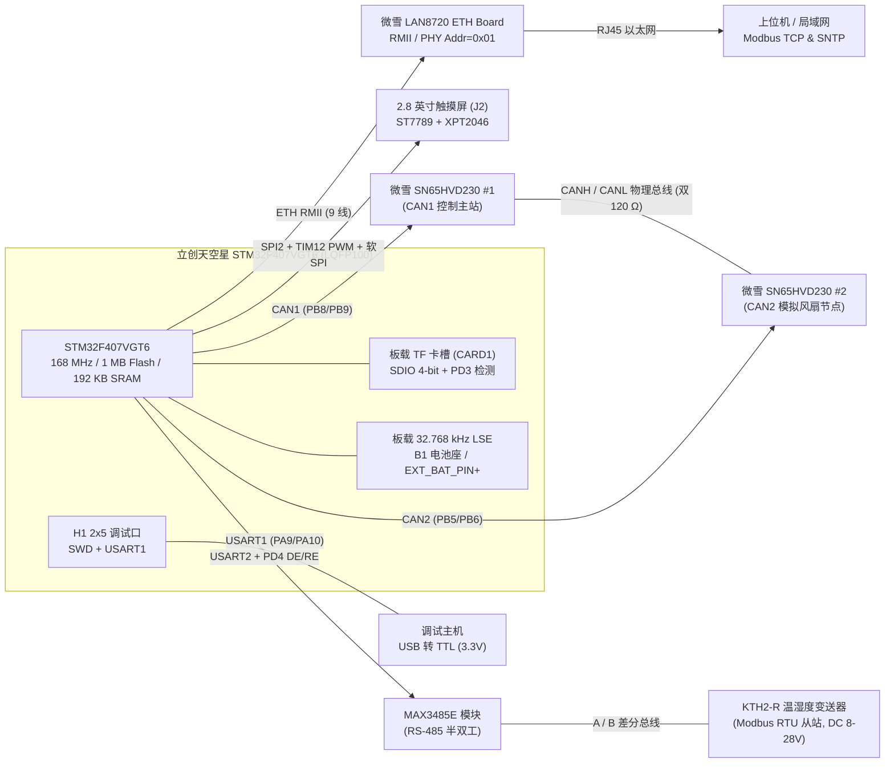

# SmartEdge_F407 硬件资源分配表

## 文档控制信息

| 项目 | 内容 |
| --- | --- |
| **文档编号** | `SE-F407-HW-001` |
| **文档版本** | `V1.1` |
| **文档状态** | 基线更新（M3 实测接线同步） |
| **项目名称** | SmartEdge_F407 工业边缘采集网关与本地触控终端 |
| **适用硬件** | 立创·梁山派·天空星 STM32F407VGT6 开发板（LQFP100）及配套外设模块 |
| **关联文档** | [SmartEdge_F407 软件需求规格说明书（SRS）](./SmartEdge_F407_软件需求规格说明书_SRS.md) [SmartEdge_F407 软件架构设计文档（SAD）](./SmartEdge_F407_软件架构设计文档_SAD.md) |
| **编制日期** | 2026-11-28 |

### 修订记录

| 版本 | 日期 | 修订人 | 修订说明 |
| --- | --- | --- | --- |
| `V1.0` | 2026-11-25 | 系统工程组 | 由原《引脚分配与杜邦线接线表》升级为完整规范的硬件资源分配表，补全 MCU 存储/Flash 分区、时钟树、外设、DMA、NVIC 中断、82 引脚全量核查及供电/装配规范。 |
| `V1.1` | 2026-11-28 | 系统工程组 | 同步 M2/M3 实物核验结论：CCMRAM LVGL 堆扩容至 `48 KB`；补充微雪 SN65HVD230 直连不交叉与 `RS485 V2.05` 转接板 `TXD/RXD` 须交叉连接实测标注。 |

---

## 1. 硬件平台与物料清单（BOM）

### 1.1 系统硬件拓扑

### 1.2 核心硬件清单

| 序号 | 模块名称 | 型号 / 规格 | 供电要求 | 通信接口 | 关键硬件备注 |
| :---: | --- | --- | --- | --- | --- |
| 1 | 主控开发板 | 立创·梁山派·天空星 STM32F407VGT6（LQFP100） | Type-C 5 V 输入，板载 `SCJA1117B-3.3` 转 3.3 V | 双排 2×20 排针 `P1`/`P2` + 2×5 调试口 `H1` | 板载 8 MHz HSE、32.768 kHz LSE、TF 卡槽、LED2（PB2）、按键 SW2（PA0） |
| 2 | 本地触控屏 | 2.8 英寸 240×320 TFT 触摸屏（ST7789 + XPT2046，14 针 `J2`） | 5 V（`J1` 断开经板载 XC6206 稳压）或 3.3 V（`J1` 短接） | 显示：SPI2 单向 + TIM12 PWM 背光；触摸：独立软件 SPI | 模块自带 `J4` 与 TF 卡槽留空，不使用 |
| 3 | 以太网 PHY | 微雪 2×7 针 LAN8720 ETH Board（LAN8720A） | 3.3 V | ETH RMII（9 根信号线） | 板载 50 MHz 晶振向 MCU 提供 `REF_CLK`；硬件 PHY 地址 = `1`（`0x01`）；`nRST` 为 RC 上电复位（未引出） |
| 4 | CAN 收发器（×2） | 微雪 SN65HVD230 CAN Board（2 块） | 3.3 V | CAN1（控制端）与 CAN2（模拟风扇节点） | 每块板载 120 Ω 终端电阻，两块模块 `CANH`/`CANL` 直连即构成标准双端 120 Ω 终端 |
| 5 | RS-485 收发器 | MAX3485E 转接模块（如 `RS485 V2.05`） | 3.3 V | USART2 + 1 路 GPIO 方向控制（`DE`/`/RE`） | 非隔离方案需与变送器电源负极共地 |
| 6 | 温湿度变送器 | 科杰迅 KTH2-R 卡轨式 RS-485 温湿度变送器 | 独立 DC 8–28 V（24 V 静态约 10 mA） | RS-485（Modbus RTU，默认 `9600 8N1`，站地址 `0x01`） | 测温 `-40~85 ℃`（`±0.2 ℃`），测湿 `<100 %RH`（`±2 %RH`），分辨率 `0.1` |
| 7 | 串口调试适配器 | USB 转 TTL 模块（3.3 V 电平） | 仅共地（不反向给板供电） | USART1（`H1-6`/`8`/`10`） | 用于调试日志输出与 CLI 故障模拟命令 |
| 8 | 存储与备用电池 | MicroSD（TF）卡 + 3 V 纽扣电池（可选） | 3.3 V（TF）/ 3 V（VBAT） | 板载 SDIO 4-bit / `B1` 或 `P2-26` | 开发板原理图 `B1` 电池座默认标“不贴”，按实物确认是否已焊或通过 `P2-26` 外接 |

---

## 2. MCU 核心与存储资源分配

### 2.1 主控芯片核心规格（STM32F407VGT6）

| 资源项 | 规格参数 | 项目使用策略 |
| --- | --- | --- |
| **内核与主频** | ARM Cortex-M4F（含 FPU & DSP），最高 `168 MHz` | 主频运行于 `168 MHz`，开启单精度硬件 FPU |
| **封装与 I/O** | LQFP100，共 `82` 个可用 GPIO（PA0–15、PB0–15、PC0–15、PD0–15、PE0–15、PH0–1） | 功能分配 `36` 脚 + 板载系统/保留 `14` 脚 + 空闲扩展 `32` 脚 = `82` 脚 |
| **片内 Flash** | `1024 KB`（12 个非均匀扇区：4×16 KB + 1×64 KB + 7×128 KB） | 划分 Bootloader、配置/OTA 元数据、App 运行区与 OTA 下载缓存区 |
| **片内主 SRAM** | `128 KB`（SRAM1 `112 KB` @ `0x2000_0000` + SRAM2 `16 KB` @ `0x2001_C000`） | 存放全局变量、DMA 缓冲区、ETH 描述符/收发缓冲、LVGL 显存、LwIP/FatFs 堆 |
| **CCM RAM** | `64 KB`（`0x1000_0000`–`0x1000_FFFF`，**仅 CPU 可访问，DMA 不可访问**） | 推荐存放 FreeRTOS 堆（不涉及 DMA 的任务栈）或纯 CPU 运算缓冲区 |
| **备份域存储** | `4 KB` Backup SRAM（`0x4002_4000`）+ `20×32 bit` RTC 备份寄存器 | 存放 RTC 初始化魔数、复位原因快照、IAP/OTA 升级请求标志 |

### 2.2 片内 Flash 分区规划（含 IAP/OTA 预留）

> **规划原则**：STM32F407VGT6 共 12 个非均匀扇区（Sector 0–3 各 `16 KB`、Sector 4 为 `64 KB`、Sector 5–11 各 `128 KB`）。
> - **本阶段开发落地（单工程直烧，免改 CubeMX 默认链接脚本）**：主应用程序从 `0x0800_0000` 直烧运行（约 `190–230 KB`，占用 Sector 0–5），**掉电持久化配置直接存放在最后一个扇区 `Sector 11`（`0x080E_0000`, `128 KB`）**，与代码段相隔 >660 KB 绝无覆盖风险。
> - **后续 IAP/OTA 扩展演进规划**：引入 Bootloader 后可按下方目标分区边界启用双槽升级（链接脚本将 App 偏移至 `0x0802_0000` 并开启 `SCB->VTOR`，配置区仍保留在独立扇区 `Sector 11` 或迁移至 `Sector 3`）。

| 分区名称 | 扇区范围 | 起始地址 | 结束地址 | 容量 | 本阶段用途与后续 OTA 规划 |
| --- | --- | --- | --- | :---: | --- |
| **Bootloader 预留区** | Sector 0–2 | `0x0800_0000` | `0x0800_BFFF` | `48 KB` | 本阶段直烧 App 起始区；后续引入 OTA 时专供 Bootloader 引导程序 |
| **OTA 元数据 / 扩展预留** | Sector 3–4 | `0x0800_C000` | `0x0801_FFFF` | `80 KB` | 本阶段随 App 连续使用；后续可作为 OTA 元数据区或增强型 Bootloader 扩容区 |
| **App 运行槽（Slot A）** | Sector 5–7 | `0x0802_0000` | `0x0807_FFFF` | `384 KB` | 后续 OTA 启用后的主应用程序固定运行槽位（配置 `SCB->VTOR = 0x08020000`） |
| **OTA 下载槽（Slot B）** | Sector 8–10 | `0x0808_0000` | `0x080D_FFFF` | `384 KB` | 预留用于存放新版本固件镜像，校验通过后由 Bootloader 搬运更新 |
| **系统配置存储区（本阶段启用）** | **Sector 11** | **`0x080E_0000`** | **`0x080F_FFFF`** | **`128 KB`** | **本阶段及后续统一存放掉电持久化配置**（温控阈值、触摸校准、网络参数、背光，含 Magic + CRC32） |
| **合计** | Sector 0–11 | `0x0800_0000` | `0x080F_FFFF` | **`1024 KB`** | 与 STM32F407VGT6 物理扇区完全对齐 |

### 2.3 SRAM 与备份寄存器分配建议

> **CubeMX 默认链接脚本适配原则**：直接使用 STM32CubeMX 自动生成的 `STM32F407xx_FLASH.ld`（`128 KB` 主 RAM + `64 KB` CCMRAM），无需手动切分 SRAM1/SRAM2，只需将纯 CPU 访问的大内存对象放 `.ccmram` 以腾出主 RAM 空间。

| 内存区域 | 地址范围 | 容量 | 推荐分配对象 | 硬件约束说明 |
| --- | --- | :---: | --- | --- |
| **主 RAM（SRAM1 + SRAM2）** | `0x2000_0000`–`0x2001_FFFF` | `128 KB` | FreeRTOS `ucHeap`（`36 KB`）、CubeMX LwIP ETH 描述符与收发缓冲（`~13 KB`）、LwIP 堆与 PBUF（`~14 KB`）、LVGL SPI2 DMA 双部分刷屏缓冲（`25 KB`）、FatFs、USART1/2 DMA 缓冲及 `.data`/`.bss` | 全部支持 DMA1/DMA2 与 ETH DMA 访问，零改动 CubeMX 生成代码 |
| **CCMRAM** | `0x1000_0000`–`0x1000_FFFF` | `64 KB` | 仅放纯 CPU 数据（`__attribute__((section(".ccmram")))`）：**LVGL v9 内部对象内存池（`48 KB`）** + **历史趋势环形缓存（`~1 KB`）** | **严禁**将 SPI2、SDIO、USART、ETH 的 DMA 缓冲区或任务栈（涉及 FatFs/DMA）放入 CCMRAM |
| **RTC 备份寄存器** | `RTC_BKP_DR0`–`DR19` | `80 B` | `DR0`：RTC 已初始化魔数；`DR1`：上次复位原因编码；`DR2`：IAP/OTA 升级请求魔数；`DR3`：IWDG 卡死任务位图快照 | 需开启 PWR 时钟与备份域写使能（`HAL_PWR_EnableBkUpAccess`）；断电由 VBAT 保持 |

---

## 3. 时钟树资源分配

| 时钟源 / 总线 | 频率 | 时钟来源与分频/倍频路径 | 供给目标与约束说明 |
| --- | :---: | --- | --- |
| **HSE（外部高速晶振）** | `8 MHz` | 板载无源晶振 `X1`（`PH0`/`PH1`，20 pF 匹配电容） | 主 PLL 输入基准 |
| **LSE（外部低速晶振）** | `32.768 kHz` | 板载晶振 `X2`（`PC14`/`PC15`，12 pF 匹配电容） | **RTC** 实时时钟源（断电由 VBAT 保持走时） |
| **LSI（内部低速 RC）** | `~32 kHz`（范围 17–47 kHz） | 片内 RC 振荡器 | **IWDG** 独立看门狗时钟源（硬件固定） |
| **主 PLL 输出（SYSCLK）** | `168 MHz` | `HSE (8 MHz) / PLLM(4) * PLLN(168) / PLLP(2)`（VCO 输入 `2 MHz`，更低抖动） | Cortex-M4 内核、SysTick、AHB 总线 |
| **PLL48CLK** | `48 MHz` | `HSE (8 MHz) / PLLM(4) * PLLN(168) / PLLQ(7)` | **SDIO**（48 MHz 基准）、**RNG**、预留 **USB OTG FS**（严格要求 48 MHz） |
| **HCLK（AHB 总线）** | `168 MHz` | `SYSCLK / 1` | DMA1、DMA2、ETH MAC、GPIO、Flash（5 Wait States + 预取/Cache 使能） |
| **PCLK1（APB1 外设时钟）** | `42 MHz` | `HCLK / 4`（STM32F407 上限 42 MHz） | **SPI2**（最高 21 MHz）、**CAN1/CAN2**、**USART2**、PWR |
| **APB1 定时器时钟** | `84 MHz` | `PCLK1 × 2`（分频系数 ≠ 1 时自动倍频） | **TIM6**（HAL 时基）、**TIM7**（运行统计预留）、**TIM12**（LCD 背光 PWM） |
| **PCLK2（APB2 外设时钟）** | `84 MHz` | `HCLK / 2`（STM32F407 上限 84 MHz） | **USART1**、**SDIO** 接口逻辑、SYSCFG/EXTI |
| **ETH RMII REF_CLK** | `50 MHz` | 外部 LAN8720 模块板载 `OSC1` 有源晶振输入至 `PA1` | 同步 RMII 收发时序，**严禁**将 `PA1` 误配为其他功能或使用过长杜邦线 |

---

## 4. 片上外设资源分配总表

| 片上外设 | 所属总线 | 工作模式与关键配置（基线） | 对应功能模块 | 关键硬件/驱动约束 |
| --- | :---: | --- | --- | --- |
| **ETH** | AHB1 | RMII 模式，PHY 地址 `0x01`，Auto-Negotiation，硬件校验和卸载 | 以太网（Modbus TCP + SNTP） | LAN8720 `nRST` 未接 MCU，初始化时须经 MDIO 写 BMCR 执行 PHY 软复位；初始化前先将 `PA4` 拉高屏蔽板载选贴 Flash |
| **SPI2** | APB1 (`42 MHz`) | Master 单向发送（TX-Only），8-bit，CPOL=0/CPHA=0（Mode 0），Prescaler=2（`21 MHz`），软件片选 | ST7789 2.8" LCD 显示驱动 | `TFT_SDO` 悬空；配合 DMA1 Stream4 异步刷屏以释放 CPU |
| **TIM12** | APB1 (`84 MHz`) | `CH1`（`PB14`）PWM Generation，频率基线 `2 kHz`（范围 1–20 kHz），高电平有效 | 触摸屏背光亮度调节 | 经模块 NPN 三极管 `Q1 (S8050)` 驱动背光 LEDK |
| **CAN1** | APB1 (`42 MHz`) | Normal 模式，基线波特率 `500 kbps`（如 Prescaler=6, BS1=11tq, BS2=2tq, SJW=1tq, 采样点 85.7%）；接收使用 FIFO0 | 网关风扇控制主站（发指令、收反馈/心跳） | 共享 28 组滤波器（建议 Bank 0–13 归 CAN1） |
| **CAN2** | APB1 (`42 MHz`) | Normal 模式，与 CAN1 同波特率 `500 kbps`；接收使用 FIFO1（或独立 FIFO0） | 片内模拟风扇节点（经外部收发器接入同条物理总线） | **CAN2 为从属控制器，必须先使能 CAN1 时钟**；滤波器起始号 `SlaveStartFilterBank = 14`（Bank 14–27 归 CAN2） |
| **USART2** | APB1 (`42 MHz`) | 异步串口，`9600 bps, 8N1`（匹配 KTH2-R 出厂默认，可配置），硬件流控关闭，由 `PD4` 控制 RS-485 方向 | RS-485 / Modbus RTU 主站（采集 KTH2-R） | 发送完毕须等待 **TC（发送完成）中断** 再将 `PD4` 拉低切回接收态，禁止仅判 TXE 切换 |
| **USART1** | APB2 (`84 MHz`) | 异步串口，基线 `115200 bps, 8N1` | 调试日志输出与 CLI 故障注入命令行 | 引出至调试口 `H1-8`/`H1-10`（3.3 V 电平） |
| **SDIO** | APB2 + `48 MHz` | 4-bit 宽总线（初始化阶段 1-bit `≤400 kHz`，识别后切换 4-bit，SDIO_CK 基线 `12–24 MHz`），开启硬件流控（按需） | 板载 TF 卡 FatFs 日志存储 | 结合 `PD3`（低电平有效）做物理插拔检测；读写须走 DMA2 |
| **RTC** | 备份域 (`LSE`) | 24 小时日历模式（32.768 kHz LSE，Asynch=127, Synch=255 -> 1 Hz） | 断电走时、时间戳与备份寄存器 | 首次上电校验 `RTC_BKP_DR0` 魔数，避免复位覆盖已校准时间 |
| **IWDG** | 独立 (`LSI ~32 kHz`) | Prescaler = `64`（约 500 Hz），Reload = `2000`，理论超时 **约 `4.0 s`** | 关键任务卡死看门狗自动复位 | 因 LSI 存在 `17–47 kHz` 器件偏差，软件喂狗周期建议 `≤ 1.0 s`，并做任务心跳汇总校验 |
| **SysTick** | Cortex 内核 | `1 kHz`（1 ms 节拍），最低优先级（`15`） | **FreeRTOS 系统时钟节拍** | 专供 FreeRTOS 使用，不可兼作 HAL 时基 |
| **TIM6** | APB1 (`84 MHz`) | 基本定时器，`1 kHz`（1 ms）更新中断 | **STM32 HAL 时基源（HAL Timebase）** | 规避 FreeRTOS 调度挂起或高优先级中断中调用 `HAL_Delay()` 死锁 |
| **TIM7** | APB1 (`84 MHz`) | 基本定时器，`10–20 kHz` 自由计数（可选） | FreeRTOS 任务 CPU 占用率统计（预留） | 诊断与性能调优使用 |
| **CRC / RNG** | AHB1 / AHB2 | CRC32 硬件单元 / 48 MHz 硬件随机数 | 配置/OTA 镜像校验；LwIP TCP 随机序列号（可选） | 不占用外部引脚 |
| **USB_OTG_FS** | AHB2 (`48 MHz`) | 本阶段不使能（引脚已由 Type-C 占用） | 预留扩展（USB CDC / DFU） | 占用 `PA11`/`PA12`，未引出排针 |
| **SPI1** | APB2 | **禁止使能**（`PA7` 已分配给 `ETH_RMII_CRS_DV`） | 板载选贴 SPI Flash `U5` 所在总线 | 若开发板已焊接 `U5`，须保持 `PA4`（`#CS`）推挽输出高电平 |

---

## 5. DMA 通道与数据流分配表

STM32F407 拥有 `DMA1`（8 流）、`DMA2`（8 流）及独立 `ETH DMA`。以下分配严格依据 RM0090 映射表核对，**无任何 Stream 冲突**。

| DMA 控制器 | 数据流 (Stream) | 通道 (Channel) | 外设请求 | 传输方向 | 模式 | 优先级 | 用途说明 |
| :---: | :---: | :---: | --- | --- | --- | :---: | --- |
| **ETH DMA** | 专用内嵌 | — | `ETH_RX` / `ETH_TX` | 双向 | 描述符环形链 | 高 | LwIP 以太网帧零拷贝/缓冲收发（缓冲区须在主 SRAM1/SRAM2） |
| **DMA1** | `Stream 4` | `Channel 0` | `SPI2_TX` | Mem → Periph | Normal | 中 | ST7789 LVGL 显存异步刷新，传输完成中断通知 `lv_display_flush_ready()` |
| **DMA1** | `Stream 5` | `Channel 4` | `USART2_RX` | Periph → Mem | Circular / Normal | 中 | RS-485 Modbus RTU 接收，配合串口 `IDLE` 空闲中断帧切分 |
| **DMA1** | `Stream 6` | `Channel 4` | `USART2_TX` | Mem → Periph | Normal | 中 | RS-485 Modbus RTU 发送，配合 `USART2 TC` 中断切回接收方向 |
| **DMA2** | `Stream 2` | `Channel 4` | `USART1_RX` | Periph → Mem | Circular | 低 | 调试串口 CLI 命令接收（也可改用 `DMA2 Stream 5 Ch4`），配合 `IDLE` 中断 |
| **DMA2** | `Stream 3` | `Channel 4` | `SDIO` (RX) | Periph → Mem | Normal (PFCTRL) | 高 | TF 卡 SDIO 块读取（外设流控） |
| **DMA2** | `Stream 6` | `Channel 4` | `SDIO` (TX) | Mem → Periph | Normal (PFCTRL) | 高 | TF 卡 SDIO 块写入（外设流控） |
| **DMA2** | `Stream 7` | `Channel 4` | `USART1_TX` | Mem → Periph | Normal | 低 | 调试串口异步日志发送 |

> **关键核查结论**：
> - `DMA1` 已占 Stream 4、5、6；空闲 Stream 0、1、2、3、7。
> - `DMA2` 已占 Stream 2、3、6、7；空闲 Stream 0、1、4、5。
> - 所有 DMA 缓冲区**严禁**位于 CCMRAM（`0x1000_0000`）。

---

## 6. NVIC 中断优先级规划

采用 **NVIC Priority Group 4**（4 位抢占优先级 `0–15`，0 位子优先级；数值越小优先级越高）。  
配合 FreeRTOS，设定 `configLIBRARY_MAX_SYSCALL_INTERRUPT_PRIORITY = 5`，`configLIBRARY_LOWEST_INTERRUPT_PRIORITY = 15`：
- **优先级 `0–4`**：不可调用任何 FreeRTOS `FromISR` API，且不受临界区屏蔽。
- **优先级 `5–15`**：可安全调用 FreeRTOS `FromISR` API（如信号量、任务通知、队列）。

| 中断向量 (IRQn) | 抢占优先级（建议基线） | 调用 FreeRTOS API | 用途说明 |
| --- | :---: | :---: | --- |
| `TIM6_DAC_IRQn` | `1`（或 `4`） | 否 | STM32 HAL 1 ms 时基，保证 HAL 超时检测在任何驱动等待中均有效 |
| `ETH_IRQn` | `5` | 是 | 以太网收帧唤醒 LwIP `tcpip_thread` / 以太网输入任务 |
| `SDIO_IRQn` | `5` | 是 | SDIO 传输状态与完成事件（注意：**SDIO 中断优先级须高于或等于对应 DMA2 流优先级**，推荐 `SDIO=5`、`DMA2_S3/S6=6`） |
| `DMA2_Stream3_IRQn` / `DMA2_Stream6_IRQn` | `6` | 是 | SDIO 读写 DMA 完成中断 |
| `CAN1_RX0_IRQn` / `CAN2_RX1_IRQn`（或 `RX0`） | `6` | 是 | CAN1 主站接收应答/心跳帧；CAN2 模拟风扇节点接收控制命令帧 |
| `USART2_IRQn` / `DMA1_Stream5_IRQn` / `DMA1_Stream6_IRQn` | `7` | 是 | RS-485 Modbus RTU 收发与 IDLE/TC 帧处理 |
| `DMA1_Stream4_IRQn` | `8` | 是 | SPI2 LCD 刷屏完成回调，释放 LVGL 帧缓冲 |
| `EXTI15_10_IRQn`（`PD12` `TP_IRQ`，可选） | `9` | 是 | 触摸按下中断触发（若 LVGL 采用定时轮询读取 XPT2046，可降级为普通输入不使能 EXTI） |
| `USART1_IRQn` / `DMA2_Stream2_IRQn` / `DMA2_Stream7_IRQn` | `10` | 是 | 调试串口 CLI 命令接收与异步输出 |
| `PendSV_IRQn` / `SysTick_IRQn` | `15` | FreeRTOS 内核 | FreeRTOS 上下文切换与 1 ms 系统节拍（强制最低优先级） |

---

## 7. MCU 全引脚资源分配总表

### 7.1 引脚分配统计与冲突核查总览

| 分类 | 引脚数量 | 覆盖范围 | 冲突状态 |
| --- | :---: | --- | :---: |
| 以太网 ETH RMII | 9 | `PA1, PA2, PA7, PB11, PB12, PB13, PC1, PC4, PC5` | 无冲突（`PA7` 需以 `PA4=HIGH` 隔离选贴 Flash） |
| 触摸屏 ST7789 + XPT2046 | 11 | `PE14, PE15, PB10, PB14, PB15, PD8, PD9, PD10, PD11, PD12, PD13` | 无冲突 |
| 双路 CAN（CAN1 + CAN2） | 4 | `PB5, PB6, PB8, PB9` | 无冲突 |
| RS-485（USART2 + DE/RE） | 3 | `PD4, PD5, PD6` | 无冲突 |
| 调试串口（USART1） | 2 | `PA9, PA10` | 无冲突 |
| 板载 TF 卡（SDIO + DET） | 7 | `PC8, PC9, PC10, PC11, PC12, PD2, PD3` | 无冲突（`P2-1` 至 `P2-7` 保留不外接） |
| 板载系统 / 晶振 / 调试 / 预留 | 14 | `PH0, PH1, PC14, PC15, PA13, PA14, PB3, PB2, PA0, PA4, PA5, PA6, PA11, PA12` | 无冲突 |
| 空闲可扩展 GPIO | 32 | `PA3, PA8, PA15, PB0, PB1, PB4, PB7, PC0, PC2, PC3, PC6, PC7, PC13, PD0, PD1, PD7, PD14, PD15, PE0–PE13` | 可用于后续扩展 |
| **合计（LQFP100 全部 I/O）** | **82** | **PA(16) + PB(16) + PC(16) + PD(16) + PE(16) + PH(2)** | **100% 核对无重用** |

### 7.2 已分配功能引脚与系统保留引脚明细表

| 子系统 | GPIO | LQFP100 脚号 | 开发板排针 / 位置 | 复用功能 / 信号名 | AF | 方向与电气配置（CubeMX） | 备注与约束 |
| --- | :---: | :---: | :---: | --- | :---: | --- | --- |
| **ETH RMII** | `PA1` | 24 | `P1-4` | `ETH_RMII_REF_CLK` | AF11 | 复用推挽，Very High，无上下拉 | 外部 50 MHz 参考时钟输入，线长尽量 `≤ 5–10 cm` |
| **ETH RMII** | `PA2` | 25 | `P1-1` | `ETH_MDIO` | AF11 | 复用推挽，Very High | LAN8720 板载 `1.5 kΩ` 上拉 |
| **ETH RMII** | `PA7` | 32 | `P1-10` | `ETH_RMII_CRS_DV` | AF11 | 复用推挽，Very High | 与板载选贴 `U5` SPI Flash `SI` 共线，须保持 `PA4=HIGH` |
| **ETH RMII** | `PC1` | 16 | `P2-15` | `ETH_MDC` | AF11 | 复用推挽，Very High | 管理接口时钟 |
| **ETH RMII** | `PC4` | 33 | `P1-9` | `ETH_RMII_RXD0` | AF11 | 复用推挽，Very High | 接收数据位 0 |
| **ETH RMII** | `PC5` | 34 | `P1-12` | `ETH_RMII_RXD1` | AF11 | 复用推挽，Very High | 接收数据位 1 |
| **ETH RMII** | `PB11` | 48 | `P1-24` | `ETH_RMII_TX_EN` | AF11 | 复用推挽，Very High | 发送使能 |
| **ETH RMII** | `PB12` | 51 | `P1-26` | `ETH_RMII_TXD0` | AF11 | 复用推挽，Very High | 发送数据位 0 |
| **ETH RMII** | `PB13` | 52 | `P1-25` | `ETH_RMII_TXD1` | AF11 | 复用推挽，Very High | 发送数据位 1 |
| **冲突隔离** | `PA4` | 29 | `P1-5`（留空） | `FLASH_CS_GUARD` | GPIO | 推挽输出，初始 `HIGH` | 板载选贴 `U5` `#CS`（板载 10 kΩ 上拉），初始化 ETH 前拉高锁定 |
| **LCD 显示** | `PE15` | 46 | `P1-21` | `LCD_CS` | GPIO | 推挽输出，High，初始 `HIGH` | ST7789 片选，低电平有效 |
| **LCD 显示** | `PE14` | 45 | `P1-22` | `LCD_RST` | GPIO | 推挽输出，Low，初始 `HIGH` | ST7789 复位，低电平有效 |
| **LCD 显示** | `PD9` | 56 | `P1-29` | `LCD_DC`（`TFT_RS`） | GPIO | 推挽输出，High | `0`=写命令，`1`=写数据 |
| **LCD 显示** | `PB10` | 47 | `P1-23` | `SPI2_SCK` | AF5 | 复用推挽，Very High | 显示时钟（基线 21 MHz） |
| **LCD 显示** | `PB15` | 54 | `P1-27` | `SPI2_MOSI` | AF5 | 复用推挽，Very High | 显示数据输入（SPI2 单向发送） |
| **LCD 显示** | `PB14` | 53 | `P1-28` | `TIM12_CH1`（`LCD_BL`） | AF9 | 复用推挽，Low | 背光 PWM，高电平点亮 |
| **触摸屏** | `PD8` | 55 | `P1-30` | `TP_CLK` | GPIO | 推挽输出，Medium，初始 `LOW` | XPT2046 软件 SPI 时钟 |
| **触摸屏** | `PD11` | 58 | `P1-31` | `TP_CS` | GPIO | 推挽输出，Medium，初始 `HIGH` | XPT2046 片选，空闲高电平 |
| **触摸屏** | `PD10` | 57 | `P1-32` | `TP_MOSI`（`TP_DIN`） | GPIO | 推挽输出，Medium | XPT2046 数据输入 |
| **触摸屏** | `PD13` | 60 | `P1-33` | `TP_MISO`（`TP_OUT`） | GPIO | 浮空/上拉输入 | XPT2046 数据输出 |
| **触摸屏** | `PD12` | 59 | `P1-34` | `TP_IRQ`（`EXTI12`） | GPIO | 上拉输入或 EXTI12 下降沿 | 按下为低电平，模块已有 10 kΩ 上拉 |
| **CAN1 主站** | `PB9` | 96 | `P2-20` | `CAN1_TX` | AF9 | 复用推挽，High | 接 CAN1 收发器 `CAN_TX` |
| **CAN1 主站** | `PB8` | 95 | `P2-21` | `CAN1_RX` | AF9 | 复用推挽/上拉，High | 接 CAN1 收发器 `CAN_RX` |
| **CAN2 节点** | `PB6` | 92 | `P2-23` | `CAN2_TX` | AF9 | 复用推挽，High | 接 CAN2 收发器 `CAN_TX` |
| **CAN2 节点** | `PB5` | 91 | `P2-24` | `CAN2_RX` | AF9 | 复用推挽/上拉，High | 接 CAN2 收发器 `CAN_RX` |
| **RS-485** | `PD5` | 86 | `P2-29` | `USART2_TX` | AF7 | 复用推挽，High | 接 MAX3485 `DI` |
| **RS-485** | `PD6` | 87 | `P2-28` | `USART2_RX` | AF7 | 复用上拉输入 | 接 MAX3485 `RO` |
| **RS-485** | `PD4` | 85 | `P2-30` | `RS485_DE_RE` | GPIO | 推挽输出，Medium，初始 `LOW` | 低电平接收，高电平发送 |
| **调试串口** | `PA9` | 68 | `H1-10` | `USART1_TX` | AF7 | 复用推挽，High | 接 USB-TTL `RXD` |
| **调试串口** | `PA10` | 69 | `H1-8` | `USART1_RX` | AF7 | 复用上拉输入 | 接 USB-TTL `TXD` |
| **板载 TF 卡** | `PD3` | 84 | `P2-1`（保留） | `SD_CARD_DET` | GPIO | 输入（板载 47 kΩ 上拉） | 低电平表示 TF 卡已插入 |
| **板载 TF 卡** | `PC9` | 66 | `P2-2`（保留） | `SDIO_D1` | AF12 | 复用推挽，Very High（板载上拉） | 板载直连 `CARD1` |
| **板载 TF 卡** | `PC8` | 65 | `P2-3`（保留） | `SDIO_D0` | AF12 | 复用推挽，Very High（板载上拉） | 板载直连 `CARD1` |
| **板载 TF 卡** | `PC12` | 80 | `P2-4`（保留） | `SDIO_CK` | AF12 | 复用推挽，Very High | 板载经 22 Ω 串联至 `CARD1` |
| **板载 TF 卡** | `PD2` | 83 | `P2-5`（保留） | `SDIO_CMD` | AF12 | 复用推挽，Very High（板载上拉） | 板载直连 `CARD1` |
| **板载 TF 卡** | `PC11` | 79 | `P2-6`（保留） | `SDIO_D3` | AF12 | 复用推挽，Very High（板载上拉） | 板载直连 `CARD1` |
| **板载 TF 卡** | `PC10` | 78 | `P2-7`（保留） | `SDIO_D2` | AF12 | 复用推挽，Very High（板载上拉） | 板载直连 `CARD1` |
| **系统时钟** | `PH0` / `PH1` | 12 / 13 | 板载 `X1` | `RCC_OSC_IN/OUT` | — | 外部高速晶振 8 MHz | 系统主时钟源 |
| **RTC 时钟** | `PC14` / `PC15` | 8 / 9 | 板载 `X2` | `RCC_OSC32_IN/OUT` | — | 外部低速晶振 32.768 kHz | RTC 走时时钟源 |
| **SWD 调试** | `PA13` / `PA14` / `PB3` | 72 / 76 / 89 | `H1-5` / `H1-3` / `H1-1` | `SWDIO` / `SWCLK` / `SWO` | AF0 | 调试专用，禁止复用为普通 GPIO | 在线烧录与调试 |
| **板载交互** | `PB2` | 37 | 板载 `LED2`（未引出） | `SYS_LED` / `BOOT1` | GPIO | 推挽输出，高电平点亮 | 启动采样后作心跳/运行指示灯（板载 10 kΩ 下拉） |
| **板载/唤醒** | `PA0` | 23 | `P1-3` / 板载 `SW2` | `USER_KEY` / `SYS_WKUP` | GPIO | 输入（板载 10 kΩ 下拉，按下高电平） | 本地用户按键；**预留低功耗模式唤醒引脚** |
| **板载保留** | `PA5` / `PA6` | 30 / 31 | `P1-8` / `P1-7` | 板载选贴 `U5` SPI Flash `SCLK`/`SO` | — | 模拟输入（低功耗防漏电） | 若板载 `U5` 已焊且 `RN3` 在位，请勿外接其他设备 |
| **板载保留** | `PA11` / `PA12` | 70 / 71 | 板载 Type-C（未引出） | `USB_OTG_FS_DM/DP` | — | 本阶段保留（模拟输入） | 预留 USB DFU / 虚拟串口扩展 |

### 7.3 空闲可扩展 GPIO 汇总（共 32 脚）

以下引脚当前未占用，建议初始化为 `GPIO_MODE_ANALOG`（无上下拉）以降低功耗并防悬空干扰；后续功能扩展（如蜂鸣器、继电器、ADC 电流采样、第二路串口/I2C 传感器）可按需选用：

| 端口 | 空闲 GPIO 及天空星排针位号 | 可复用典型外设能力（供扩展参考） |
| :---: | --- | --- |
| **PA** | `PA3` (`P1-6`), `PA8` (`P2-34`), `PA15` (`P2-33`, JTDI) | `ADC123_IN3`, `TIM1_CH1`, `I2C3_SCL` |
| **PB** | `PB0` (`P1-11`), `PB1` (`P1-14`), `PB4` (`P2-25`, NJTRST), `PB7` (`P2-22`) | `ADC12_IN8/9`, `TIM3_CH3/4`, `I2C1_SDA`, `TIM4_CH2` |
| **PC** | `PC0` (`P2-14`), `PC2` (`P2-16`), `PC3` (`P2-17`), `PC6` (`P2-35`), `PC7` (`P2-36`), `PC13` (`P2-8`) | `ADC123_IN10/12/13`, `USART6_TX/RX`, `TIM8_CH1/2`, `RTC_TAMP1` |
| **PD** | `PD0` (`P2-32`), `PD1` (`P2-31`), `PD7` (`P2-27`), `PD14` (`P1-36`), `PD15` (`P1-35`) | `TIM4_CH3/4`, 普通 GPIO |
| **PE** | `PE0` (`P2-19`), `PE1` (`P2-18`), `PE2` (`P2-13`), `PE3` (`P2-12`), `PE4` (`P2-11`), `PE5` (`P2-10`), `PE6` (`P2-9`), `PE7` (`P1-13`), `PE8` (`P1-16`), `PE9` (`P1-15`), `PE10` (`P1-18`), `PE11` (`P1-17`), `PE12` (`P1-20`), `PE13` (`P1-19`) | `TIM1_CH1–3`, `TIM9_CH1/2`, 通用 GPIO / 外部中断 |

---

## 8. 物理接线规范、线束布局与装配指南

> **看图基准**：开发板侧针号均按《立创梁山派·天空星开发板原理图》标注；**正面（芯片朝上、TF 卡槽在上、Type-C 在下）观察时，`P1` 在左、`P2` 在右**。插线时务必以板上 GPIO 丝印及针脚 1 标识为准，从背面观察时左右镜像。

### 8.1 模块摆放与线束布局规划

| 模块位置 | 开发板接线区 | 走线与捆扎规范 |
| --- | --- | --- |
| **LAN8720** 靠 `P1` 上半部，RJ45 朝外 | `P1-1, 4, 9, 10, 12, 24, 25, 26`，另有 `P2-15` | `P1` 上部的 MDIO、参考时钟和接收信号为一束；`P1` 中段 3 根发送线为一束；`MDC` 单独短跨至 `P2-15`。RMII 线长尽量控制在 `5–10 cm`，`REF_CLK` 与 GND 并行。 |
| **触摸屏** 靠 `P1` 下半部，`J2` 朝开发板 | `P1-21` 至 `P1-34` 中的 11 个信号脚 | 显示线（6 根）与触摸线（5 根）各自成束。触摸 5 根线按 `J2-10..14` 顺序一对一连续插至 `P1-30..34`。 |
| **两块 CAN 模块** 并排靠 `P2` 中下部 | `P2-20, 21, 23, 24` | 每块模块 2 根逻辑线；两块模块的 `CANH`–`CANH`、`CANL`–`CANL` 在模块总线端直接短线对连（并排或轻绞）。 |
| **MAX3485** 靠 `P2` 下半部 | `P2-28, 29, 30` | 3 根逻辑线成一束；总线端 `A`/`B` 双绞引出至 KTH2-R 变送器端子。 |
| **USB 转 TTL** 靠底边调试口 | `H1-6, 8, 10` | 3 根线占 `H1` 同一偶数排，按针号依次为 GND、适配器 TXD、适配器 RXD。 |

#### `P1` 中下部高密度接线区逐排核对表（`P1-21` 至 `P1-34`）

每一行对应排针上相邻的一对奇数/偶数针脚，插线后逐排复检可避免错位：

| `P1` 奇数脚（外侧/左列） | 信号归属 | `P1` 偶数脚（内侧/右列） | 信号归属 |
| :---: | --- | :---: | --- |
| `P1-21` (`PE15`) | LCD `CS` | `P1-22` (`PE14`) | LCD `RESET` |
| `P1-23` (`PB10`) | LCD `SCK` | `P1-24` (`PB11`) | 网口 `TX_EN` |
| `P1-25` (`PB13`) | 网口 `TXD1` | `P1-26` (`PB12`) | 网口 `TXD0` |
| `P1-27` (`PB15`) | LCD `SDI` | `P1-28` (`PB14`) | LCD `BL` |
| `P1-29` (`PD9`) | LCD `RS` (`DC`) | `P1-30` (`PD8`) | 触摸 `CLK` |
| `P1-31` (`PD11`) | 触摸 `CS` | `P1-32` (`PD10`) | 触摸 `DIN` |
| `P1-33` (`PD13`) | 触摸 `OUT` | `P1-34` (`PD12`) | 触摸 `IRQ` |

---

### 8.2 分模块物理接线明细表

#### 8.2.1 2.8 英寸触摸屏 `J2`（共 13 根线，含电源）

| 模块 `J2` 针脚 | 天空星针脚 | MCU GPIO / 配置 | 接线注意事项 |
| --- | :---: | --- | --- |
| `J2-1` `VCC` | `P1-40` | `+5V` | **上电前必须核对模块 `J1`**：`J1` 断开时接 `P1-40`（5 V）；若实物 `J1` 已短接，须改接左侧 `3.3 V` 分线点且 `P1-40` 留空 |
| `J2-2` `GND` | 左侧 GND 分线点 | `GND` | 分线点接 `P1-39` |
| `J2-3` `TFT_CS` | `P1-21` | `PE15`，GPIO 输出（空闲高） | 显示片选 |
| `J2-4` `TFT_RESET` | `P1-22` | `PE14`，GPIO 输出（低复位） | 显示硬件复位 |
| `J2-5` `TFT_RS` | `P1-29` | `PD9`，GPIO 输出 | 数据/命令选择（`DC`） |
| `J2-6` `TFT_SDI` | `P1-27` | `PB15`，`SPI2_MOSI`（AF5） | SPI2 主机单向发送 |
| `J2-7` `TFT_SCK` | `P1-23` | `PB10`，`SPI2_SCK`（AF5） | SPI2 时钟 |
| `J2-8` `TFT_BL` | `P1-28` | `PB14`，`TIM12_CH1` PWM（AF9） | 高电平点亮（经模块 S8050 驱动） |
| `J2-9` `TFT_SDO` | 留空 | — | 单向显示不使用 MISO |
| `J2-10` `TP_CLK` | `P1-30` | `PD8`，GPIO 输出 | 独立软件 SPI 时钟 |
| `J2-11` `TP_CS` | `P1-31` | `PD11`，GPIO 输出（空闲高） | 触摸片选 |
| `J2-12` `TP_DIN` | `P1-32` | `PD10`，GPIO 输出 | 触摸 MOSI |
| `J2-13` `TP_OUT` | `P1-33` | `PD13`，GPIO 输入 | 触摸 MISO |
| `J2-14` `TP_IRQ` | `P1-34` | `PD12`，GPIO 输入 / `EXTI12` 下降沿 | 模块已有 10 kΩ 上拉，按下变低 |

> **说明**：屏幕模块自带的 `J4` 扩展排针与背面 TF 卡槽均留空，本项目统一使用天空星开发板板载 SDIO TF 卡槽。

#### 8.2.2 微雪 LAN8720 ETH Board RMII（9 根信号线 + 电源）

> **注意区分**：下表左列 `模块 P2-x` 指 LAN8720 模块上的 2×7 排针，中列 `P1-x` / `P2-x` 指天空星开发板排针。

| LAN8720 模块 `P2` 针脚 | 天空星针脚 | MCU GPIO / 配置 | 接线注意事项 |
| --- | :---: | --- | --- |
| 模块 `P2-1` 或 `P2-2` `VCC` | `P1-38` | `+3V3` | 模块两脚内部短接，任接其一 |
| 模块 `P2-3` 或 `P2-4` `GND` | 左侧 GND 分线点 | `GND` | 分线点接 `P1-39`，地线与 `REF_CLK` 并行且尽量短 |
| 模块 `P2-5` `MDC` | `P2-15` | `PC1`，`ETH_MDC`（AF11） | 跨至 `P2` 侧短线连接 |
| 模块 `P2-6` `MDIO` | `P1-1` | `PA2`，`ETH_MDIO`（AF11） | 模块板载 1.5 kΩ 上拉 |
| 模块 `P2-7` `CRS_DV` | `P1-10` | `PA7`，`ETH_RMII_CRS_DV`（AF11） | **须同时在软件中将 `PA4` (`P1-5`) 推挽拉高**以防选贴 SPI Flash 冲突 |
| 模块 `P2-8` `R_RXCLK` | `P1-4` | `PA1`，`ETH_RMII_REF_CLK`（AF11） | 模块 50 MHz 晶振向 MCU 供时钟，优先压短至 `5–10 cm` |
| 模块 `P2-9` `RXD1` | `P1-12` | `PC5`，`ETH_RMII_RXD1`（AF11） | — |
| 模块 `P2-10` `RXD0` | `P1-9` | `PC4`，`ETH_RMII_RXD0`（AF11） | — |
| 模块 `P2-11` `TXD0` | `P1-26` | `PB12`，`ETH_RMII_TXD0`（AF11） | — |
| 模块 `P2-12` `TX_EN` | `P1-24` | `PB11`，`ETH_RMII_TX_EN`（AF11） | — |
| 模块 `P2-13` | 留空 | — | 模块原理图无连接 |
| 模块 `P2-14` `TXD1` | `P1-25` | `PB13`，`ETH_RMII_TXD1`（AF11） | — |

#### 8.2.3 双路 SN65HVD230 CAN 与 MAX3485E / KTH2-R 接线表

| 模块与信号 | 天空星针脚 | MCU GPIO / 配置 | 接线与电气说明 |
| --- | :---: | --- | --- |
| CAN1 模块 `P1-1` `CAN_TX` | `P2-20` | `PB9`，`CAN1_TX`（AF9） | 对应芯片脚 `D`（**实测确认：与 MCU `CAN_TX` 直连，不交叉**） |
| CAN1 模块 `P1-2` `CAN_RX` | `P2-21` | `PB8`，`CAN1_RX`（AF9） | 对应芯片脚 `R`（**实测确认：与 MCU `CAN_RX` 直连，不交叉**） |
| CAN2 模块 `P1-1` `CAN_TX` | `P2-23` | `PB6`，`CAN2_TX`（AF9） | 对应芯片脚 `D`（**与 MCU `CAN_TX` 直连，不交叉**） |
| CAN2 模块 `P1-2` `CAN_RX` | `P2-24` | `PB5`，`CAN2_RX`（AF9） | 对应芯片脚 `R`（**与 MCU `CAN_RX` 直连，不交叉**） |
| 两块 CAN 模块 `P1-3` `GND` | 右侧 GND 分线点 | `GND` | 分线点接 `P2-37` |
| 两块 CAN 模块 `P1-4` `3.3V` | 右侧 3.3 V 分线点 | `+3V3` | 分线点接 `P2-38` |
| CAN1 `can1-2` (`CANH`) ↔ CAN2 `can1-2` (`CANH`) | 模块间直连 | 物理 CAN 总线高电平 | 两块模块均已板载 `120 Ω` 终端电阻，直连即等效 `60 Ω` 匹配 |
| CAN1 `can1-1` (`CANL`) ↔ CAN2 `can1-1` (`CANL`) | 模块间直连 | 物理 CAN 总线低电平 | 与 `CANH` 并排或轻绞走线 |
| MAX3485 芯片 `RO`（`RS485 V2.05` 丝印 **`TXD`**） | `P2-28` | `PD6`，`USART2_RX`（AF7） | **实测确认**：`RS485 V2.05` 转接板丝印 `TXD`/`RXD` 与 MCU 须**交叉连接**（模块 `TXD` 接 `PD6 USART2_RX`） |
| MAX3485 芯片 `DI`（`RS485 V2.05` 丝印 **`RXD`**） | `P2-29` | `PD5`，`USART2_TX`（AF7） | **实测确认**：模块 `RXD` 接 `PD5 USART2_TX`（交叉连接） |
| MAX3485 芯片 `DE` 与 `/RE`（转接板 `EN`） | `P2-30` | `PD4`，GPIO 输出 | 模块侧合并控制，低电平接收、高电平发送 |
| MAX3485 `VCC` / `GND` | 右侧电源分线点 | `+3V3` / `GND` | 3.3 V 逻辑供电 |
| MAX3485 总线端 `A` / `B` | 接 KTH2-R 端子 | RS-485 差分总线 | `A` 接 KTH2-R 端子 **3 (`A`)**，`B` 接端子 **4 (`B`)** |
| KTH2-R 电源端子 **1 (`V+`)** / **2 (`V-`)** | 独立电源 | **DC 8–28 V** | 独立供电；使用非隔离 MAX3485 时，**变送器电源负极 (`V-`) 须与右侧 GND 分线点共地**；螺丝端子使用剥皮线或冷压端头压紧 |

#### 8.2.4 调试口 `H1`（USB 转 TTL 与 SWD）、板载 TF 与 RTC

天空星 `H1` 为 2×5 调试排针（核对原理图第 8 页及背面丝印）：

| `H1` 针脚 | 信号名 | MCU 引脚 | 本项目接线与用途 |
| :---: | --- | :---: | --- |
| `H1-1` | `DBG_SWO` | `PB3` | SWD 跟踪输出（可选） |
| `H1-2` | `+3V3` | 电源 | 仅作 SWD 目标参考电压检测，不作外设大电流取电 |
| `H1-3` | `DBG_SWCLK` | `PA14` | 接 ST-Link / DAP-Link `SWCLK` |
| `H1-4` | `GND` | 地 | 接调试器 `GND` |
| `H1-5` | `DBG_SWDIO` | `PA13` | 接 ST-Link / DAP-Link `SWDIO` |
| `H1-6` | `GND` | 地 | **接 USB-TTL `GND`** |
| `H1-7` | `PIN_IN_+5V` | `+5V` | 留空（勿与 USB-TTL 5 V 互连） |
| `H1-8` | `USART1_RX` | `PA10`（AF7） | **接 USB-TTL `TXD`**（仅限 3.3 V 电平） |
| `H1-9` | `NRST` | `NRST` | 接调试器复位脚（可选） |
| `H1-10` | `USART1_TX` | `PA9`（AF7） | **接 USB-TTL `RXD`**（仅限 3.3 V 电平） |

- **板载 TF 卡**：全部走开发板内部连线（`P2-1` 至 `P2-7` 保留），无需杜邦线。
- **RTC 备用电池**：通过板载 `B1` 电池座或 `P2-26` (`EXT_BAT_PIN+`) 接入 3 V 纽扣电池。原理图显示 `VBAT` 经 `BAV70` 双二极管 `D1` 与 `R3`（`0 Ω`）连至 `+3V3`，**外接电池时按原理图建议核查 `B1` 焊接状态及 `R3` 装配情况**，避免电池向主供电轨漏电或无法切换备份供电。

---

### 8.3 供电架构、电流预算与接线顺序

#### 8.3.1 供电分配与电流评估

| 电源轨 | 来源 | 负载模块 | 典型/峰值电流估算 | 工程裕量与检查要点 |
| --- | --- | --- | :---: | --- |
| **开发板 `5 V` (`PIN_IN_+5V`)** | Type-C USB 5 V（经 500 mA 自恢复保险丝 `F1`） | 板载 3.3 V LDO + 触摸屏 `VCC`（`J1` 断开时经板载 LDO） | 总计约 `300–450 mA` | **注意 `F1` 为 500 mA 保险丝**；满载（网口通信 + 满背光 + TF 写入）时需实测 `+5V` 与 `+3V3` 压降，若压降明显建议适当降低背光 PWM 占空比或外部独立 5 V/3.3 V 稳压供电 |
| **开发板 `3.3 V` (`+3V3`)** | 板载 `SCJA1117B-3.3` | MCU（~100 mA）+ LAN8720（~50–100 mA）+ TF 卡（峰值 ~80 mA）+ 2×SN65HVD230（~20–50 mA）+ MAX3485（~10–30 mA） | 典型 `~220 mA`，峰值 `~360 mA` | 左侧 `P1-38` 专供 LAN8720，右侧 `P2-38` 分线供双 CAN 与 MAX3485；确保 `+3V3` 实测维持在 `3.15–3.45 V` |
| **独立 `DC 8–28 V`** | 外部直流电源（推荐 12 V 或 24 V） | KTH2-R 温湿度变送器 | 约 `10 mA @ 24 V` | 严禁将 `8–28 V` 接入开发板任何逻辑或电源引脚；仅负端共地 |

#### 8.3.2 标准分线与上电接线顺序

1. **第一步：先布供电与共地**
   - 左侧以 `P1-39` 为 `GND` 分线点，分别接触摸屏与 LAN8720；LAN8720 从 `P1-38` 取 `3.3 V`；触摸屏核对 `J1` 状态后接 `P1-40`（`5 V`）或左侧 `3.3 V`。
   - 右侧以 `P2-37`（`GND`）与 `P2-38`（`+3V3`）做电源分线，供两块 SN65HVD230 和 MAX3485。分线推荐使用小型配电端子、面包板电源排或压接分线束，确保每个开发板针脚仅插一个杜邦壳。
2. **第二步：接网口与触摸屏信号线**
   - 先插 `P1-24`、`25`、`26` 三根 RMII 发送线，再插相邻的 LCD 控制/SPI 线；触摸 5 根线按序直插 `P1-30` 至 `P1-34`。
   - 建议先将 LAN8720 靠近 `P1` 摆放、压短 RMII 线长并验证网口稳定收发后，再整理束线。
3. **第三步：接右侧通信与调试线，分步上电验证**
   - 接入双路 CAN、MAX3485、KTH2-R 及 `H1` USB-TTL 调试线。
   - **上电前必查**：万用表蜂鸣档测 `5V-GND`、`3.3V-GND` 无短路；核对触摸屏 `J1` 供电匹配；核对 KTH2-R 电源极性与共地。
   - **带载实测**：所有模块上电并联运行后，测量 `+3V3` 轨在屏幕刷屏、以太网通信与 TF 写入并发时的电压纹波与稳定性。

---

## 9. 扩展预留硬件支持

| 扩展方向 | 已预留硬件条件 | 后续软件对接方式 |
| --- | --- | --- |
| **IAP / OTA 固件升级** | 片内 `1024 KB` Flash 规划 Bootloader (`48 KB`)、App (`384 KB`)、OTA 槽 (`384 KB`) 与独立配置区（`Sector 11`, `128 KB`）；预留 `RTC_BKP_DR2` 升级标志；具备以太网、USART1 与板载 TF 卡三种镜像输入通道 | 本阶段单工程直烧 `0x0800_0000`；后续引入 Bootloader 时按第 2.2 节地址链接并配置 `SCB->VTOR` |
| **低功耗模式** | `PA0` (`SW2`) 支持 `SYS_WKUP` 硬件唤醒；`RTC` 具备闹钟/周期唤醒中断；`PB14` 可关断 LCD 背光；外设时钟与引脚均可软件门控/切至模拟输入态 | 通过 `App_PmSuspendPeripherals()` / `App_PmResumePeripherals()` / `App_PmConfigWakeup()` 预留挂起、恢复与唤醒接口 |

---

## 10. 核对依据与参考资料

- [立创梁山派·天空星开发板原理图（2024-01-17）](./立创·梁山派·天空星STM32F407开发板/立创梁山派·天空星开发板原理图_2024-01-17.pdf)
- [天空星 GPIO 与排针位号对照表](./立创·梁山派·天空星STM32F407开发板/GPIO_位号对照表.md) · [天空星引脚分配图](./立创·梁山派·天空星STM32F407开发板/天空星-STM32-引脚分配图.pdf)
- [STM32F407 数据手册](./立创·梁山派·天空星STM32F407开发板/STM32F407数据手册.pdf) · [STM32F4xx 参考手册（RM0090）](./立创·梁山派·天空星STM32F407开发板/STM32F4xx参考手册.pdf)
- [2.8 英寸触摸屏模块原理图](./2.8寸触摸屏模块/2.8-TFT-Board-Schematic.pdf) · [ST7789P3 数据手册](./2.8寸触摸屏模块/ST7789P3.pdf) · [XPT2046 数据手册](./2.8寸触摸屏模块/XPT2046.PDF)
- [微雪 LAN8720 模块原理图](./LAN8720网络模块/LAN8720-ETH-Board-Schematic.pdf) · [LAN8720A 数据手册](./LAN8720网络模块/LAN8720A.pdf)
- [微雪 SN65HVD230 CAN 模块原理图](./SN65HVD230模块/SN65HVD230-CAN-Board-Schematic.pdf) · [SN65HVD230 数据手册](./SN65HVD230模块/SN65HVD230-CAN-Board_Datasheets.pdf)
- [MAX3485E 芯片手册](<./MAX3485模块/MAX3485ESA(UMW).PDF>) · [MAX3485 转接板实拍参考](./MAX3485模块/MAX3485.png)
- [KTH2-R 温湿度变送器用户使用手册 V1.5](./KTH2-R温湿度变送器/KTH2-RX_UserManual_CN_V1.5.pdf) · [KTH2-R 快速使用手册](./KTH2-R温湿度变送器/KTH2-RX-Quick+Start+Guide.pdf)
- 外部技术文档：[立创天空星 STM32F407VxT6 文档](https://wiki.lckfb.com/zh-hans/tkx/tkx-stm32f407vxt6/) · [微雪 LAN8720 ETH Board 资料](https://www.waveshare.com/lan8720-eth-board.htm)
