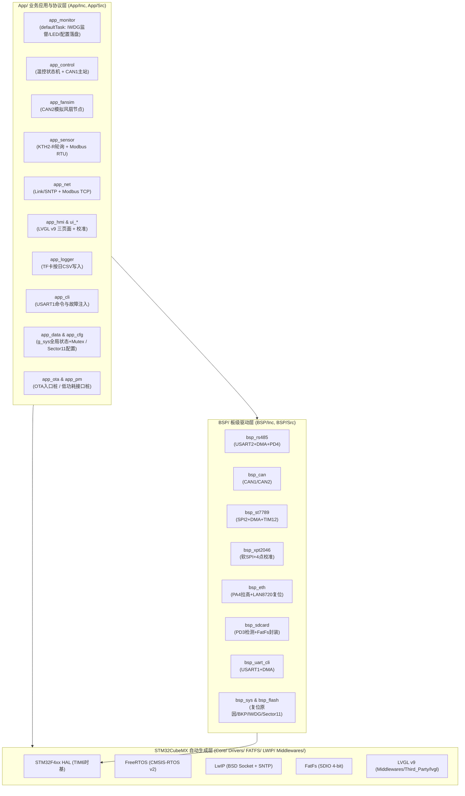
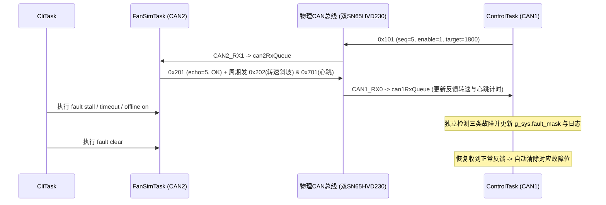
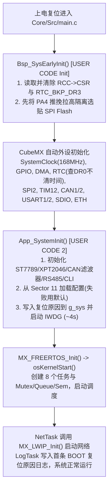

# SmartEdge_F407 软件架构设计文档（SAD）

## 文档控制信息

| 项目 | 内容 |
| --- | --- |
| **文档编号** | `SE-F407-SAD-001` |
| **文档版本** | `V2.2` |
| **文档状态** | 基线发布（Baseline） |
| **项目定位** | 大学生嵌入式综合学习与实战开发项目（简洁清晰、零过度设计、直接贴合 STM32CubeMX 工程落地） |
| **工程根目录** | `D:\SmartEdge_F407`（直接作为 STM32CubeMX 工程根目录，所有文件延续 CubeMX 风格） |
| **关联文档** | [SmartEdge_F407 软件需求规格说明书（SRS）](./SmartEdge_F407_软件需求规格说明书_SRS.md)（`SE-F407-SRS-001`）<br>[SmartEdge_F407 硬件资源分配表](./SmartEdge_F407_硬件资源分配表.md)（`SE-F407-HW-001`）<br>[SmartEdge_F407 软件详细设计文档（SDD）](./SmartEdge_F407_软件详细设计文档_SDD.md)（`SE-F407-SDD-001`） |
| **编制日期** | 2026-11-28 |

### 修订记录

| 版本 | 日期 | 修订说明 |
| --- | --- | --- |
| `V1.0` | 2026-11-25 | 初版完整软件架构设计文档。 |
| `V2.0` | 2026-11-25 | 调整为务实精简的 CubeMX 原生工程架构：根目录直接为 CubeMX CMake 工程，FreeRTOS/LwIP/FatFs 全由 CubeMX 生成，沿用默认 `.ld` 链接脚本与 `Inc/Src` 目录风格，精简任务通信、配置存储（Sector 11 单结构体）、TF 日志与低功耗预留实现复杂度。 |
| `V2.1` | 2026-11-27 | 根据 M2 实测（LVGL v9.6.0 渲染栈深与内存占用）将 `HmiTask` 栈扩容至 `1536 Words (6144 B)`、`defaultTask` 栈扩容至 `384 Words (1536 B)`（总堆保持 `36864 B`），并将 `.ccmram` 中 LVGL 内部内存池由 `32 KB` 扩容至 `48 KB`。 |
| `V2.2` | 2026-11-28 | 同步 M3 阶段 `AppState_t` 新增 `can_online` 在线标志字段，准确反映 CAN2 心跳在线状态。 |

---

## 1. 架构定位与核心设计决策

### 1.1 设计原则

本项目面向 STM32F407 + FreeRTOS + LwIP + FatFs + LVGL v9 综合学习与开发，在 **100% 满足 `SE-F407-SRS-001` 全部功能与验收项**的前提下，坚持以下四条实用原则：

1. **完全贴合 CubeMX 原生工程**：`D:\SmartEdge_F407` 直接就是 CubeMX 项目根目录；FreeRTOS（CMSIS-RTOS v2）、LwIP、FatFs 及全部 HAL 初始化均由 CubeMX 自动生成；**不手改 CubeMX 默认链接脚本**、**不折腾双工程 Bootloader 烧录**，实现 ST-Link 一键编译下载与单步调试。
2. **目录简单统一**：仅新增与 CubeMX 同风格（`Inc/` + `Src/`）的 `BSP/` 和 `App/` 两个自研目录，LVGL v9 放入 `Middlewares/Third_Party/lvgl/`，CubeMX 每次重新生成代码时零冲突。
3. **避开关键硬件大坑，不做过度封装**：重点解决 STM32F407 真正会导致死机/调不通的硬件坑（CCMRAM 不能走 DMA、`PA4=HIGH` 防板载 SPI Flash 干扰 ETH、`CAN2` 依赖 `CAN1` 时钟、RS-485 等 `TC` 切方向、SDIO 中断高于 DMA），而对于控制通信、配置保存、低功耗预留均采用直观易懂的 C 代码写法。
4. **外设异常互不拖垮**：传感器断线、网线拔出、TF 卡未插或损坏时，核心温控、CAN 通信与触控界面仍能正常运行。

### 1.2 关键架构决策汇总

| 序号 | 架构维度 | 选定方案 |
| :---: | --- | --- |
| 1 | **构建与目录** | CubeMX 原生 CMake 导出 + ARM GCC (VS Code)，纯 C11；根目录 `D:\SmartEdge_F407` 下新增 `BSP/(Inc,Src)`、`App/(Inc,Src)`，LVGL 放 `Middlewares/Third_Party/lvgl/` |
| 2 | **中间件与协议** | CubeMX 自动生成 **FreeRTOS (CMSIS-RTOS v2)**、**LwIP (BSD Socket)**、**FatFs**；Modbus RTU 主站与 Modbus TCP 从站采用**自研轻量 C 模块** |
| 3 | **RAM 内存策略** | 直接沿用 CubeMX 默认 `.ld`（`128 KB` 主 RAM + `64 KB` CCMRAM）：仅把 **LVGL v9 内部内存池（48 KB）和趋势数组**放 `.ccmram`，其余 FreeRTOS 堆、LwIP、FatFs、ETH 与刷屏缓冲全部留默认 `128 KB` 主 RAM |
| 4 | **任务创建与通信** | 全部业务任务、互斥锁、队列均在 **CubeMX FreeRTOS 界面配置生成**（`Core/Src/freertos.c`），任务入口调用 `App/Src/` 业务函数；数据共享采用 **全局结构体 `g_sys` + 1 把 `sysMutex` + 带校验的短锁读写函数**，省去复杂 RPC 命令信号量 |
| 5 | **自动调速与协议** | 自动滞回 + **温差线性调速**（`T_start` 起 `1200–3000 RPM`，滞回维持 `1000 RPM`，失效安全降级 `1500 RPM`）；CAN 4 帧标准协议（`0x101/0x201/0x202/0x701` @ `500 kbps`）；Modbus TCP 端口 `502`，默认静态 IP（`192.168.1.100`，支持切 DHCP），自动模式拒写手动启停返回异常码 `0x04` |
| 6 | **本地触控 HMI** | 横屏 **`320 × 240`** + **纯英文界面**（仅启用 LVGL 内置 `Montserrat` 字体，不引入外部/中文字库）+ 主 RAM 双部分刷屏缓冲（`2 × 12.5 KB = 25 KB`）走 SPI2 DMA 异步刷新 + XPT2046 4 点校准 |
| 7 | **配置保存与 OTA 预留** | **单工程直烧 `0x0800_0000`**；掉电配置保存在片内 Flash 最后一扇区 **`Sector 11 (0x080E_0000)`**（单结构体 + Magic + CRC32，2 s 防抖，擦前喂狗）；IAP/OTA 通过分区宏、`VTOR` 注释及 `App_OtaRequestUpgrade()` 入口桩预留 |
| 8 | **日志、看门狗与低功耗** | TF 卡采用异步队列（16 条）+ 按日 CSV + 即时 `f_sync()` + `PD3` 热插拔容错（不做复杂自动删旧）；`defaultTask` 兼作 IWDG 监督（5 核心任务心跳位图 + `RTC_BKP_DR3` 记录卡死任务）；低功耗提供简洁的 `App_PmSuspend/Resume/Wakeup` 固定接口桩 |

---

## 2. 系统架构与 CubeMX 目录结构

### 2.1 三层实用软件架构

相比复杂的企业级多层架构，本项目采用清晰直观的 **“CubeMX 底层与中间件 — BSP 外设驱动 — App 业务与协议”** 三层结构：



### 2.2 工程目录结构（`D:\SmartEdge_F407` 为 CubeMX 根目录）

全部文件夹延续 CubeMX 的大写驼峰与 `Inc/` + `Src/` 习惯：

```text
D:\SmartEdge_F407\
├── SmartEdge_F407.ioc                 # STM32CubeMX 工程配置文件
├── CMakeLists.txt                     # CubeMX 生成的根 CMakeLists（在 USER CODE 区追加 BSP/App/lvgl）
├── CMakePresets.json                  # CubeMX 生成的 CMake 构建预设（Debug / Release）
├── STM32F407xx_FLASH.ld               # CubeMX 默认链接脚本（直接使用，无需修改）
├── cmake/
│   └── stm32cubemx/                   # CubeMX 自动维护的芯片与中间件构建清单
├── Core/                              # CubeMX 自动生成
│   ├── Inc/                           # main.h, FreeRTOSConfig.h, stm32f4xx_hal_conf.h ...
│   └── Src/                           # main.c, freertos.c（任务壳）, stm32f4xx_it.c ...
├── Drivers/                           # CubeMX 自动生成（CMSIS + STM32F4xx_HAL_Driver）
├── FATFS/                             # CubeMX 自动生成（Target/ + App/fatfs.c）
├── LWIP/                              # CubeMX 自动生成（Target/ethernetif.c + App/lwip.c）
├── Middlewares/
│   └── Third_Party/
│       ├── FreeRTOS/                  # CubeMX 自动生成
│       ├── LwIP/                      # CubeMX 自动生成
│       ├── FatFs/                     # CubeMX 自动生成
│       └── lvgl/                      # ★ 手动放入 LVGL v9 源码与 lv_conf.h
├── BSP/                               # ★ 自研板级外设驱动（延续 CubeMX Inc/Src 风格）
│   ├── Inc/                           # bsp_rs485.h, bsp_can.h, bsp_st7789.h, bsp_xpt2046.h,
│   │                                  # bsp_eth.h, bsp_sdcard.h, bsp_uart_cli.h, bsp_flash.h, bsp_sys.h
│   └── Src/                           # 对应 .c 实现（含 HAL DMA/UART/CAN 回调）
├── App/                               # ★ 自研业务、轻量协议与 UI（延续 CubeMX Inc/Src 风格）
│   ├── Inc/                           # app_data.h, app_cfg.h, app_modbus_rtu.h, app_modbus_tcp.h,
│   │                                  # app_can_proto.h, app_tasks.h, app_ui.h, app_ota.h, app_pm.h
│   └── Src/
│       ├── app_data.c                 # 全局状态 g_sys + sysMutex 读写与参数校验封装
│       ├── app_cfg.c                  # Flash Sector 11 单结构体读写与 2s 防抖保存
│       ├── app_modbus_rtu.c           # 自研 Modbus RTU 主站组帧、CRC16 与解析
│       ├── app_modbus_tcp.c           # 自研 Modbus TCP 寄存器映射与功能码 0x03/0x04/0x06/0x10
│       ├── app_can_proto.c            # CAN 0x101/0x201/0x202/0x701 编解码
│       ├── app_monitor.c              # defaultTask：IWDG 5 任务心跳监督、LED2 闪烁、配置落盘
│       ├── app_control.c              # ControlTask：滞回+线性温控、CAN1 主站与三类故障检测
│       ├── app_fansim.c               # FanSimTask：CAN2 独立模拟风扇节点与故障注入
│       ├── app_sensor.c               # SensorTask：KTH2-R 周期采集与 3 次失败断线判定
│       ├── app_net.c                  # NetTask：Link 检测、SNTP 校时、BSD Socket select() 服务器
│       ├── app_hmi.c                  # HmiTask：LVGL v9 刷新与 XPT2046 触控读取
│       ├── app_logger.c               # LogTask：PD3 热插拔与按日 CSV 即时落盘
│       ├── app_cli.c                  # CliTask：USART1 调试命令与故障/卡死注入
│       ├── app_ota.c                  # IAP/OTA 分区宏与升级入口桩
│       ├── app_pm.c                   # 低功耗外设挂起/恢复/唤醒接口桩
│       ├── ui_main.c                  # LVGL 公共顶栏/底栏导航与 250ms 差量刷新
│       ├── ui_page_overview.c         # Overview 运行总览页（纯英文界面）
│       ├── ui_page_trend.c            # Trend 历史趋势页（lv_chart）
│       └── ui_page_diag.c             # Diag 系统诊断与设置页 + 4 点触摸校准页
└── docs/                              # 项目规格、硬件资源与架构文档
```

### 2.3 CubeMX 代码衔接约定（防重生成覆盖）

1. **`CMakeLists.txt`**：仅在 CubeMX 生成的 `CMakeLists.txt` 底部追加 `BSP/Src/*.c`、`App/Src/*.c` 和 `Middlewares/Third_Party/lvgl/` 源文件及头文件包含路径（CubeMX 重新生成时不会覆盖根目录手改的 `CMakeLists.txt`，仅更新 `cmake/stm32cubemx/CMakeLists.txt`）。
2. **`Core/Src/main.c`**：仅在两处 `USER CODE` 块调用 2 个入口函数：
   - `USER CODE BEGIN Init`：`Bsp_SysEarlyInit()`（第一时间读并清 `RCC->CSR` 复位标志、查 `RTC_BKP_DR3`、在 `MX_ETH_Init()` 之前强制拉高 `PA4`）。
   - `USER CODE BEGIN 2`：`App_SystemInit()`（初始化 BSP、从 Sector 11 加载配置、启动 IWDG）。
3. **`Core/Src/freertos.c`**：所有任务、互斥锁、队列均在 CubeMX 图形界面创建；每个生成的 `StartXxxTask(void *argument)` 函数体内仅写 1 行调用 `App_XxxTaskLoop()`，业务逻辑全部写在 `App/Src/` 中。

---

## 3. CubeMX FreeRTOS 配置清单与内存预算

### 3.1 STM32CubeMX FreeRTOS 图形界面直接配置表

在 CubeMX `Middleware -> FREERTOS` 选择 **`CMSIS_V2`**，设置 `TOTAL_HEAP_SIZE = 36864`（`36 KB`），开启 `USE_MUTEXES = Enabled` 与 `CHECK_FOR_STACK_OVERFLOW = Option 2`。

> **重要提醒**：STM32CubeMX 界面中任务的 `Stack Size` 单位是 **Words（1 Word = 4 Bytes）**，下表同时标出 Words 与 Bytes 以便直接录入。

#### 任务清单（CubeMX `Tasks and Queues -> Tasks`）

| CubeMX 任务名 (`Task Name`) | 优先级 (`Priority`) | 栈大小 (`Words` / `Bytes`) | 入口函数 (`Entry Function`) | 对应 `App/Src` 业务职责 | IWDG 监督位 |
| --- | :---: | :---: | --- | --- | :---: |
| `defaultTask` | `osPriorityHigh` | `384` (`1536 B`) | `StartDefaultTask` → `App_MonitorTask()` | 看门狗 5 任务巡检喂狗、LED2 闪烁、2s 防抖配置落盘 | 喂狗主体 |
| `ControlTask` | `osPriorityAboveNormal2` | `512` (`2048 B`) | `StartControlTask` → `App_ControlTask()` | 自动滞回/线性温控、CAN1 指令下发与三类故障判定 | `bit0` |
| `FanSimTask` | `osPriorityAboveNormal` | `384` (`1536 B`) | `StartFanSimTask` → `App_FanSimTask()` | CAN2 独立模拟风扇节点、转速斜坡、心跳与故障注入 | `bit1` |
| `SensorTask` | `osPriorityNormal2` | `384` (`1536 B`) | `StartSensorTask` → `App_SensorTask()` | RS-485 Modbus RTU 每秒轮询 KTH2-R、断线判定 | `bit2` |
| `NetTask` | `osPriorityNormal1` | `1024` (`4096 B`) | `StartNetTask` → `App_NetTask()` | PHY Link 监测、SNTP 校时、BSD Socket `select()` Modbus TCP | `bit3` |
| `HmiTask` | `osPriorityNormal` | `1536` (`6144 B`) | `StartHmiTask` → `App_HmiTask()` | LVGL v9 `lv_timer_handler()`、XPT2046 采样、UI 刷新 | `bit4` |
| `LogTask` | `osPriorityBelowNormal` | `768` (`3072 B`) | `StartLogTask` → `App_LogTask()` | `PD3` 热插拔、FatFs 按日写 CSV 并立即 `f_sync()` | 不监督（防卡死拖垮） |
| `CliTask` | `osPriorityLow` | `512` (`2048 B`) | `StartCliTask` → `App_CliTask()` | USART1 调试命令解析、故障与任务卡死注入 | 不监督 |

*(注：LwIP 初始化时还会自动创建 `tcpip_thread` [约 4 KB 栈] 和 `EthIf` 接收线程 [约 1.4 KB 栈]，系统实际共运行 10 个线程。)*

#### 同步与通信对象清单（CubeMX GUI 创建）

| 对象类型 | CubeMX 名称 (`Name`) | 参数配置 | 用途说明 |
| --- | --- | --- | --- |
| **Mutex** | `sysMutex` | 默认（CMSIS-RTOS v2 默认带优先级继承） | 保护全局系统状态结构体 `g_sys` |
| **Queue** | `can1RxQueue` | 长度 `16`，项大小 `sizeof(CanFrame_t)` (`16 B`) | `CAN1_RX0` 中断向 `ControlTask` 投递接收帧 |
| **Queue** | `can2RxQueue` | 长度 `8`，项大小 `sizeof(CanFrame_t)` (`16 B`) | `CAN2_RX1` 中断向 `FanSimTask` 投递控制命令帧 |
| **Queue** | `logQueue` | 长度 `16`，项大小 `sizeof(LogMsg_t)` (`48 B`) | 各模块向 `LogTask` 异步投递日志记录（队满不阻塞业务） |
| **Binary Sem** | `lcdDmaSem` | 初始值 `0` | `SPI2_TX` DMA 完成回调通知 `HmiTask` 释放 LVGL 帧缓冲 |

*(RS-485 与 CLI 串口收发事件直接使用 CMSIS-RTOS v2 轻量线程标志 `osThreadFlagsSet(SensorTaskHandle, ...)`，无需额外建队列或信号量。)*

### 3.2 RAM 与 Flash 空间预算（直接沿用 CubeMX 默认 `.ld`）

| 存储区域 | 总容量 | 预估占用 | 剩余裕量 | 分配说明 |
| --- | :---: | :---: | :---: | --- |
| **主 RAM** (`0x2000_0000`) | `128 KB` | `~100 KB` | **`~28 KB` (22%)** | FreeRTOS `ucHeap` (`36 KB`) + CubeMX LwIP ETH 描述符与缓冲 (`~13 KB`) + LwIP 堆与 PBUF (`~14 KB`) + **LVGL SPI2 DMA 双部分刷屏缓冲** (`2 × 320×20×2 B = 25 KB`) + FatFs/USART 缓冲与 `.data`/`.bss` (`~12 KB`) |
| **CCMRAM** (`0x1000_0000`) | `64 KB` | `~49 KB` | **`~15 KB` (23%)** | 仅放两处纯 CPU 数据（加 `__attribute__((section(".ccmram")))`）：<br>1. LVGL v9 动态内存池 `g_lvgl_mem[48 * 1024]`（`48 KB`，通过 `LV_MEM_POOL_ALLOC` 绑定）<br>2. 历史趋势环形数组（`120` 点温湿度/转速，`724 B`） |
| **Flash 代码区** (`0x0800_0000` 起) | `896 KB` (Sector 0–10) | `~190–230 KB` | **`> 660 KB`** | 应用程序全部代码 + LVGL 内置英文字体（`Montserrat` 12/14/16/24），不引入外部字库，与末尾 Sector 11 距离极远 |
| **Flash 配置区** (`Sector 11`, `0x080E_0000`) | `128 KB` | `128 B` 有效结构体 | 独立扇区 | 存放 `AppConfig_t` 掉电参数（阈值、触摸校准、网络配置、背光） |

> **核心防坑说明**：STM32F407 的 `CCMRAM` 无法被 DMA 访问。采用上述策略后，**所有任务栈、FatFs、LwIP、ETH、SPI2 刷屏缓冲、USART 缓冲全在默认 128 KB 主 RAM 中**，只有 LVGL 内部对象堆与趋势数组在 `.ccmram`，从根源杜绝 DMA 访问 CCMRAM 报错。

---

## 4. 数据共享模型与核心接口设计

### 4.1 简洁线程安全共享架构（`App/Inc/app_data.h`）

全系统共享状态集中存放在 `AppState_t g_sys` 中，通过 `sysMutex` 保护。遵循一条铁律：**持有 `sysMutex` 时只做内存读写与数值范围校验（耗时 `< 20 µs`），严禁在持锁期间调用 CAN 发送、485 通信、Flash 擦写或 TF 卡操作。**

```c
typedef enum {
    FAULT_NONE             = 0x0000U,
    FAULT_SENSOR_OFFLINE   = (1U << 0), /* 温湿度传感器断线/连续3次失败 */
    FAULT_CAN_STALL        = (1U << 1), /* CAN 风扇堵转 */
    FAULT_CAN_CMD_TIMEOUT  = (1U << 2), /* CAN 命令应答超时 */
    FAULT_CAN_NODE_OFFLINE = (1U << 3), /* CAN 模拟风扇节点失联 */
    FAULT_TF_ERROR         = (1U << 4), /* TF 卡未插/挂载或写盘失败 */
} FaultBit_t;

typedef enum { CTRL_MODE_AUTO = 0, CTRL_MODE_MANUAL = 1 } CtrlMode_t;
typedef enum {
    FAN_STOP = 0, FAN_AUTO_RUN = 1, FAN_MAN_RUN = 2, FAN_FAILSAFE = 3, FAN_FAULT = 4
} FanState_t;

typedef struct {
    int16_t  temp_x10;           /* 温度 0.1 ℃ (有符号) */
    uint16_t humi_x10;           /* 湿度 0.1 %RH */
    uint8_t  sensor_valid;       /* 1=有效 0=失效 */
    uint8_t  ctrl_mode;          /* CtrlMode_t */
    uint8_t  fan_state;          /* FanState_t */
    uint8_t  manual_run;         /* 手动启停 0/1 */
    uint16_t manual_target_rpm;  /* 手动目标转速 800..3000 */
    uint16_t active_target_rpm;  /* 当前实际下发的目标转速 */
    uint16_t actual_rpm;         /* CAN2 反馈模拟转速 */
    int16_t  temp_start_x10;     /* 自动启动阈值，默认 300 (30.0 ℃) */
    int16_t  temp_stop_x10;      /* 自动停止阈值，默认 270 (27.0 ℃) */
    uint16_t fault_mask;         /* FaultBit_t 位图 */
    uint16_t reset_reason;       /* 0未知 1POR/BOR 2NRST 3IWDG 4WWDG 5SFTRST */
    uint16_t hung_task_mask;     /* IWDG 复位时从 RTC_BKP_DR3 读出的卡死任务位图 */
    uint8_t  eth_link_up;        /* 1=网线连通 */
    uint8_t  sntp_synced;        /* 1=SNTP 校时成功 */
    uint8_t  tf_ready;           /* 1=TF 卡就绪 */
    uint8_t  can_online;         /* 1=CAN2 心跳在线 */
    uint8_t  backlight_pct;      /* 10..100 % */
    uint32_t ipv4_addr;          /* 当前 IPv4 */
    uint32_t uptime_sec;         /* 运行秒数 */
    uint32_t rtc_unix_ts;        /* RTC 时间戳 */
    uint32_t rs485_err_cnt;      /* 诊断计数 */
    uint32_t can_err_cnt;        /* 诊断计数 */
} AppState_t;
```

#### 统一对外读写与控制封装 API

- `void AppData_GetSnapshot(AppState_t *out)`：加锁快速拷贝整份快照后立刻解锁；HMI、Modbus TCP 读寄存器、CLI、Logger 统一读本地副本，互不卡顿。
- `int AppCtrl_SetMode(uint8_t mode)`：校验 `0/1` → 更新 `g_sys.ctrl_mode` → 通知 `ControlTask` 立即重新计算并下发 CAN1 → 写入状态变更日志。
- `int AppCtrl_SetManualRun(uint8_t run, uint8_t from_modbus)`：若当前为自动模式且来自 Modbus TCP，直接拒绝返回 `-EPERM`（协议层回异常码 `0x04`）；手动模式下更新 `manual_run` 并唤醒 `ControlTask`。
- `int AppCtrl_SetManualRpm(uint16_t rpm)`：校验 `800 <= rpm <= 3000`（否则返回 `-EINVAL` / 异常码 `0x03`）→ 更新并唤醒 `ControlTask`。
- `int AppCtrl_SetThresholds(int16_t start_x10, int16_t stop_x10)`：校验均在 `[0, 700]` 且 `start_x10 - stop_x10 >= 10`（最小死区 `1.0 ℃`）→ 更新状态、唤醒 `ControlTask`、标记配置脏标志（2 s 后自动存 Sector 11）。

---

## 5. 各功能模块详细设计

### 5.1 温湿度采集模块（`SensorTask` + `app_modbus_rtu` + `bsp_rs485`）

- **RS-485 方向切换关键实现**：发送前拉高 `PD4` → 延时 ~50 µs → 启动 `USART2 TX DMA` → 在 **`HAL_UART_TxCpltCallback`（TC 发送完成中断）** 中将 `PD4` 拉低切回接收，同时启动 `HAL_UARTEx_ReceiveToIdle_DMA()`。接收完成后在 `HAL_UARTEx_RxEventCallback` 中通过 `osThreadFlagsSet(SensorTaskHandle, FLAG_RX_DONE)` 唤醒任务。
- **采集与断线逻辑**：
  1. 每 `1000 ms` 发出 KTH2-R 联读请求帧 `01 03 03 00 00 02 C4 4F`，等待应答超时 `500 ms`。
  2. 校验长度（9 字节）、站址/功能码、CRC16-Modbus 及量程（温度 `-40.0~85.0 ℃` 补码解析，湿度 `0.0~100.0 %RH`）。
  3. 连续失败 `3` 次置位 `FAULT_SENSOR_OFFLINE` 与 `sensor_valid = 0`，唤醒 `ControlTask` 切入安全降级通风并写日志；恢复收到 1 帧合法数据即自动清除故障。

### 5.2 通风控制与双路 CAN 模块（`ControlTask` + `FanSimTask` + `app_can_proto` + `bsp_can`）

#### 自动滞回 + 温差线性调速逻辑

1. **传感器失效降级**：自动模式下 `sensor_valid == 0` → 直接进入 `FAN_FAILSAFE`，下发 **`1500 RPM`** 维持安全通风。
2. **正常滞回 + 线性调速**：
   - 停机态下 `temp_x10 >= temp_start_x10`（默认 `30.0 ℃`）→ 启动风扇进入 `FAN_AUTO_RUN`。
   - 运行态下 `temp_x10 <= temp_stop_x10`（默认 `27.0 ℃`）→ 停止风扇进入 `FAN_STOP`（`0 RPM`）。
   - `FAN_AUTO_RUN` 期间目标转速计算：
     - `temp_x10 >= temp_start_x10` 时，从 `1200 RPM` 起按每 `+1.0 ℃` 增加 `180 RPM` 线性爬升，超温 `+10.0 ℃` 限幅满速 **`3000 RPM`**（变化量 `≥ 50 RPM` 才触发重发防抖）。
     - `temp_stop_x10 < temp_x10 < temp_start_x10`（滞回死区）时，维持最低转速 **`1000 RPM`** 避免临界抖动。
3. **手动模式**：按 `manual_run` 下发 `0` 或 `manual_target_rpm`（`800–3000 RPM`）。

#### CAN 通信协议（500 kbps，标准 11-bit ID，8 字节小端序）

> **STM32F407 CAN2 必记要点**：初始化时必须先使能 `CAN1` 时钟，并通过 `CAN1` 配置 `SlaveStartFilterBank = 14`；`CAN1` 滤波器 Bank 0 接收 `0x201/0x202/0x701` → FIFO0，`CAN2` 滤波器 Bank 14 接收 `0x101` → FIFO1。

| 帧名 / StdID | 方向 / 周期 | Byte 0 | Byte 1 | Byte 2–3 (`uint16`) | Byte 4–5 (`uint16`) | Byte 6 | Byte 7 |
| --- | --- | --- | --- | --- | --- | --- | --- |
| **控制命令** `0x101` | CAN1 → CAN2<br>变更即发 + `500 ms` 保活 | `cmd_seq` (`1..255`) | `enable` (`0`/`1`) | `target_rpm` | `ctrl_mode` (`0`Auto `1`Man `2`Failsafe) | `0x00` | `xor` (B0..6 异或) |
| **命令应答** `0x201` | CAN2 → CAN1<br>收 `0x101` 即回 | `echo_seq` | `ack` (`0`OK `2`STALL) | `accepted_rpm` | `cur_state` | `0x00` | `xor` |
| **运行状态** `0x202` | CAN2 → CAN1<br>周期 `200 ms` | `node_state` (`0`停 `1`运 `2`堵转) | `fault_bits` (`bit0`=堵转) | `actual_rpm` | `target_rpm` | `cnt` | `xor` |
| **节点心跳** `0x701` | CAN2 → CAN1<br>周期 `500 ms` | `0x01` (在线) | `alive_cnt` | `uptime_low16` | `err_flags` | `0x00` | `xor` |

#### 三类 CAN 故障检测与 `FanSimTask` 模拟注入

- **命令超时 (`FAULT_CAN_CMD_TIMEOUT`)**：发送 `0x101` 后 `500 ms` 未收到匹配 `echo_seq` 的 `0x201` → 重发 1 次 → 再超 `500 ms` 置位故障；收到正常应答即清除。（`fault timeout on` 令 `FanSimTask` 仅丢弃 `0x201`，心跳照发。）
- **节点失联 (`FAULT_CAN_NODE_OFFLINE`)**：超过 `1500 ms` 未收到 `0x701` → 置位故障且显示转速归零；重收 `0x701` 自动清除。（`fault offline on` 令 `FanSimTask` 停止发送全部帧。）
- **风扇堵转 (`FAULT_CAN_STALL`)**：`0x202` 上报堵转位，或运行态超过 `1500 ms` 且反馈转速 `< 200 RPM` → 置位故障；堵转解除转速恢复后自动清除。（`fault stall on` 令 `FanSimTask` 置位堵转标志并将模拟转速拉至 0，应答与心跳照常。）



### 5.3 本地触控 HMI 模块（`HmiTask` + `ui_*` + `bsp_st7789` + `bsp_xpt2046`）

- **显示刷新**：ST7789 配为横屏 **`320 × 240`**；在默认主 RAM 定义双缓冲 `uint16_t lcd_buf1[320*20]`、`lcd_buf2[320*20]`（共 `25 KB`，整除 240 高为 12 片）；`disp_flush` 设窗口后启动 `HAL_SPI_Transmit_DMA(&hspi2, ...)`，DMA 完成中断回调释放 `lcdDmaSem` 并调用 `lv_display_flush_ready()`。
- **字体与内存**：LVGL 内存池 `48 KB` 放 `.ccmram`；界面统一采用**纯英文 + LVGL 内置字体**（在 `lv_conf.h` 启用 `LV_FONT_MONTSERRAT_12/14/16/24` 即可，不引入任何外部字库，完全不依赖 TF 卡；温度单位使用内置支持的 `"°C"` 或 `"C"`，勿用 CJK 符号 `℃` 以防缺字）。
- **触摸与校准**：XPT2046 软件 SPI 每 `20 ms` 由 LVGL 输入回调轮询，按下时采 5 点去极值取平均；校准页引导点击屏幕 4 个靶点计算线性仿射系数并存入 `AppConfig_t` 掉电保存。
- **三页面结构**：顶栏（`AUTO/MAN/SAFE` 模式、`485/CAN/ETH/TF` 状态与 RTC 时钟）+ 底栏三页切换（**`Overview`** / **`Trend`** / **`Diag`**），每 `250 ms` 拉一次 `AppData_GetSnapshot()`，仅数值变化时更新控件。

### 5.4 以太网、Modbus TCP 与 SNTP 模块（`NetTask` + `app_modbus_tcp` + `bsp_eth`）

- **硬件避坑初始化**：`Bsp_SysEarlyInit()` 先将 `PA4` 设为输出高电平隔离选贴 SPI Flash；CubeMX 生成的 `ethernetif.c` 中 PHY 地址配置为 `1`，并通过 MDIO 写 `BMCR = 0x8000` 执行 LAN8720 软复位。
- **单任务 BSD Socket `select()` 服务**：
  - 监听 TCP 端口 `502`，维护最多 `3` 个客户端 Socket 数组，空闲超过 `60 s` 自动关闭防僵尸连接；`select()` 超时设为 `200 ms`，醒来后顺便做 PHY Link 热插拔检测、触发 SNTP 校时及上报看门狗心跳。
  - IP 模式默认静态 IP（`192.168.1.100 / 255.255.255.0 / 192.168.1.1`），可在配置项切换为 DHCP。
  - **Modbus TCP 寄存器映射**：完全遵循 `SE-F407-SRS-001` 第 4.4 节（`0x0000–0x000B` 只读状态，支持 `0x04`/`0x03`；`0x0100–0x0105` 控制与参数，支持 `0x03`/`0x06`/`0x10`）。读请求直接取 `AppData_GetSnapshot()`；写请求调用 `AppCtrl_SetXxx()`，非法地址回 `0x02`、越界回 `0x03`、自动模式写手动启停（`0x0101`）回 `0x04`。
- **SNTP 校时**：开启 CubeMX LwIP 中的 SNTP（或直接加入 `lwip/apps/sntp.c`），检测到 Link Up 后请求 NTP 服务器，在回调 `sntp_set_system_time(sec)` 中加 `+8 * 3600` 写入硬件 RTC 并写 `RTC_BKP_DR0 = 0x32F2A55A`；此后每 `6 小时` 自动重校一次，并支持 CLI 手动触发。

### 5.5 Flash 配置存储与 TF 卡日志模块（`app_cfg` + `LogTask` + `bsp_sdcard`）

#### Sector 11 单结构体掉电配置（`App/Src/app_cfg.c`）

- 存放地址：片内 Flash 最后一扇区 **`Sector 11 (0x080E_0000)`**（与代码段完全隔离，直接沿用 CubeMX 默认 `.ld`）。
- 结构体 `AppConfig_t` 包含：`magic (0x53454346)`、`version`、自动启停阈值、手动默认转速、背光百分比、网络模式/静态 IP、6 个浮点触摸校准系数与 `crc32`。
- **读写流程**：上电直接从 `0x080E_0000` 读取并校验 `magic` 与 `crc32`，失败则加载出厂默认值；运行中修改参数仅置 `cfg_dirty = 1`，由 `defaultTask` 等待 `2 s` 防抖合并后，**先执行 `HAL_IWDG_Refresh()` 喂狗**，再擦除 Sector 11 并按 Word 写入最新配置。

#### TF 卡 CSV 日志与热插拔（`App/Src/app_logger.c`）

- 维护简洁三态状态机：`NO_CARD`（未插卡）↔ `READY`（已挂载）↔ `ERR_WAIT`（出错退避 5 s 重试），周期检查 `PD3 == LOW`（去抖 300 ms）实现插拔自动挂载与卸载，任何错误仅置位 `FAULT_TF_ERROR`，绝不阻塞业务任务或触发看门狗。
- 阻塞读取 `logQueue`（超时 `500 ms`），每条日志按 RTC 日期写入 `/YYYYMMDD.csv`（新文件自动写表头），每次 `f_write()` 后立即 `f_sync()` 防止突然断电丢数据。常规运行每 `10 s` 投递一条快照，启动复位、模式切换与故障触发/恢复时即时投递事件日志。

### 5.6 看门狗监督、复位原因与 CLI 模块（`defaultTask` + `CliTask` + `bsp_sys`）

#### 5 核心任务心跳位图监督（`App/Src/app_monitor.c`）

- 定义 5 位心跳位图 `ALL_HB_MASK = 0x1F`（`bit0` Control、`bit1` FanSim、`bit2` Sensor、`bit3` Net、`bit4` HMI），5 个核心任务每次主循环打卡将对应位置 1。
- `defaultTask` 每 **`1000 ms`** 检查一次：
  - 若 `(g_hb_mask & 0x1F) == 0x1F`：清零 `g_hb_mask`，复位连续异常计数 `miss_cnt = 0`，调用 `HAL_IWDG_Refresh(&hiwdg)`（硬件超时约 `4.0 s`），并翻转板载 LED2 (`PB2`)。
  - 若有位未打卡且 `++miss_cnt >= 2`（持续 2 秒未响应）：将缺失位图 `missing = (~g_hb_mask) & 0x1F` 写入 **`RTC_BKP_DR3 = 0xA5000000U | missing`**，串口打印告警并**停止喂狗**，硬件 IWDG 约 `4 s` 后自动复位。
- **上电溯源（`Bsp_SysEarlyInit`）**：在 `main()` 最开头读取 `RCC->CSR` 解析复位源（`IWDG`/`WWDG`/`NRST`/`POR`/`SFTRST`）后清硬件标志；若为 `IWDG` 且 `RTC_BKP_DR3` 高字节为 `0xA5`，一并读出具体卡死的任务名并清零 `RTC_BKP_DR3`，随后通过串口、诊断页、Modbus 寄存器与 TF 卡启动日志四端展示。

#### 串口 CLI 命令（`App/Src/app_cli.c`）

基于 `USART1 DMA + IDLE` 接收文本行，支持命令：`help`、`status`、`fault stall|timeout|offline on|off`、`fault clear`、`wdt hang control|fansim|sensor|net|hmi|monitor`、`sntp sync`、`ota enter`。

---

## 6. 系统启动顺序与扩展预留

### 6.1 启动流程图



*(注：CubeMX 默认把 `MX_LWIP_Init()` 放在 `StartDefaultTask` 中初始化，建议移至 `NetTask` 启动开头执行或保留在 `defaultTask` 首次进入循环前执行，确保 LwIP 在调度器启动后再初始化且不阻塞看门狗启动。)*

### 6.2 扩展预留设计（简洁实用）

1. **IAP / OTA 固件升级预留（`App/Inc/app_ota.h`, `App/Src/app_ota.c`）**：
   - 在头文件中清晰定义后续演进的 Flash 分区地址宏（Bootloader `0x0800_0000` 48 KB、App `0x0802_0000` 384 KB、OTA 下载槽 `0x0808_0000` 384 KB、配置区 `0x080E_0000` 128 KB）与 `APP_VTOR_OFFSET` 宏注释。
   - 提供 `App_OtaRequestUpgrade()` 入口桩（CLI `ota enter` 或 Modbus 寄存器 `0x01F0` 触发）：停止风扇 → 刷盘关闭 TF 日志 → 写入 `RTC_BKP_DR2 = 0x4F544131` 升级请求标志 → `NVIC_SystemReset()`。后续开发 Bootloader 时仅需改链接脚本起始地址并启用 `VTOR` 偏移即可无缝对接。
2. **低功耗模式预留（`App/Inc/app_pm.h`, `App/Src/app_pm.c`）**：
   - 直接提供 3 个清晰函数接口，按固定顺序调用各外设 BSP 接口，不做复杂回调框架：
     - `void App_PmSuspendPeripherals(void)`：关 LCD 背光（`PB14` PWM 置 0）→ 卸载 TF 卡 → 挂起 ETH/RS-485/CAN。
     - `void App_PmResumePeripherals(void)`：逆序恢复外设与背光。
     - `void App_PmConfigWakeup(uint32_t rtc_sec)`：预留 `PA0 (SYS_WKUP)` 按键上升沿唤醒与 RTC 定时唤醒配置桩。

---

## 7. CubeMX 配置与编码落地速查清单

开始用 STM32CubeMX 搭建 `D:\SmartEdge_F407` 工程时，按以下 8 条逐项勾选即可避免 90% 的调试踩坑：

1. **工程导出**：`Project Manager -> Toolchain/IDE` 选 **`CMake`**，项目路径直接选 `D:\SmartEdge_F407`。
2. **时基与调试**：`SYS -> Debug = Serial Wire`；**`Timebase Source = TIM6`**（严禁用 SysTick）。
3. **时钟树**：HSE `8 MHz` → SYSCLK `168 MHz`、APB1 `42 MHz`、APB2 `84 MHz`、PLL48CLK `48 MHz`；LSE `32.768 kHz` → RTC。
4. **中断优先级**：NVIC Priority Group 4；**`SDIO` 全局中断优先级 (`5`) 必须高于 `SDIO DMA2 Stream3/6` (`6`)**；所有在中断内调 CMSIS-RTOS v2 API 的中断优先级均设在 `5–15`。
5. **ETH + SPI Flash 隔离**：ETH 选 RMII，PHY 地址设 `1`，`PA4` 配为 GPIO Output 默认 `High`（且在 `Bsp_SysEarlyInit` 中抢先置高）。
6. **CAN1 / CAN2**：波特率同设 `500 kbps`，均开启 RX 中断（CAN1 用 FIFO0，CAN2 用 FIFO1），代码中先开 CAN1 时钟并设 `SlaveStartFilterBank = 14`。
7. **RS-485 (`USART2`)**：开启 TX/RX DMA（DMA1 Stream5/6）与全局中断，发送完成后必须在 `HAL_UART_TxCpltCallback`（TC）中拉低 `PD4`。
8. **内存与栈检测**：LVGL 内部堆 `48 KB` 与趋势数组加 `__attribute__((section(".ccmram")))`；FreeRTOS `TOTAL_HEAP_SIZE = 36864` 并开启栈溢出检测钩子 `vApplicationStackOverflowHook` 串口打印报错。
