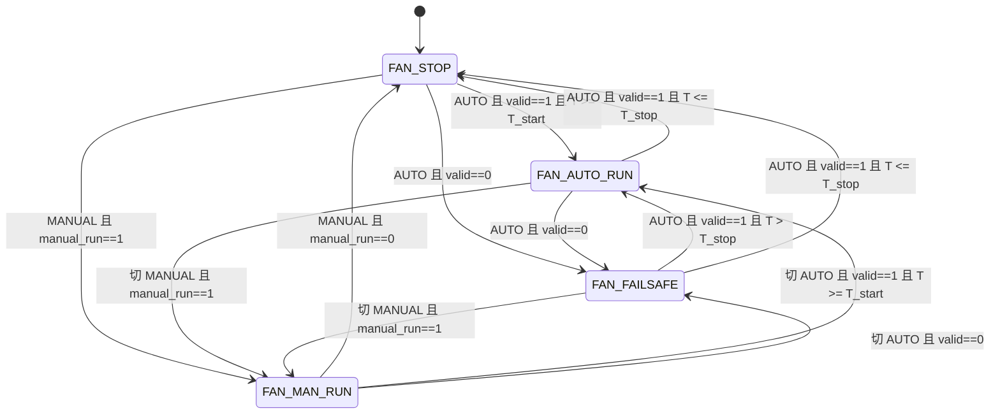
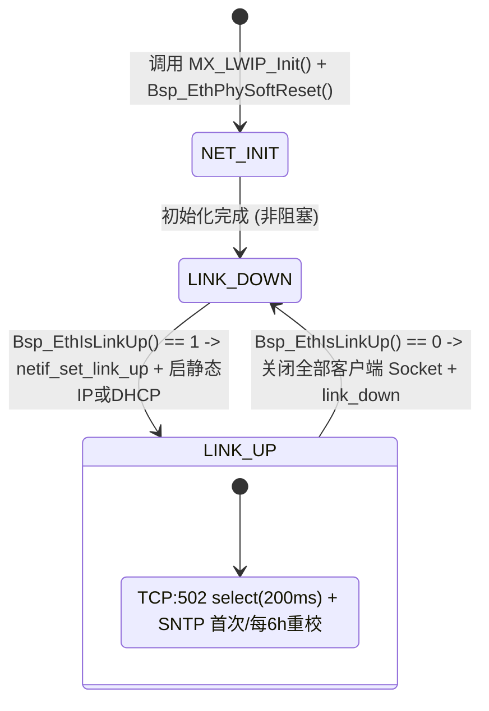

# SmartEdge_F407 软件详细设计文档（SDD）

## 文档控制信息

| 项目 | 内容 |
| --- | --- |
| **文档编号** | `SE-F407-SDD-001` |
| **文档版本** | `V1.1` |
| **文档状态** | 基线更新（M2 实测同步） |
| **项目名称** | SmartEdge_F407 工业边缘采集网关与本地触控终端 |
| **工程根目录** | `D:\SmartEdge_F407`（STM32CubeMX 原生 CMake 工程，纯 C11） |
| **上游基线** | [软件需求规格说明书（SRS）](./SmartEdge_F407_软件需求规格说明书_SRS.md)（`SE-F407-SRS-001`）<br>[硬件资源分配表](./SmartEdge_F407_硬件资源分配表.md)（`SE-F407-HW-001`）<br>[软件架构设计文档（SAD）](./SmartEdge_F407_软件架构设计文档_SAD.md)（`SE-F407-SAD-001` V2.1） |
| **编制日期** | 2026-11-27 |

### 修订记录

| 版本 | 日期 | 修订说明 |
| --- | --- | --- |
| `V1.0` | 2026-11-25 | 完成全系统 9 个 BSP 驱动模块、5 个核心服务/协议模块、8 个 FreeRTOS 任务及 2 个扩展预留模块的详细设计，并附设计评审风险核查表与分阶段联调路线。 |
| `V1.1` | 2026-11-27 | 同步 M2 阶段实测落地细节：LVGL v9.6.0 采用原生 `LV_COLOR_FORMAT_RGB565_SWAPPED`（零刷屏字节交换）、`.ccmram` 内存池扩容至 `48 KB`（`LV_MEM_POOL_ALLOC` 绑定）、`ST7789` 实测非反显（`0x20 INVOFF`）与 `flush_wait_cb` 阻塞等 `lcdDmaSem` + 超时自恢复、`bsp_flash`/`app_cfg` 提前至 M2 落地并细化 API 签名。 |

---

## 1. 引言与编码契约

### 1.1 编写目的

本《软件详细设计文档（SDD）》直接面向编码实现与设计评审，将 `SE-F407-SAD-001`（V2.1）中的模块划分细化到**文件级数据结构、精确字段布局、函数 API 签名、状态机流转、中断/DMA 交互时序以及 STM32F407 硬件避坑要点**。开发前须依据第 7 章评审清单完成逐项核查，确保编码一次成型、避免后期推翻返工。

### 1.2 全局编码与错误码约定

所有自研代码位于 `BSP/(Inc,Src)` 与 `App/(Inc,Src)`，统一使用 C11 标准并遵循以下约定：

```c
/* App/Inc/app_err.h — 全局统一返回码（0 表示成功，负值表示失败） */
#ifndef APP_ERR_H
#define APP_ERR_H

typedef enum {
    APP_OK          =  0,  /* 成功 */
    APP_ERR_PARAM   = -1,  /* 参数越界或非法（对应 Modbus 异常码 0x03） */
    APP_ERR_PERM    = -2,  /* 当前模式/状态拒绝操作（对应 Modbus 异常码 0x04） */
    APP_ERR_ADDR    = -3,  /* 地址/寄存器不存在（对应 Modbus 异常码 0x02） */
    APP_ERR_TIMEOUT = -4,  /* 通信或等待超时 */
    APP_ERR_BUSY    = -5,  /* 外设/发送邮箱忙 */
    APP_ERR_IO      = -6,  /* 硬件读写、CRC 或文件系统错误 */
    APP_ERR_NOT_RDY = -7,  /* 模块未初始化或设备未就绪（如未插卡/未连网） */
} AppErr_t;

#endif
```

**五条并发与内存红线**：
1. **单锁短持**：全局仅 `sysMutex` 保护 `g_sys`；持锁时间严格 `< 20 µs`，**严禁**在持锁期间调用任何阻塞 IO（CAN/RS-485/Flash/TF/Socket/Delay）或嵌套取锁。
2. **ISR 禁用 Mutex**：中断回调函数仅允许调用 `osMessageQueuePut(..., 0)`、`osSemaphoreRelease()`、`osThreadFlagsSet()` 等 ISR 安全接口。
3. **LVGL 单线程铁律**：除 `HmiTask` 外的任何任务均**严禁**直接调用 `lv_*` 函数，全部通过更新 `g_sys` 间接刷新 UI。
4. **DMA 禁入 CCMRAM**：仅 `g_lvgl_mem[48*1024]` 与 `g_trend` 加 `__attribute__((section(".ccmram")))`；其余栈、缓冲全留默认 128 KB 主 RAM。
5. **HAL DMA 接收防半传输坑**：所有调用 `HAL_UARTEx_ReceiveToIdle_DMA()` 后必须立即调用 `__HAL_DMA_DISABLE_IT(huart->hdmarx, DMA_IT_HT)`，防止半传输中断提前截断 Modbus RTU 或 CLI 帧。

---

## 2. 中断优先级、DMA 与任务同步总表

### 2.1 NVIC 中断优先级详细配置表（Priority Group 4）

CubeMX 配置 `NVIC Priority Group = 4 bits preemption / 0 bits subpriority`，FreeRTOS 配置 `configLIBRARY_MAX_SYSCALL_INTERRUPT_PRIORITY = 5`，`configLIBRARY_LOWEST_INTERRUPT_PRIORITY = 15`。

| 中断向量 (`IRQn`) | 抢占优先级 | 允许调 RTOS API | 关联 HAL / BSP 回调函数 | 触发后的内部动作 |
| --- | :---: | :---: | --- | --- |
| `TIM6_DAC_IRQn` | `1` | 否 | `HAL_TIM_PeriodElapsedCallback` | 调用 `HAL_IncTick()`，为 HAL 提供独立 1 ms 时基 |
| `ETH_IRQn` | `5` | 是 | CubeMX `HAL_ETH_RxCpltCallback` | 释放 LwIP `RxPktSemaphore` 唤醒 `EthIf` 线程 |
| `SDIO_IRQn` | `5` | 是 | CubeMX `BSP_SD_IRQHandler` | 处理 SDIO 命令/数据块结束事件（**必须严格高于 SDIO DMA 优先级 6**） |
| `DMA2_Stream3_IRQn` | `6` | 是 | CubeMX `SDIO_RX` DMA 回调 | 通知 FatFs `sd_diskio` 块读完成 |
| `DMA2_Stream6_IRQn` | `6` | 是 | CubeMX `SDIO_TX` DMA 回调 | 通知 FatFs `sd_diskio` 块写完成 |
| `CAN1_RX0_IRQn` | `6` | 是 | `HAL_CAN_RxFifo0MsgPendingCallback` | 读取 CAN1 FIFO0 帧，调用 `osMessageQueuePut(can1RxQueueHandle, &f, 0, 0)` |
| `CAN2_RX1_IRQn` | `6` | 是 | `HAL_CAN_RxFifo1MsgPendingCallback` | 读取 CAN2 FIFO1 帧，调用 `osMessageQueuePut(can2RxQueueHandle, &f, 0, 0)` |
| `USART2_IRQn` | `7` | 是 | `HAL_UART_TxCpltCallback` / `HAL_UARTEx_RxEventCallback` | TX 完成拉低 `PD4` 并启 RX DMA；RX IDLE 记录帧长并 `osThreadFlagsSet(SensorTaskHandle, FLAG_RS485_RX)` |
| `DMA1_Stream5_IRQn` | `7` | 是 | USART2 RX DMA 通道 | 配合 `USART2` IDLE 接收（关闭 `DMA_IT_HT`） |
| `DMA1_Stream6_IRQn` | `7` | 是 | USART2 TX DMA 通道 | 搬运完成后由 `USART2` TC 中断切方向 |
| `DMA1_Stream4_IRQn` | `8` | 是 | `HAL_SPI_TxCpltCallback` (`&hspi2`) | 拉高 `LCD_CS`（或保持流式），调用 `osSemaphoreRelease(lcdDmaSemHandle)` 并通知 `lv_display_flush_ready()` |
| `USART1_IRQn` | `10` | 是 | `HAL_UARTEx_RxEventCallback` / `HAL_UART_TxCpltCallback` | RX IDLE 投递字节到 CLI 环形缓冲并 `osThreadFlagsSet(CliTaskHandle, FLAG_CLI_RX)` |
| `DMA2_Stream2_IRQn` | `10` | 是 | USART1 RX DMA 通道 | 配合 `USART1` IDLE 接收（关闭 `DMA_IT_HT`） |
| `DMA2_Stream7_IRQn` | `10` | 是 | USART1 TX DMA 通道 | 清除 `cli_tx_busy` 标志 |
| `PendSV_IRQn` / `SysTick_IRQn` | `15` | RTOS 内核 | FreeRTOS 调度与 1 ms 节拍 | 固定最低优先级 |

*(注：`PD12 (TP_IRQ)` 配置为普通 `GPIO_Input`，由 `HmiTask` 每 `20 ms` 轮询，不使能 `EXTI12` 中断，彻底规避电阻屏机械抖动触发高频中断风暴。)*

### 2.2 线程标志（ThreadFlags）与队列信号总览

| 目标任务 Handle | 通信机制 | 标志 / 队列名 | 位值 / 容量 | 触发源 |
| --- | --- | --- | :---: | --- |
| `ControlTaskHandle` | ThreadFlags | `FLAG_CTRL_UPDATE` | `0x0001U` | `AppCtrl_Set*()`、`SensorTask` 数据更新 |
| `ControlTaskHandle` | Queue | `can1RxQueueHandle` | `16 × 16 B` | `CAN1_RX0_IRQn` |
| `FanSimTaskHandle` | Queue | `can2RxQueueHandle` | `8 × 16 B` | `CAN2_RX1_IRQn` |
| `SensorTaskHandle` | ThreadFlags | `FLAG_RS485_RX` / `FLAG_RS485_ERR` | `0x0001U` / `0x0002U` | `USART2_IRQn` |
| `HmiTaskHandle` | Binary Sem | `lcdDmaSemHandle` | `Max=1` | `DMA1_Stream4_IRQn` (`SPI2_TX`) |
| `LogTaskHandle` | Queue | `logQueueHandle` | `16 × 48 B` | `Monitor`/`Control`/`Sensor`/`Net`/`CLI` |
| `CliTaskHandle` | ThreadFlags | `FLAG_CLI_RX` | `0x0001U` | `USART1_IRQn` |
| `defaultTaskHandle` | 原子变量 | `g_hb_mask` (`uint32_t`) | `bit0..bit4` | 5 个受监核心任务打卡 |

---

## 3. 核心公共数据结构定义

### 3.1 统一状态与趋势缓存（`App/Inc/app_data.h`）

```c
#define TREND_MAX_POINTS   120U  /* 每 10s 采 1 点，覆盖最近 20 分钟 */

typedef struct {
    int16_t  temp_x10[TREND_MAX_POINTS]; /* 0.1 °C */
    uint16_t humi_x10[TREND_MAX_POINTS]; /* 0.1 %RH */
    uint16_t rpm[TREND_MAX_POINTS];      /* 0..3000 RPM */
    uint16_t write_idx;                  /* 下一个写入下标 0..119 */
    uint16_t count;                      /* 已有效采样点数 0..120 */
} TrendRing_t; /* 放 .ccmram，大小约 724 Bytes */
```

*(`AppState_t`、`FaultBit_t`、`CtrlMode_t`、`FanState_t` 完整结构体定义延续 `SE-F407-SAD-001` 第 4.1 节，补充以下复位枚举：)*

```c
typedef enum {
    RESET_REASON_UNKNOWN = 0U,
    RESET_REASON_POR_BOR = 1U, /* 上电/欠压复位 */
    RESET_REASON_PIN     = 2U, /* NRST 外部按键复位 */
    RESET_REASON_IWDG    = 3U, /* 独立看门狗复位 */
    RESET_REASON_WWDG    = 4U, /* 窗口看门狗复位 */
    RESET_REASON_SW      = 5U, /* 软件复位 (NVIC_SystemReset) */
} ResetReason_t;

/* 心跳监督位掩码（同时作为 RTC_BKP_DR3 卡死任务定位掩码） */
#define HB_BIT_CONTROL   (1U << 0) /* 0x01 */
#define HB_BIT_FANSIM    (1U << 1) /* 0x02 */
#define HB_BIT_SENSOR    (1U << 2) /* 0x04 */
#define HB_BIT_NET       (1U << 3) /* 0x08 */
#define HB_BIT_HMI       (1U << 4) /* 0x10 */
#define HB_MASK_ALL      (0x1FU)   /* 纳入 IWDG 监督的 5 个核心任务位图 */
#define HB_BIT_MONITOR   (1U << 5) /* 0x20: 仅用于 CLI wdt hang monitor 注入测试 */
```

### 3.2 Flash Sector 11 掉电配置结构（`App/Inc/app_cfg.h`）

精确按 4 字节对齐、无隐式填充，大小固定 `128 Bytes`：

```c
#define APP_CFG_MAGIC        0x53454346UL /* "SECF" */
#define APP_CFG_VERSION      0x0001U
#define APP_CFG_FLASH_ADDR   0x080E0000UL /* STM32F407 Sector 11 起始地址 */
#define APP_CFG_FLASH_SECTOR FLASH_SECTOR_11

typedef struct __attribute__((aligned(4))) {
    uint32_t magic;            /* [0..3]   固定 0x53454346 */
    uint16_t version;          /* [4..5]   结构体版本号 */
    uint16_t flags;            /* [6..7]   bit0=DHCP使能(0静态/1DHCP), bit1=触摸已校准 */
    int16_t  temp_start_x10;   /* [8..9]   默认 300 (30.0 °C) */
    int16_t  temp_stop_x10;    /* [10..11] 默认 270 (27.0 °C) */
    uint16_t manual_rpm_def;   /* [12..13] 默认 1500 RPM */
    uint8_t  backlight_pct;    /* [14]     默认 80 % (10..100) */
    uint8_t  rs485_slave_id;   /* [15]     默认 0x01 */
    uint32_t static_ip;        /* [16..19] 默认 192.168.1.100 (0x6401A8C0) */
    uint32_t static_mask;      /* [20..23] 默认 255.255.255.0 */
    uint32_t static_gw;        /* [24..27] 默认 192.168.1.1 */
    uint32_t ntp_ip;           /* [28..31] 可选局域网 NTP IP（0 表示走域名/默认池） */
    float    touch_cal[6];     /* [32..55] 4 点仿射校准系数 A,B,C,D,E,F (24 B) */
    uint8_t  reserved[68];     /* [56..123] 预留扩展字节 */
    uint32_t crc32;            /* [124..127] 前 124 字节 IEEE CRC32 */
} AppConfig_t;

_Static_assert(sizeof(AppConfig_t) == 128U, "AppConfig_t must be 128 bytes");
```

### 3.3 CAN 帧与日志消息结构

```c
/* BSP/Inc/bsp_can.h — 放入 can1RxQueue / can2RxQueue (16 Bytes) */
typedef struct {
    uint32_t std_id;   /* 11-bit 标准帧 ID */
    uint8_t  dlc;      /* 固定 8 */
    uint8_t  data[8];  /* 原始载荷 */
    uint8_t  pad[3];   /* 4 字节对齐填充 */
} CanFrame_t;

/* App/Inc/app_logger.h — 放入 logQueue (48 Bytes) */
typedef enum {
    LOG_EVT_PERIODIC = 0,
    LOG_EVT_BOOT,
    LOG_EVT_MODE_CHG,
    LOG_EVT_FAULT_CHG,
    LOG_EVT_OTA_REQ,
} LogEvent_t;

typedef struct {
    uint32_t unix_ts;        /* 记录产生时的 RTC 时间戳 */
    int16_t  temp_x10;
    uint16_t humi_x10;
    uint16_t target_rpm;
    uint16_t actual_rpm;
    uint16_t fault_mask;
    uint16_t reset_reason;
    uint16_t hung_task_mask;
    uint8_t  sensor_valid;
    uint8_t  ctrl_mode;
    uint8_t  fan_state;
    uint8_t  evt_type;       /* LogEvent_t */
    char     evt_note[24];   /* 简短英文事件标签，如 "CAN_STALL_SET" / "BOOT" */
} LogMsg_t;
```

---

## 4. BSP 板级驱动层详细设计（`BSP/Inc` & `BSP/Src`）

### 4.1 `bsp_sys`（系统复位、RTC/BKP、IWDG、LED2、PA0）

- **对外 API**：
  ```c
  void          Bsp_SysEarlyInit(void);                    /* main.c USER CODE Init 调用 */
  ResetReason_t Bsp_SysGetResetReason(void);
  uint16_t      Bsp_SysGetHungTaskMask(void);              /* 仅 IWDG 复位有效 */
  const char   *Bsp_SysResetReasonStr(ResetReason_t r);
  uint32_t      Bsp_RtcGetUnixTime(void);                  /* 返回本地时间(UTC+8) Unix 秒 */
  AppErr_t      Bsp_RtcSetUnixTime(uint32_t local_unix);   /* 写硬件日历 + DR0 魔数 */
  void          Bsp_RtcGetDateTimeStr(char *date8, char *time8); /* "20261125", "14:30:05" */
  uint32_t      Bsp_BkpRead(uint32_t dr_idx);              /* RTC_BKP_DR0..DR19 */
  void          Bsp_BkpWrite(uint32_t dr_idx, uint32_t val);
  void          Bsp_WdtStart(void);                        /* 启动 IWDG (~4.0s) */
  void          Bsp_WdtRefresh(void);
  void          Bsp_LedToggle(void);                       /* PB2 高电平点亮 */
  uint8_t       Bsp_KeyIsPressed(void);                    /* PA0 高电平有效 */
  ```
- **内部逻辑**：
  1. `Bsp_SysEarlyInit()` 执行顺序：
     - 开启 `PWR` 时钟与备份域访问（`__HAL_RCC_PWR_CLK_ENABLE(); HAL_PWR_EnableBkUpAccess();`）。
     - 按优先级判别 `RCC->CSR`：`IWDGRST` → `WWDGRST` → `SFTRST` → `PORRST/BORRST` → `PINRST`；随后置位 `__HAL_RCC_CLEAR_RESET_FLAGS()` 清除硬件标志。
     - 若为 `RESET_REASON_IWDG`，检查 `RTC_BKP_DR3` 高 8 位是否为 `0xA5`：若是则提取低 16 位存入 `s_hung_task_mask`，并立即将 `RTC_BKP_DR3` 清零（防下次手动复位误报）。
     - 使能 `GPIOA` 时钟，立刻将 **`PA4` 配为推挽输出 `GPIO_PIN_SET`**（抢在 `MX_ETH_Init()` 之前屏蔽板载选贴 SPI Flash `U5`）。
  2. **RTC 防重启清零**：在 CubeMX 生成的 `MX_RTC_Init()` 中用 `USER CODE` 检查 `Bsp_BkpRead(RTC_BKP_DR0) == 0x32F2A55AUL`；若已初始化则**跳过** `HAL_RTC_SetTime/SetDate`，完整保持电池走时。

### 4.2 `bsp_flash`（Sector 11 安全擦写）

- **对外 API**：
  ```c
  AppErr_t Bsp_FlashRead(uint32_t addr, void *buf, uint32_t len);
  AppErr_t Bsp_FlashEraseWriteSector11(const void *data, uint32_t len_bytes);
  ```
- **内部逻辑（关键防踩坑）**：
  - STM32F407 擦除 128 KB `Sector 11` 典型耗时 `1.0 s`、最长 `2.0 s`，期间 CPU 从 Flash 取指挂起。
  - 实现顺序：`Bsp_WdtRefresh()`（擦前满血喂狗）→ `HAL_FLASH_Unlock()` → 清除所有 Flash 错误标志 → `HAL_FLASHEx_Erase(FLASH_SECTOR_11, FLASH_VOLTAGE_RANGE_3)` → 按 `uint32_t` Word 循环调用 `HAL_FLASH_Program(FLASH_TYPEPROGRAM_WORD, ...)` → `HAL_FLASH_Lock()` → `Bsp_WdtRefresh()`（写完立刻再次喂狗）→ 逐字节 `memcmp` 回读校验。

### 4.3 `bsp_rs485`（USART2 DMA + PD4 半双工）

- **对外 API**：
  ```c
  void     Bsp_Rs485Init(void);
  AppErr_t Bsp_Rs485Transceive(const uint8_t *tx, uint16_t tx_len,
                               uint8_t *rx, uint16_t rx_max,
                               uint16_t *rx_len, uint32_t timeout_ms);
  ```
- **内部时序逻辑**：
  1. 清零 `SensorTaskHandle` 上残留的 `FLAG_RS485_RX | FLAG_RS485_ERR` 标志。
  2. 将 `tx` 拷贝至静态全局 `s_rs485_tx_buf[64]`（主 RAM），拉高 `PD4 (RS485_DE_RE)`，忙等 `~50 µs`（DWT 周期计数或短循环），启动 `HAL_UART_Transmit_DMA(&huart2, s_rs485_tx_buf, tx_len)`。
  3. **`HAL_UART_TxCpltCallback(huart)`**（由 `USART2 TC` 中断触发，确保最后 1 bit 停止位已完全离开移位寄存器）：
     - 立即拉低 `PD4` 切回接收态；
     - 立即启动 `HAL_UARTEx_ReceiveToIdle_DMA(&huart2, s_rs485_rx_buf, sizeof(s_rs485_rx_buf))`；
     - **紧接着关闭半传输中断**：`__HAL_DMA_DISABLE_IT(huart2.hdmarx, DMA_IT_HT)`。
  4. **`HAL_UARTEx_RxEventCallback(huart, Size)`**：记录 `s_rs485_rx_len = Size`，调用 `osThreadFlagsSet(SensorTaskHandle, FLAG_RS485_RX)`。
  5. `Bsp_Rs485Transceive()` 调用 `osThreadFlagsWait(..., timeout_ms)`：若超时则调用 `HAL_UART_AbortReceive(&huart2)` 复位接收并返回 `APP_ERR_TIMEOUT`；若成功则拷贝数据返回 `APP_OK`。

### 4.4 `bsp_can`（CAN1 / CAN2 双通道物理总线）

- **对外 API**：
  ```c
  AppErr_t Bsp_CanInit(void);
  AppErr_t Bsp_Can1Send(uint32_t std_id, const uint8_t data[8]);
  AppErr_t Bsp_Can2Send(uint32_t std_id, const uint8_t data[8]);
  ```
- **内部逻辑**：
  1. `Bsp_CanInit()`：
     - 配置 `CAN1` 滤波器 `FilterBank = 0`, `SlaveStartFilterBank = 14`, `FilterMode = CAN_FILTERMODE_IDLIST`, `FilterScale = CAN_FILTERSCALE_16BIT`（1 个 Bank 4 个 16-bit ID 槽正好精确匹配 `0x201`、`0x202`、`0x701`！），导向 `CAN_RX_FIFO0`。
     - 配置 `CAN2` 滤波器 `FilterBank = 14`, `FilterMode = CAN_FILTERMODE_IDLIST`, `FilterScale = CAN_FILTERSCALE_16BIT`（精确匹配 `0x101`），导向 `CAN_RX_FIFO1`。
     - 启动 `HAL_CAN_Start(&hcan1)`、`HAL_CAN_Start(&hcan2)`，并分别激活 `CAN_IT_RX_FIFO0_MSG_PENDING` 与 `CAN_IT_RX_FIFO1_MSG_PENDING`。
  2. **发送邮箱防卡死**：发送前检查 `HAL_CAN_GetTxMailboxesFreeLevel(hcan) == 0` 时返回 `APP_ERR_BUSY`（并递增 `can_err_cnt`），绝不死等。
  3. **ISR 回调**：在 FIFO0/FIFO1 回调中 `HAL_CAN_GetRxMessage()` 读出帧并 `osMessageQueuePut(..., 0, 0)` 投递至对应队列。

### 4.5 `bsp_st7789`（横屏 320×240 + SPI2 DMA + TIM12 PWM）

- **对外 API**：
  ```c
  AppErr_t Bsp_LcdInit(void);
  void     Bsp_LcdSetBacklight(uint8_t pct); /* 0..100 -> TIM12->CCR1 */
  AppErr_t Bsp_LcdWaitIdle(uint32_t timeout_ms);
  AppErr_t Bsp_LcdFlushDma(uint16_t x1, uint16_t y1, uint16_t x2, uint16_t y2,
                           const uint8_t *pixels, uint32_t byte_len,
                           BspLcdFlushDoneCb_t done_cb);
  ```
- **内部逻辑**：
  - `Bsp_LcdInit()`：先启动 `TIM12_CH1` PWM（2 kHz，ARR=999，`Pulse=0` 防开机花屏）→ 拉低 `PE14 (RST)` 20 ms → 拉高等待 120 ms → 发送 `0x11 (Sleep Out)` → 设 `MADCTL (0x36) = 0x70`（横屏 `320×240` RGB）→ `COLMOD (0x3A) = 0x55` (16-bit RGB565) → `INVOFF (0x20)`（适配本实物非反显 ST7789P3 模组，可经 `BSP_LCD_INVERT_COLOR` 切换）→ 清黑整屏 → `DISPON (0x29)`；首帧 LVGL 刷完后再按配置占空比开背光。
  - `Bsp_LcdFlushDma()`：先轮询发 `0x2A`（列地址）、`0x2B`（行地址）、`0x2C`（写显存）短命令 → 拉高 `PD9 (DC)`、保持 `PE15 (CS)` 为低 → 依托 LVGL v9.6.0 原生 `LV_COLOR_FORMAT_RGB565_SWAPPED` 免 CPU 字节交换，直接调用 `HAL_SPI_Transmit_DMA(&hspi2, (uint8_t *)pixels, byte_len)`（单次 `320×20×2 = 12800 B < 65535`）；同步配合 LVGL `flush_wait_cb` 调用 `Bsp_LcdWaitIdle()` 阻塞等待 `lcdDmaSemHandle`（超时自动 `HAL_SPI_Abort` 自恢复）。
  - `HAL_SPI_TxCpltCallback(&hspi2)`：拉高 `PE15 (CS)` → 清忙标志、释放 `lcdDmaSemHandle` 并调用 `done_cb()`（内部调 `lv_display_flush_ready(disp)`）。

### 4.6 `bsp_xpt2046`（软件 SPI + 5 点中值滤波 + 4 点校准）

- **对外 API**：
  ```c
  void    Bsp_TouchInit(const float cal[6]);
  void    Bsp_TouchSetCal(const float cal[6]);
  uint8_t Bsp_TouchReadRaw(uint16_t *raw_x, uint16_t *raw_y);    /* 返回 1=按下, 0=松开 */
  uint8_t Bsp_TouchReadScreen(int16_t *sx, int16_t *sy);         /* 应用仿射变换并限幅 0..319 / 0..239 */
  AppErr_t Bsp_TouchSolveAffine4Pt(const uint16_t adc_x[4], const uint16_t adc_y[4],
                                   const int16_t scr_x[4], const int16_t scr_y[4],
                                   float out_cal[6]);
  ```
- **内部逻辑**：
  - 仅当 `PD12 (TP_IRQ) == GPIO_PIN_RESET` 时读取；软件 SPI（约 `1 MHz` 节拍）连续发 `0xD0` (X) 与 `0x90` (Y) 采样 `5` 组 12-bit 值，丢弃首点防切换瞬态或对 5 点排序去掉最大/最小取中间 3 点均值。
  - `Bsp_TouchSolveAffine4Pt()`：用前 3 点求解 3×3 线性方程组得 `A..F`，再用第 4 点做残差验证（允许误差 `≤ 12 px`），验证失败返回 `APP_ERR_PARAM` 提示重新校准。

### 4.7 `bsp_eth`（LAN8720 复位与非阻塞链路检测）

- **对外 API**：
  ```c
  AppErr_t Bsp_EthPhySoftReset(void);
  uint8_t  Bsp_EthIsLinkUp(void);  /* 读 PHY Addr=1 Reg1 (BSR) bit2 */
  ```
- **内部逻辑**：
  - 核查 `PA4 == HIGH`；通过 `HAL_ETH_WritePHYRegister(&heth, 1, 0x00, 0x8000)` 执行 PHY 软复位，轮询等待 bit15 清零（超时 500 ms），随后开启自动协商（`0x1000`）。
  - **关键防卡死**：初始化阶段**不死等网线插入（Link Up）**，无网线时仍正常返回，由 `NetTask` 每 `500 ms` 周期调 `Bsp_EthIsLinkUp()` 动态感知插拔。

### 4.8 `bsp_sdcard` & 4.9 `bsp_uart_cli`

- **`bsp_sdcard` API**：
  - `uint8_t Bsp_SdIsInserted(void)`：读取 `PD3 == LOW`（调用方连续 300 ms 确认去抖）。
  - `AppErr_t Bsp_SdMount(void)` / `void Bsp_SdUnmount(void)`：封装 `f_mount(&SDFatFS, SDPath, 1)` 与卸载。
  - **CubeMX 硬件防坑**：`SDIO` `ClockDiv = 2`（`12 MHz` 稳定时钟），`HardwareFlowControl = DISABLE`（规避 STM32F407 SDIO 硬件流控硅片勘误）。
- **`bsp_uart_cli` API**：
  - `void Bsp_CliInit(void)`：启动 `USART1` `HAL_UARTEx_ReceiveToIdle_DMA()` 并关闭 `DMA_IT_HT`。
  - `uint16_t Bsp_CliReadLine(char *out, uint16_t max_len)`：从内部 256 B 环形缓冲提取以 `\r` 或 `\n` 结尾的一行命令。
  - `void Bsp_CliPrintf(const char *fmt, ...)`：格式化至静态 256 B 缓冲并启动 `USART1 TX DMA`（若上次 TX 未完成短暂等待 ≤ 20 ms 后发，防止串口日志粘连）。

---

## 5. App 核心服务与轻量协议模块详细设计

### 5.1 `app_data`（数据中心与控制参数校验）

- **对外 API**：
  ```c
  void AppData_Init(const AppConfig_t *cfg, ResetReason_t rst, uint16_t hung_mask);
  void AppData_GetSnapshot(AppState_t *out);
  void AppData_UpdateSensor(int16_t temp_x10, uint16_t humi_x10, uint8_t valid);
  void AppData_UpdateCanFeedback(uint16_t actual_rpm, uint8_t fan_state);
  void AppData_UpdateFaultBit(FaultBit_t bit, uint8_t active); /* 状态变化自动记日志 */
  void AppData_UpdateNet(uint8_t link_up, uint32_t ipv4, uint8_t sntp_synced);
  void AppData_UpdateSystemTick(uint32_t uptime_sec, uint32_t rtc_unix, uint8_t tf_ready);
  void AppData_PushTrendPoint(int16_t temp_x10, uint16_t humi_x10, uint16_t rpm);
  void AppData_GetTrendCopy(TrendRing_t *out);

  /* 受校验控制接口（HMI / Modbus TCP / CLI 统一入口） */
  AppErr_t AppCtrl_SetMode(uint8_t mode);
  AppErr_t AppCtrl_SetManualRun(uint8_t run, uint8_t from_modbus);
  AppErr_t AppCtrl_SetManualRpm(uint16_t rpm);
  AppErr_t AppCtrl_SetThresholds(int16_t start_x10, int16_t stop_x10);
  AppErr_t AppCtrl_SetBacklight(uint8_t pct);
  ```
- **核心内部逻辑**：
  - `AppCtrl_SetManualRun(run, from_modbus)`：校验 `run <= 1`（否则 `APP_ERR_PARAM`）→ 取锁检查 `if (from_modbus && g_sys.ctrl_mode == CTRL_MODE_AUTO)` 返回 `APP_ERR_PERM`（对应 Modbus 异常码 `0x04`）→ 更新 `g_sys.manual_run = run` → 解锁 → `osThreadFlagsSet(ControlTaskHandle, FLAG_CTRL_UPDATE)`。
  - `AppCtrl_SetThresholds(start, stop)`：校验 `0 <= stop && start <= 700 && (start - stop) >= 10` → 更新 `g_sys` → 解锁 → 调 `AppCfg_MarkDirty()` 与唤醒 `ControlTask`。
  - `AppData_UpdateFaultBit(bit, active)`：仅当新旧位值**发生变化**时才更新 `g_sys.fault_mask` 并在解锁后调用 `AppLog_PostEvent(LOG_EVT_FAULT_CHG, ...)`，天然去重不刷屏。

### 5.2 `app_cfg`（Sector 11 持久化与 2 s 防抖）

- **对外 API**：
  ```c
  void     AppCfg_LoadDefault(AppConfig_t *cfg);
  uint8_t  AppCfg_Init(void);
  void     AppCfg_GetCurrent(AppConfig_t *out);
  uint8_t  AppCfg_IsLoadedFromFlash(void);
  uint8_t  AppCfg_IsTouchCalibrated(void);
  void     AppCfg_SyncRuntimeParams(int16_t start_x10, int16_t stop_x10,
                                    uint16_t manual_rpm_def, uint8_t backlight_pct);
  void     AppCfg_UpdateTouchCal(const float cal[6]);
  void     AppCfg_MarkDirty(void);      /* 任意配置变更调用，重置 2s 计时器 */
  AppErr_t AppCfg_PollSave(void);       /* 由 defaultTask 每 1s 轮询调用 */
  AppErr_t AppCfg_FlushNow(void);       /* 立即写盘（含并发写盘有界等待） */
  void     AppCfg_ApplyDefaultMemory(AppConfig_t *out_def);
  AppErr_t AppCfg_ResetToDefault(void);
  ```
- **防抖与擦写补偿逻辑**：
  - `AppCfg_PollSave()` 发现 `s_dirty && (now - s_dirty_tick >= 2000)`：从 `g_sys` 同步最新阈值/背光等字段计算 `crc32` → 调用 `Bsp_FlashEraseWriteSector11(&s_cfg, sizeof(s_cfg))` → 清除 `s_dirty` → **通知 `AppControl_ResetCanTimers()` 重置 CAN 心跳基准时间戳**（抵消 Sector 11 擦除 `1–2 s` 冻结，防止误报 CAN 失联）。

### 5.3 `app_modbus_rtu`（KTH2-R 编解码）

```c
uint16_t ModbusRtu_Crc16(const uint8_t *buf, uint16_t len);
uint16_t ModbusRtu_BuildRead03(uint8_t slave, uint16_t reg, uint16_t qty, uint8_t out[8]);
AppErr_t ModbusRtu_ParseKth2Resp(const uint8_t *rx, uint16_t len, uint8_t slave,
                                 int16_t *temp_x10, uint16_t *humi_x10);
```
- `ModbusRtu_ParseKth2Resp()`：校验 `len == 9`、`rx[0] == slave`、`rx[1] == 0x03`、`rx[2] == 0x04`、`CRC16` 匹配（小端：`rx[7] | (rx[8] << 8)`）→ `int16_t t = (int16_t)((rx[3] << 8) | rx[4])`、`uint16_t h = (uint16_t)((rx[5] << 8) | rx[6])` → 校验 `-400 <= t && t <= 850` 且 `h <= 1000`，任一失败返回 `APP_ERR_IO`。

### 5.4 `app_modbus_tcp`（MBAP 协议解析与寄存器映射）

```c
/* 输入 1 个完整 Modbus TCP ADU，输出响应 ADU 长度（返回 0 表示静默丢弃非法帧） */
uint16_t ModbusTcp_HandleFrame(const uint8_t *req, uint16_t req_len,
                               uint8_t *resp, uint16_t resp_max);
```
- **MBAP 与功能码处理逻辑**：
  1. 校验 `req_len >= 8`、`ProtocolID (req[2..3]) == 0x0000`、`mbap_len == req_len - 6`。
  2. 支持功能码：
     - `0x04`（读输入寄存器）：合法范围 `0x0000`–`0x000B`（共 12 个寄存器，大端编码；单次读 `qty >= 1` 且 `start + qty <= 12`）。
     - `0x03`（读保持寄存器）：同时兼容读 `0x0000–0x000B`（镜像只读状态）及 `0x0100–0x0105`（控制与参数区），方便上位机一次轮询。
     - `0x06`（写单个保持寄存器）：
       - `0x0100` → `AppCtrl_SetMode(val)`
       - `0x0101` → `AppCtrl_SetManualRun(val, 1)`（自动模式返回 `APP_ERR_PERM` → 异常码 `0x04`）
       - `0x0102` → `AppCtrl_SetManualRpm(val)`（越界返回 `APP_ERR_PARAM` → 异常码 `0x03`）
       - `0x0103` → `AppCtrl_SetThresholds((int16_t)val, snap.temp_stop_x10)`
       - `0x0104` → `AppCtrl_SetThresholds(snap.temp_start_x10, (int16_t)val)`
       - `0x0105` → `AppCtrl_SetBacklight(val)`
       - `0x01F0` → 若 `val == 0xA55A` 触发 `App_OtaRequestUpgrade()`，否则返回 `0x03`
     - `0x10`（写多个保持寄存器）：对原子联动对（尤其是同时写 `0x0103` 与 `0x0104` 两个阈值时！）先暂存新 `T_start`/`T_stop` 再一次性调用 `AppCtrl_SetThresholds()`，避免单步校验导致把 `30/27` 整体下调到 `25/22` 时先改 `T_start=25` 被 `25 < 27` 误拦截！
     - 不支持的功能码回复异常码 `0x01`（Illegal Function）。

### 5.5 `app_can_proto`（CAN 8 字节编解码）

```c
#define CAN_ID_CTRL_CMD    0x101U
#define CAN_ID_CMD_ACK     0x201U
#define CAN_ID_FAN_STATUS  0x202U
#define CAN_ID_FAN_HB      0x701U

typedef struct { uint8_t seq; uint8_t enable; uint16_t target_rpm; uint16_t mode; } CanCmd101_t;
typedef struct { uint8_t echo_seq; uint8_t ack; uint16_t accepted_rpm; uint16_t state; } CanAck201_t;
typedef struct { uint8_t node_state; uint8_t fault_bits; uint16_t actual_rpm; uint16_t target_rpm; uint8_t cnt; } CanStat202_t;
typedef struct { uint8_t hb_state; uint8_t alive_cnt; uint16_t uptime_s; uint16_t err_flags; } CanHb701_t;

void     CanProto_Pack101(const CanCmd101_t *in, uint8_t out[8]);
AppErr_t CanProto_Unpack101(const uint8_t in[8], CanCmd101_t *out);
void     CanProto_Pack201(const CanAck201_t *in, uint8_t out[8]);
AppErr_t CanProto_Unpack201(const uint8_t in[8], CanAck201_t *out);
void     CanProto_Pack202(const CanStat202_t *in, uint8_t out[8]);
AppErr_t CanProto_Unpack202(const uint8_t in[8], CanStat202_t *out);
void     CanProto_Pack701(const CanHb701_t *in, uint8_t out[8]);
AppErr_t CanProto_Unpack701(const uint8_t in[8], CanHb701_t *out);
```
- 所有 `Unpack*` 首先校验 `xor(in[0..6]) == in[7]`，校验失败返回 `APP_ERR_IO` 直接丢弃。

---

## 6. FreeRTOS 任务模块内部逻辑与状态机详细设计

### 6.1 `app_monitor`（`defaultTask`：监督、喂狗与定时调度）

- **启动序列**：
  1. 启动 `Bsp_WdtStart()`（IWDG 约 `4.0 s`，在 `NetTask` 异步启动 LwIP 之后或同时进行，不因无网线卡死）。
  2. 投递首条 `LOG_EVT_BOOT` 日志（含复位原因及 IWDG 卡死任务名）。
- **每 `1000 ms` 主循环**：
  1. **卡死测试钩子**：若 `g_hang_inject_mask & HB_BIT_MONITOR` 置位，进入 `while(1) {}`。
  2. **5 核心任务心跳检查**：
     ```c
     uint32_t snap_hb = __atomic_exchange_n(&g_hb_mask, 0U, __ATOMIC_SEQ_CST);
     if ((snap_hb & HB_MASK_ALL) == HB_MASK_ALL) {
         miss_cnt = 0;
         Bsp_WdtRefresh();
     } else if (++miss_cnt >= 2U) {
         uint16_t missing = (uint16_t)((~snap_hb) & HB_MASK_ALL);
         Bsp_BkpWrite(RTC_BKP_DR3, 0xA5000000UL | missing);
         Bsp_CliPrintf("[WDT] Hung task mask=0x%02X, stop feeding!\r\n", missing);
         /* 故意停止调用 Bsp_WdtRefresh()，等待硬件 ~4s 复位 */
     } else {
         Bsp_WdtRefresh(); /* 第 1 秒宽限期内继续喂狗，避免任务偶发抖动误复位 */
     }
     ```
  3. 翻转板载 `LED2 (PB2)`；递增 `uptime_sec` 并更新 `g_sys` 的 `rtc_unix_ts`。
  4. 调用 `AppCfg_PollSave()` 处理 2 s 防抖配置写入。
  5. 每满 **`10 s`**：拉取快照，调用 `AppData_PushTrendPoint()` 存入 `.ccmram` 趋势数组，并投递一条 `LOG_EVT_PERIODIC` 日志至 `logQueue`。

### 6.2 `app_sensor`（`SensorTask`：RS-485 温湿度采集）

- **状态流转**：`POLL_SEND` → `WAIT_RESP (≤500ms)` → `VALIDATE` → `UPDATE_STORE` → `SLEEP (补齐 1000 ms 周期)`。
- **内部伪逻辑**：
  1. 打卡 `AppMonitor_FeedBit(HB_BIT_SENSOR)`；检查 `g_hang_inject_mask`。
  2. 构造 `01 03 03 00 00 02 C4 4F`，调用 `Bsp_Rs485Transceive(..., 500)`。
  3. 若成功且 `ModbusRtu_ParseKth2Resp()` 返回 `APP_OK`：
     - `fail_cnt = 0`；调用 `AppData_UpdateSensor(t, h, 1)`、`AppData_UpdateFaultBit(FAULT_SENSOR_OFFLINE, 0)`；
     - 唤醒 `ControlTask`（`osThreadFlagsSet(ControlTaskHandle, FLAG_CTRL_UPDATE)`）。
  4. 否则：递增 `g_sys.rs485_err_cnt`；若 `++fail_cnt >= 3`：
     - 限幅 `fail_cnt = 3`；调用 `AppData_UpdateSensor(0, 0, 0)`、`AppData_UpdateFaultBit(FAULT_SENSOR_OFFLINE, 1)`；
     - 唤醒 `ControlTask` 立即切入安全通风降级。

### 6.3 `app_control`（`ControlTask`：核心温控状态机 + CAN1 主站）

#### 通风控制内部状态机



- **纯整数线性调速计算（零浮点误差）**：
  ```c
  static uint16_t CalcAutoRpm(int16_t t_x10, int16_t t_start_x10) {
      if (t_x10 < t_start_x10) {
          return 1000U; /* 滞回死区 (T_stop < T < T_start) 维持最低 1000 RPM */
      }
      int32_t delta = (int32_t)(t_x10 - t_start_x10); /* 0.1 °C 为单位 */
      int32_t rpm   = 1200 + (delta * 1800) / 100;    /* +10.0 °C (100) -> 3000 RPM */
      if (rpm > 3000) rpm = 3000;
      return (uint16_t)rpm;
  }
  ```
- **`100 ms` 节拍 + 事件唤醒主循环**：
  1. 打卡 `HB_BIT_CONTROL`；检查 `g_hang_inject_mask`。
  2. 非阻塞排空 `can1RxQueueHandle` 中所有帧：
     - `0x201`（应答）：若 `echo_seq == s_pending_seq`，清除 `s_cmd_waiting = 0`、`s_cmd_retries = 0`，调用 `AppData_UpdateFaultBit(FAULT_CAN_CMD_TIMEOUT, 0)`。
     - `0x202`（状态）：更新 `s_actual_rpm = stat.actual_rpm`、`s_node_stall_flag = (stat.fault_bits & 0x01)`。
     - `0x701`（心跳）：更新 `s_last_hb_tick = now`，清除 `FAULT_CAN_NODE_OFFLINE`。
  3. 重新评估目标启停 `want_en` 与 `want_rpm`：若启停改变、目标转速变化 `≥ 50 RPM`、或距上次发送已满 `500 ms` 保活周期，递增 `s_tx_seq`（跳过 0）调用 `Bsp_Can1Send(0x101, ...)`，并启动应答计时 `s_cmd_waiting = 1, s_cmd_tx_tick = now`。
  4. **三类 CAN 故障超时检测**：
     - **命令超时**：`s_cmd_waiting && (now - s_cmd_tx_tick >= 500)` → 若 `s_cmd_retries == 0` 则重发同 `seq` 一次并重置计时；否则置位 `FAULT_CAN_CMD_TIMEOUT` 并 `s_cmd_waiting = 0`。
     - **节点失联**：`(now - s_last_hb_tick >= 1500)` → 置位 `FAULT_CAN_NODE_OFFLINE`，将 `s_actual_rpm = 0`。
     - **风扇堵转**：若节点在线且 (`s_node_stall_flag == 1` 或 `[want_en == 1 && (now - s_run_start_tick >= 1500) && s_actual_rpm < 200]`) → 置位 `FAULT_CAN_STALL`；否则清除 `FAULT_CAN_STALL`。
  5. 若任意 CAN 故障位激活，上报展示状态为 `FAN_FAULT`（同时保留实际控制目标）；调用 `AppData_UpdateCanFeedback(s_actual_rpm, show_state)`。

### 6.4 `app_fansim`（`FanSimTask`：CAN2 独立模拟风扇节点）

- **对外故障注入 API（供 `CliTask` 调用）**：
  ```c
  #define SIM_INJ_STALL    (1U << 0)
  #define SIM_INJ_TIMEOUT  (1U << 1)
  #define SIM_INJ_OFFLINE  (1U << 2)
  void AppFanSim_SetInjectMask(uint8_t mask);
  uint8_t AppFanSim_GetInjectMask(void);
  ```
- **`100 ms` 仿真主循环**：
  1. 打卡 `HB_BIT_FANSIM`；检查 `g_hang_inject_mask`。
  2. 排空 `can2RxQueueHandle` 收到的 `0x101` 帧：
     - 更新节点内部目标 `s_sim_enable`、`s_sim_target_rpm`。
     - 仅当 `(inj & (SIM_INJ_TIMEOUT | SIM_INJ_OFFLINE)) == 0` 时，立即组织 `0x201` 应答帧（若 `inj & SIM_INJ_STALL` 则 `ack = 2`）调用 `Bsp_Can2Send(0x201, ...)`。
  3. **转速物理斜坡仿真（每 `100 ms`）**：
     - 若 `inj & SIM_INJ_STALL` 或 `!s_sim_enable`：以 `-400 RPM / 100 ms` 迅速归零至 `0 RPM`。
     - 否则：以 `±200 RPM / 100 ms` 平滑逼近 `s_sim_target_rpm`（并附加 `±5 RPM` 轻微波动使曲线更真实）。
  4. 仅当 `(inj & SIM_INJ_OFFLINE) == 0` 时：
     - 每 `200 ms` 发送 `0x202` 状态帧（`fault_bits = (inj & SIM_INJ_STALL) ? 1 : 0`）；
     - 每 `500 ms` 发送 `0x701` 心跳帧（`alive_cnt++`）。

### 6.5 `app_hmi` 与 `ui_*`（`HmiTask`：LVGL v9 纯英文横屏界面）

- **内存与时钟绑定**：
  ```c
  /* 仅此 48KB 内部堆放 CCMRAM（纯 CPU 访问，零 DMA） */
  static uint8_t g_lvgl_mem[48U * 1024U] __attribute__((section(".ccmram"), aligned(8)));
  /* 双部分刷屏缓冲放默认主 RAM（走 SPI2 DMA1 Stream4） */
  static uint16_t s_lcd_buf1[320U * 20U]; /* 12.5 KB */
  static uint16_t s_lcd_buf2[320U * 20U]; /* 12.5 KB */
  ```
  初始化调用：`lv_init()` → `lv_tick_set_cb(osKernelGetTickCount)` → 创建 `320×240` `lv_display_t` 绑定 `s_lcd_buf1`/`s_lcd_buf2`（`LV_DISPLAY_RENDER_MODE_PARTIAL`）与 `Bsp_LcdFlushDma` → 创建 `lv_indev_t`（`LV_INDEV_TYPE_POINTER`）绑定 `Bsp_TouchReadScreen()`。
- **纯英文三页面布局规划（`320 × 240`，内置 `Montserrat 12/14/16/24`）**：
  - **顶栏 (`y: 0..27`)**：左侧 `AUTO`/`MAN`/`SAFE` 彩色标签；中部 `485` `CAN` `ETH` `TF` 四颗状态小徽章（绿=正常、红=故障/离线）；右侧 `HH:MM:SS`（`Montserrat 14`）。
  - **主内容区 (`y: 28..203`, 高 `176 px`)**：
    - **`Overview` 页**：
      - 左卡片（`w=150`）：`TEMP` 大字号（`Montserrat 24`，如 `28.5 °C` 或 `--.-`）、`HUMI`（如 `54.2 %RH`）、底部动态告警栏（`OK` / `ERR: SENSOR` / `ERR: CAN STALL` / `ERR: CMD TMO` / `ERR: NODE OFF`，多故障轮显或并列缩写）。
      - 右卡片（`w=154`）：`FAN` 状态 + `ACT / TGT RPM` 数值、`AUTO/MAN` 切换按钮、手动 `RUN/STOP` 按钮与 `800-3000` 调节滑块/`-`/`+` 按钮（自动模式下手动按钮置灰禁用）。
    - **`Trend` 页**：全宽 `lv_chart`（`300 × 135`），顶部提供 `[T/H]` 与 `[RPM]` 切换按钮及坐标轴量程标签，每 `10 s` 与 `TrendRing_t` 同步重绘。
    - **`Diag` 页**：左区显示 `IP`、`SNTP`、`485/CAN Err`、`TF` 与 **`RST: IWDG (CTRL)`**；右区提供 `T_ON` / `T_OFF` `+/-` 阈值按钮、背光 `BL` 滑块及 `[Touch Cal]` 按钮。
  - **底栏 (`y: 204..239`, 高 `36 px`)**：三等分按钮 `[Overview]` | `[Trend]` | `[Diag]`。
- **4 点触摸校准状态机（`ui_page_diag.c`）**：
  ```mermaid
  stateDiagram-v2
      [*] --> CAL_IDLE
      CAL_IDLE --> CAL_PT0 : 点击 Touch Cal (全屏遮罩，画靶点 30,30)
      CAL_PT0 --> CAL_PT1 : 采集按下并等待松手 (靶点 290,30)
      CAL_PT1 --> CAL_PT2 : 采集按下并等待松手 (靶点 30,210)
      CAL_PT2 --> CAL_PT3 : 采集按下并等待松手 (靶点 290,210)
      CAL_PT3 --> CAL_SOLVE : 调用 Bsp_TouchSolveAffine4Pt()
      CAL_SOLVE --> CAL_IDLE : 成功 -> 更新驱动 + AppCfg_UpdateTouchCal() + 提示 OK
      CAL_SOLVE --> CAL_PT0 : 残差超限 -> 提示 Retry 重新采集
  ```
- **主循环（`10 ms` 节拍）**：调用 `lv_timer_handler()`；每 `250 ms` 拉一次 `AppData_GetSnapshot(&snap)` 与上次 `prev_snap` 逐项比对，仅变化项刷新控件；每 `≤ 500 ms` 打卡 `HB_BIT_HMI`。

### 6.6 `app_net`（`NetTask`：Link、SNTP 与单任务 `select()` Modbus TCP）



- **BSD Socket 连接池与半包/粘包处理**：
  ```c
  #define MODBUS_MAX_CLIENTS  3U
  #define MODBUS_ADU_MAX      260U
  typedef struct {
      int      fd;                    /* -1 表示空闲 */
      uint32_t last_active_tick;      /* 超 60000 ms 自动 close */
      uint8_t  rx_buf[MODBUS_ADU_MAX];
      uint16_t rx_len;                /* 已缓存未消费字节数 */
  } TcpClient_t;
  ```
  - 每次 `recv()` 追加进 `c->rx_buf` 后进入 `while (c->rx_len >= 7)` 循环：
    - 解析 `uint16_t mbap_len = (rx_buf[4] << 8) | rx_buf[5]`；若 `mbap_len < 2 || mbap_len > 254` 直接关闭该恶意/错乱连接。
    - 计算完整帧长 `frame_len = 6 + mbap_len`；若 `c->rx_len < frame_len` 则 `break` 等待下一次 `recv()`（处理半包）。
    - 否则调用 `ModbusTcp_HandleFrame(c->rx_buf, frame_len, tx_buf, sizeof(tx_buf))` 并 `send()` 回复，然后 `memmove` 移除已处理的 `frame_len` 字节继续处理可能粘在一起的下一帧（处理粘包）。
- **SNTP 校时**：`LINK_UP` 且 `ipv4 != 0` 时调用 `sntp_init()`；实现 `sntp_set_system_time(uint32_t sec)` 回调：`Bsp_RtcSetUnixTime(sec + 8U * 3600U)` 并标记 `sntp_synced = 1`。每次 `select(200ms)` 返回后打卡 `HB_BIT_NET`。

### 6.7 `app_logger`（`LogTask`：TF 卡热插拔与 CSV 即时落盘）

- **对外入队 API（非阻塞，任意任务可调）**：
  ```c
  void AppLog_PostEvent(LogEvent_t evt, const char *note); /* timeout = 0，队满丢弃并计数，绝不阻塞 */
  ```
- **内部三态状态机**：
  - `SD_NO_CARD`：每 `100 ms` 查 `Bsp_SdIsInserted()`，连续 3 次（`300 ms`）为 1 → 调 `Bsp_SdMount()`，成功转 `SD_READY`（清 `FAULT_TF_ERROR`），失败转 `SD_ERR_WAIT`。
  - `SD_READY`：阻塞等 `logQueueHandle`（超时 `500 ms`）；每次先检 `Bsp_SdIsInserted()`，若已拔卡立即 `Bsp_SdUnmount()` 转 `SD_NO_CARD`；若收到 `LogMsg_t`：
    1. 拼文件名 `0:/YYYYMMDD.csv`；若当日文件尚未打开或日期跨日，关闭旧文件并以 `FA_OPEN_APPEND | FA_WRITE` 打开新文件，若 `f_size(&fil) == 0` 立即写入表头行：
       `timestamp,temp_c,humi_rh,sensor_valid,mode,fan_state,target_rpm,actual_rpm,fault_mask,event,reset_reason\r\n`
    2. `snprintf` 格式化 1 行 CSV → `f_write()` → **立即 `f_sync(&fil)`**；任一步返回非 `FR_OK` 则关闭文件、置位 `FAULT_TF_ERROR` 转 `SD_ERR_WAIT`。
  - `SD_ERR_WAIT`：退避 `5000 ms` 后，若卡仍在位则重试挂载，已拔卡则回 `SD_NO_CARD`。

### 6.8 `app_cli`（`CliTask`）与 6.9 扩展预留模块（`app_ota` / `app_pm`）

- **`CliTask` 命令分发表**：

| 输入命令 | 参数校验与内部调用动作 |
| --- | --- |
| `help` | 打印全部命令与用法说明 |
| `status` | 调 `AppData_GetSnapshot(&s)` 打印温湿度、模式、阈值、目标/实测转速、故障位、`IP`、`RTC` 及复位原因 |
| `fault stall on\|off` | 置位/清除 `SIM_INJ_STALL`（通过 `AppFanSim_SetInjectMask()`） |
| `fault timeout on\|off` | 置位/清除 `SIM_INJ_TIMEOUT` |
| `fault offline on\|off` | 置位/清除 `SIM_INJ_OFFLINE` |
| `fault clear` | `AppFanSim_SetInjectMask(0)` 清除全部 CAN 模拟故障 |
| `wdt hang <task>` | `<task>` 为 `control`/`fansim`/`sensor`/`net`/`hmi`/`monitor`，置位 `g_hang_inject_mask` 对应位令目标任务死循环 |
| `sntp sync` | 置位 `g_sntp_force_sync = 1` 通知 `NetTask` 立即重启一次 SNTP 请求 |
| `rtc set YYYY-MM-DD HH:MM:SS` | 手动设置本地硬件 RTC 时间并置位 `RTC_BKP_DR0` 已校准魔数（M1 即可验证） |
| `bl <10..100>` | 串口设置 LCD 背光占空比并触发 2 s 防抖落盘（M2 验证辅助） |
| `touch cal` | 跨任务置位校准请求标志，由 `HmiTask` 拉起全屏 4 点触摸校准向导（M2 验证辅助） |
| `cfg save` / `cfg reset` | 立即将当前配置刷盘至 Sector 11 / 恢复出厂默认值并落盘（M2 验证辅助） |
| `reboot` | 触发 `NVIC_SystemReset()` 软件复位，用于验证 `SW` 复位原因与 RTC 走时保持 |
| `ota enter` | 调用 `App_OtaRequestUpgrade()` |

- **`app_ota` API（`App/Inc/app_ota.h`）**：
  - 定义分区宏：`OTA_FLASH_BOOT_ADDR (0x08000000UL)`、`OTA_FLASH_APP_ADDR (0x08020000UL)`、`OTA_FLASH_SLOTB_ADDR (0x08080000UL)`、`OTA_FLASH_CFG_ADDR (0x080E0000UL)`、`OTA_REQ_MAGIC (0x4F544131UL)`。
  - `void App_OtaRequestUpgrade(void)`：切手动模式停风扇（等待 `300 ms` 让 CAN 帧发完）→ 投递 `LOG_EVT_OTA_REQ` 并等待 `200 ms` 刷盘 → `AppCfg_FlushNow()` → `Bsp_BkpWrite(RTC_BKP_DR2, OTA_REQ_MAGIC)` → `NVIC_SystemReset()`。
- **`app_pm` API（`App/Inc/app_pm.h`）**：
  - `void App_PmSuspendPeripherals(void)`：`Bsp_LcdSetBacklight(0)` → `Bsp_SdUnmount()` → 停 `ETH`/`CAN1`/`CAN2`/`USART2` DMA 与外设。
  - `void App_PmResumePeripherals(void)`：逆序恢复外设并恢复配置背光亮度。
  - `void App_PmConfigWakeup(uint32_t rtc_sec)`：预留 `HAL_PWR_EnableWakeUpPin(PWR_WAKEUP_PIN1)`（`PA0`）与 `HAL_RTCEx_SetWakeUpTimer_IT()` 唤醒配置桩。

---

## 7. 设计评审（Design Review）与防返工核查

### 7.1 已识别高危硬件/并发暗坑与本 SDD 规避方案评审

在编码前已完成以下 9 项 STM32F407 实战高危风险评审，每项均已落实到对应模块详细设计中：

|   风险编号    | 高危暗坑描述（若忽略必导致返工）                                                              | 本 SDD 已落地的规避设计                                                                                             | 责任模块                                  |
| :-------: | ----------------------------------------------------------------------------- | ---------------------------------------------------------------------------------------------------------- | ------------------------------------- |
| **DR-01** | 擦除 128 KB `Sector 11` 阻塞 Flash 取指 `1–2 s`，易触发 IWDG 复位或误报 CAN 节点失联（`1.5 s` 超时） | 擦前/写后双次 `Bsp_WdtRefresh()` + 写完重置 CAN 心跳基准时间戳 + 2 s 防抖合并写入                                                 | `bsp_flash`, `app_cfg`, `app_control` |
| **DR-02** | `HAL_UARTEx_ReceiveToIdle_DMA()` 默认触发 DMA 半传输中断（`HT`），会把 9 字节 KTH2-R 响应提前腰斩   | 每次启动接收后立即 `__HAL_DMA_DISABLE_IT(huart->hdmarx, DMA_IT_HT)`                                                 | `bsp_rs485`, `bsp_uart_cli`           |
| **DR-03** | RS-485 在 `TXE` 时拉低 `PD4` 会截断最后一字节停止位，导致 KTH2-R CRC 校验失败无应答                    | 严格在 `HAL_UART_TxCpltCallback`（`TC` 发送完全结束中断）内拉低 `PD4`                                                      | `bsp_rs485`                           |
| **DR-04** | 无网线开机时若 `MX_ETH_Init` 死等 Link Up 且 IWDG 已启动，会导致无限看门狗重启                        | ETH 初始化不阻塞等待网线，Link 状态由 `NetTask` 异步轮询；IWDG 在调度启动后由 `defaultTask` 开启                                       | `bsp_eth`, `app_net`, `app_monitor`   |
| **DR-05** | STM32F407 `SDIO` 开启硬件流控存在硅片勘误易偶发卡死；且 SDIO 中断优先级若低于 DMA 会导致 `f_write` 死锁       | 强制 `HardwareFlowControl = DISABLE`、`ClockDiv = 2 (12 MHz)`、`SDIO_IRQn (5) < DMA2_S3/S6 (6)`                | `bsp_sdcard`, CubeMX                  |
| **DR-06** | `CCMRAM` 不支持 DMA，若误把任务栈或 FatFs/SPI/ETH 缓冲放进 CCMRAM 会静默失败或触发 DMA TEIF          | 仅 `g_lvgl_mem[48KB]` 与 `g_trend` 放 `.ccmram`，其余任务栈与全部外设缓冲留在默认 128 KB 主 RAM                                 | `app_hmi`, `app_data`                 |
| **DR-07** | 上位机用 `0x10` 同时把阈值从 `30/27` 改到 `25/22`，逐寄存器校验会因临时出现 `25 < 27` 而误拒              | `ModbusTcp_HandleFrame` 对 `0x10` 批量写阈值先合并新值再一次性调 `AppCtrl_SetThresholds()`                                 | `app_modbus_tcp`                      |
| **DR-08** | LVGL 内置 `Montserrat` 字体不含 CJK 符号 `℃` (`U+2103`)，直接写 `"℃"` 会显示方框               | 界面统一使用 `"°C"`（`U+00B0` 已内置）或 `"C"`，全部文案纯英文零缺字                                                              | `ui_*`                                |
| **DR-09** | `PA7 (ETH_CRS_DV)` 与板载选贴 SPI Flash `U5` 共线；`CAN2` 脱离 `CAN1` 时钟无法接收            | `Bsp_SysEarlyInit()` 在 `MX_ETH_Init()` 前拉高 `PA4`；`Bsp_CanInit()` 先使能 `CAN1` 并设 `SlaveStartFilterBank = 14` | `bsp_sys`, `bsp_can`                  |

### 7.2 编码前设计评审签核清单

在新建第一个 `.c` 文件之前，逐项核对以下评审项：

- [ ] **接口一致性**：`SRS`、`HW`、`SAD`、`SDD` 四份文档中的引脚号、Modbus TCP 寄存器地址（`0x0000–0x000B`、`0x0100–0x0105`、`0x01F0`）、CAN 帧 ID（`0x101`/`0x201`/`0x202`/`0x701`）、故障位掩码（bit0–bit4）完全一致。
- [ ] **CubeMX 生成项确认**：`TIM6` 为 HAL 时基、`CMSIS_V2`、`TOTAL_HEAP_SIZE = 36864`、8 个任务栈（Words）与 5 个内核对象（`sysMutex`/`can1RxQueue`/`can2RxQueue`/`logQueue`/`lcdDmaSem`）已对齐 `SAD` 第 3.1 节。
- [ ] **死锁与线程安全审查**：全工程仅 `sysMutex` 一把互斥锁（无多锁嵌套死锁可能）；无任何 ISR 调用 Mutex；无任何非 `HmiTask` 任务调用 `lv_*`。
- [ ] **边界条件审查**：KTH2-R 负温度补码（如 `-21.7 °C`）、TCP 粘包/半包、CAN 发送邮箱满、TF 卡拔出/未插卡、Flash 全 `0xFF` 首次启动均有明确处理分支。

### 7.3 推荐分阶段增量编码与联调路线（防返工）

严禁一次性写完所有模块再上电调试，推荐按以下 **5 个里程碑** 逐级闭环验证：

|   阶段   | 编码与联调范围                                                                                                    | 里程碑验收通过标准                                                                                                        |
| :----: | ---------------------------------------------------------------------------------------------------------- | ---------------------------------------------------------------------------------------------------------------- |
| **M1** | CubeMX 生成基础工程 + `bsp_sys` + `bsp_uart_cli` + `app_cli` + `app_monitor`（暂不启 IWDG）                           | CMake 编译通过、LED2 1 Hz 闪烁、USART1 串口 `help`/`status` 正常收发、上电正确打印复位原因                                                |
| **M2** | `bsp_st7789` + `bsp_xpt2046` + `bsp_flash` + `app_cfg` + LVGL v9（`.ccmram` 48 KB 堆）+ `app_hmi` / `ui_*` | 横屏 `320×240` 三页面切换流畅、DMA 异步刷屏无花屏、背光 PWM 可调、4 点校准与阈值/背光生效并能掉电保存至 Sector 11 |
| **M3** | `bsp_rs485` + `app_modbus_rtu` + `SensorTask` + `bsp_can` + `app_can_proto` + `ControlTask` + `FanSimTask` | 真实读取 KTH2-R 温湿度、升温/降温验证 `30/27 °C` 自动滞回线性调速、拔传感器验证 `1500 RPM` 安全降级、CLI 触发/清除三类 CAN 故障界面精准区分                      |
| **M4** | `bsp_eth` + CubeMX LwIP + `app_modbus_tcp` + `NetTask`（含 SNTP）                                             | `ping 192.168.1.100` 稳定不丢包、Modbus Poll 读写寄存器正常（自动模式写 `0x0101` 返回 `0x04`）、联网自动 SNTP 校时、断电重启 RTC 继续走时              |
| **M5** | `bsp_sdcard` + CubeMX FatFs + `LogTask` + `app_cfg` + 开启 IWDG + `app_ota`/`app_pm` 桩                       | TF 卡生成按日 CSV 且拔卡不死机、保存阈值/校准不断联不复位、`wdt hang control` 约 `4 s` 硬件复位并准确上报 `IWDG (CTRL)`，对照 SRS `AT-01`~`AT-10` 全部通过 |
