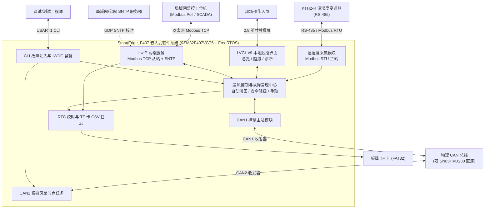
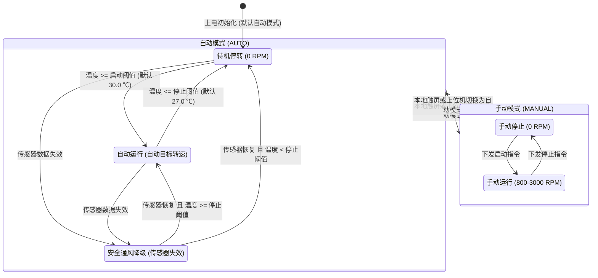

# SmartEdge_F407 软件需求规格说明书（SRS）

## 文档控制信息

| 项目 | 内容 |
| --- | --- |
| **文档编号** | `SE-F407-SRS-001` |
| **文档版本** | `V1.0` |
| **文档状态** | 基线发布（Baseline） |
| **项目名称** | SmartEdge_F407 工业边缘采集网关与本地触控终端 |
| **参考规范** | GB/T 9385-2008《计算机软件需求规格说明规范》、ISO/IEC/IEEE 29148 |
| **关联文档** | [SmartEdge_F407 硬件资源分配表](./SmartEdge_F407_硬件资源分配表.md)（硬件基线）；[SmartEdge_F407 软件架构设计文档（SAD）](./SmartEdge_F407_软件架构设计文档_SAD.md)（架构基线） |
| **编制日期** | 2026-11-25 |

### 修订记录

| 版本 | 日期 | 修订人 | 修订说明 |
| --- | --- | --- | --- |
| `V1.0` | 2026-11-25 | 系统工程组 | 基于原《SmartEdge_F407 项目需求描述》及外设数据手册，按标准 SRS 结构编写完整功能、接口、非功能需求与验收追溯矩阵。 |

---

## 1. 引言

### 1.1 编写目的

本《软件需求规格说明书（SRS）》用于明确 **SmartEdge_F407 工业边缘采集网关与本地触控终端** 嵌入式软件系统的功能边界、外部接口、性能与可靠性指标以及系统验收标准。本文档是后续软件架构设计、详细设计、编码实现、集成联调与验收测试的唯一需求基线。

### 1.2 项目背景与目标

基于 **STM32F407VGT6 微控制器与 FreeRTOS 实时操作系统**，构建一套面向“**工业机柜环境监测与智能通风**”演示场景的边缘采集网关与本地触控终端。系统需具备以下核心能力：

1. **现场感知**：通过 RS-485（Modbus RTU 主站）周期采集工业温湿度变送器数据并判定其有效性。
2. **闭环与可控通风**：支持自动滞回温控、传感器失效安全降级策略以及手动转速调节，并通过单芯片双路物理 CAN 总线（CAN1 控制端 + CAN2 模拟风扇节点）完成闭环控制与故障识别。
3. **本地与远程双通道监控**：提供 2.8 英寸 LVGL v9 本地触控交互界面，同时通过以太网 Modbus TCP 服务向局域网内上位机开放状态监测与参数配置能力。
4. **可信时间与可追溯运维**：联网后经 SNTP 自动校时并依托硬件 RTC 保持掉电走时，按日期写入 TF 卡 CSV 运行日志；提供串口故障模拟指令与独立看门狗（IWDG）自恢复及复位原因追溯能力。
5. **面向演进的扩展预留**：在架构与接口层面预留 IAP/OTA 固件升级能力及低功耗运行接口。

### 1.3 术语、定义与缩略语

| 缩略语 / 术语 | 全称 / 定义 |
| --- | --- |
| **SRS** | Software Requirements Specification，软件需求规格说明书 |
| **RTOS / FreeRTOS** | 实时操作系统，本系统采用 FreeRTOS 进行多任务调度与同步 |
| **Modbus RTU** | 基于 RS-485 串行总线的工业主从二进制通信协议（含 CRC16 校验） |
| **Modbus TCP** | 基于 TCP/IP（以太网，默认端口 `502`）的工业应用层通信协议 |
| **CAN** | Controller Area Network，控制器局域网总线 |
| **RMII** | Reduced Media Independent Interface，精简介质独立接口（以太网 MAC-PHY） |
| **LVGL v9** | Light and Versatile Graphics Library 第 9 代嵌入式图形库 |
| **SNTP** | Simple Network Time Protocol，简单网络时间协议（UDP 端口 `123`） |
| **RTC** | Real-Time Clock，片内硬件实时时钟（由 32.768 kHz LSE 与 VBAT 维持） |
| **IWDG** | Independent Watchdog，片内独立看门狗 |
| **IAP / OTA** | In-Application Programming / Over-The-Air，在应用编程 / 远程固件升级 |
| **滞回控制（Hysteresis）** | 通过设置高于停止阈值的启动阈值形成温度死区，避免临界点附近频繁启停 |
| **CLI** | Command-Line Interface，串口命令行诊断与测试接口 |

### 1.4 需求标识与约束分级约定

1. **需求编号规则**：
   - `FR-<模块>-<序号>`：功能需求（如 `FR-SENS-001`、`FR-CTRL-001`、`FR-CAN-001`、`FR-HMI-001`、`FR-NET-001`、`FR-TIME-001`、`FR-LOG-001`、`FR-DIAG-001`）。
   - `EXT-<方向>-<序号>`：扩展预留需求（如 `EXT-OTA-001`、`EXT-LP-001`）。
   - `IR-<类别>-<序号>`：外部接口需求。
   - `NFR-<类别>-<序号>`：非功能性需求。
   - `AT-<序号>`：系统验收测试用例。
2. **优先级定义**：
   - **P0（核心必选）**：构成系统基本演示与验收闭环的强制需求。
   - **P1（重要必备）**：保障工业可用性、可诊断性与数据完整性的需求。
   - **P2（预留扩展）**：面向后续迭代的接口与资源预留需求。
3. **参数来源与约束分级**：
   - **`[已确认约束]`**：源自原始项目需求或已核对硬件器件手册的硬性规格，实现必须严格满足。
   - **`[基线建议]`**：为确保 SRS 可测试而给出的工程默认指标或协议基线；设计阶段如确需调整，须在《项目设计文档》中记录并同步更新验收基线。

### 1.5 参考资料

1. [SmartEdge_F407 硬件资源分配表](./SmartEdge_F407_硬件资源分配表.md)（`SE-F407-HW-001`）
2. [KTH2-R 温湿度变送器用户使用手册 V1.5](./KTH2-R温湿度变送器/KTH2-RX_UserManual_CN_V1.5.pdf)
3. [STM32F407 数据手册](./立创·梁山派·天空星STM32F407开发板/STM32F407数据手册.pdf) · [STM32F4xx 参考手册](./立创·梁山派·天空星STM32F407开发板/STM32F4xx参考手册.pdf)
4. [ST7789P3 数据手册](./2.8寸触摸屏模块/ST7789P3.pdf) · [XPT2046 数据手册](./2.8寸触摸屏模块/XPT2046.PDF) · [LAN8720A 数据手册](./LAN8720网络模块/LAN8720A.pdf)
5. Modbus Application Protocol Specification V1.1b3 / Modbus Messaging on TCP/IP Implementation Guide V1.0b

---

## 2. 系统概述

### 2.1 产品定位与应用场景

SmartEdge_F407 是一套面向工业机柜热管理场景的嵌入式边缘网关原型，集成了**现场总线采集（RS-485）**、**执行机构总线控制与自闭环仿真（双路 CAN）**、**本地触控 HMI（ST7789 + XPT2046 + LVGL v9）**、**工业以太网上行服务（Modbus TCP + SNTP）** 与 **本地持久化黑匣子日志（TF 卡 CSV + RTC）**。

### 2.2 系统上下文与交互架构



### 2.3 用户角色与特征

| 角色 | 交互通道 | 主要职责与需求 |
| --- | --- | --- |
| **现场操作人员** | 2.8 英寸本地触摸屏 | 查看机柜实时温湿度、风扇转速及告警状态；查阅历史曲线；切换自动/手动模式、调节阈值或手动启停调速；执行触摸校准 |
| **远程上位机 / 运维人员** | 以太网 Modbus TCP | 周期轮询实时温湿度、风扇状态与故障码；远程切换控制模式、修改温控启停阈值及手动目标转速 |
| **开发 / 测试验收人员** | 调试串口（USART1 CLI）及 TF 卡 | 通过串口命令模拟三类 CAN 故障及任务卡死；导出 TF 卡 CSV 日志核查时间戳、故障事件与复位原因 |

### 2.4 运行环境与核心技术约束

| 维度 | 约束规格 | 来源分类 |
| --- | --- | :---: |
| **硬件平台** | 立创天空星 STM32F407VGT6（168 MHz、1 MB Flash、192 KB SRAM），具体外设与引脚严格遵从《硬件资源分配表》 | `[已确认约束]` |
| **操作系统** | FreeRTOS（抢占式多任务调度，SysTick 1 kHz 节拍，HAL 时基使用 TIM6） | `[已确认约束]` |
| **图形框架** | LVGL v9，适配 2.8 英寸 ST7789（240×320，RGB565）+ XPT2046 电阻触摸 | `[已确认约束]` |
| **网络与存储栈** | LwIP（RAW/Netconn/Socket 适配 FreeRTOS）+ FatFs（FAT32，长文件名或 8.3 文件名） | `[基线建议]` |
| **物理双 CAN 约束** | CAN1 与 CAN2 须运行在真实正常模式（Normal Mode），通过两块外部 SN65HVD230 经物理 `CANH`/`CANL` 通信，**禁止**使用芯片内部环回模式（Loopback）替代 | `[已确认约束]` |

### 2.5 假设与外部依赖

1. KTH2-R 温湿度变送器已连接独立 `DC 8–28 V` 电源并与 RS-485 模块共地，出厂通信参数为 `9600 8N1`、站地址 `0x01`。
2. 设备接入的局域网支持以太网 10/100 Mbps 自协商；若需验证 SNTP 自动校时，网络可访问指定局域网或公网 NTP 服务器（断网环境下系统应仍可基于本地 RTC 正常运行）。
3. 验证断电 RTC 走时前，开发板 `B1` 或 `P2-26 (EXT_BAT_PIN+)` 已可靠接入 3 V 备用电池。
4. 用于日志存储的 TF 卡已格式化为 FAT32 文件系统且无物理写保护/坏块。

---

## 3. 功能需求

### 3.1 温湿度采集与有效性判定（SENS）

| 需求编号 | 优先级 | 需求标题 | 详细规格描述 | 约束分类 |
| --- | :---: | --- | --- | :---: |
| **`FR-SENS-001`** | P0 | Modbus RTU 周期采集 | 系统应作为 Modbus RTU 主站，通过 RS-485（USART2 + `PD4` 方向控制）周期读取 KTH2-R 变送器的温湿度保持寄存器（功能码 `0x03`，起始地址 `0x0300`，连续读取 2 个寄存器：`0x0300` 温度、`0x0301` 湿度）。轮询周期基线为 **`1000 ms`**（范围 `500–2000 ms` 可配）。 | `[已确认约束]`（寄存器与协议）<br>`[基线建议]`（周期） |
| **`FR-SENS-002`** | P0 | 数据解析与量程校验 | 系统应按 KTH2-R 协议解析响应帧：温度按 **16 位有符号补码** 解析，分辨率 `0.1 ℃`；湿度按 **16 位无符号数** 解析，分辨率 `0.1 %RH`。应对每帧数据执行校验：1）从站地址与功能码匹配；2）CRC16-Modbus 校验通过；3）物理量程合法（温度 `-40.0 ℃ ~ 85.0 ℃`，湿度 `0.0 %RH ~ 100.0 %RH`）。任一校验失败则丢弃该帧并记为一次采集异常。 | `[已确认约束]` |
| **`FR-SENS-003`** | P0 | 传感器失联故障判定与恢复 | 单次请求响应超时基线为 **`500 ms`**；若连续采集失败（无响应、超时或校验错误）达到 **`3` 次**（约 3 s），系统应判定为“**温湿度传感器通信故障**”，将数据有效性标志置为 `INVALID`；当后续重新收到至少 **`1` 帧** 有效温湿度数据时，自动清除该故障并将数据有效性恢复为 `VALID`。 | `[已确认约束]`（故障识别与恢复）<br>`[基线建议]`（次数/超时值） |
| **`FR-SENS-004`** | P0 | 传感器故障多端上报 | 传感器数据失效时，系统应同步在以下通道反馈故障状态：1）本地触屏总览页与诊断页显示传感器告警，数值区标识失效（如 `--.-` 或告警色标，不误导显示陈旧“正常”值）；2）更新 Modbus TCP 故障状态寄存器与数据有效标志；3）向 TF 卡写入故障发生/恢复事件日志。 | `[已确认约束]` |

---

### 3.2 自动与手动通风控制（CTRL）

#### 控制模式与状态转换关系



| 需求编号 | 优先级 | 需求标题 | 详细规格描述 | 约束分类 |
| --- | :---: | --- | --- | :---: |
| **`FR-CTRL-001`** | P0 | 自动滞回温控策略 | 自动模式下且温湿度数据有效时，系统依据当前温度与滞回阈值控制风扇：1）当 `T ≥ T_start`（默认 **`30.0 ℃`**）时，启动风扇至自动默认目标转速（基线 **`1800 RPM`**，可按需配置或温差映射）；2）当 `T ≤ T_stop`（默认 **`27.0 ℃`**）时，停止风扇；3）当 `T_stop < T < T_start` 时，维持当前启停状态不变，避免临界点频繁启停。 | `[已确认约束]`（30/27 ℃ 滞回）<br>`[基线建议]`（自动转速值） |
| **`FR-CTRL-002`** | P0 | 传感器失效安全通风降级 | 自动模式下，若温湿度传感器数据判定为 `INVALID`（断线或持续无响应），系统应自动切入**安全通风降级策略**：维持风扇以安全转速持续运转（基线 **`1500 RPM`**，在 `800–3000 RPM` 合法区间内），防止机柜在盲测状态下过温；同时在界面与上位机明确指示“安全降级通风”。传感器数据恢复有效后，自动退出降级并恢复正常滞回判断。 | `[已确认约束]`（安全通风降级）<br>`[基线建议]`（降级转速值） |
| **`FR-CTRL-003`** | P0 | 手动启停与目标转速控制 | 手动模式下，屏蔽自动温控决策，操作人员可通过本地触屏或上位机直接控制风扇启停，并在 **`800–3000 RPM`** 范围内设置目标转速（调节步进基线 `100 RPM` 或任意整数值）。设定值超出 `800–3000 RPM` 时系统应拒绝执行并维持原有效值。 | `[已确认约束]` |
| **`FR-CTRL-004`** | P0 | 启停阈值可配置与合法性校验 | 系统应支持通过本地触屏及上位机修改自动启动阈值 `T_start` 与停止阈值 `T_stop`。写入前须强制校验合法性：1）单值在允许设定区间内（基线 `0.0 ℃ ~ 70.0 ℃`）；2）必须满足 `T_start - T_stop ≥ 1.0 ℃`（防止回差过小或倒挂导致振荡）。非法配置须拦截并反馈错误。 | `[已确认约束]`（可配置与防抖）<br>`[基线建议]`（上下限与最小死区） |
| **`FR-CTRL-005`** | P1 | 控制参数同步与持久化 | 无论通过本地触屏还是 Modbus TCP 上位机修改模式、阈值或目标转速，均统一写入核心状态中心（Single Source of Truth），确保多端显示即时一致（采用“最后写入有效”原则）。温控阈值等配置参数修改后应写入内部 Flash 独立配置扇区（`Sector 11`，含 CRC32 校验）实现掉电保存。 | `[基线建议]` |

---

### 3.3 CAN 风扇控制、模拟节点与故障识别（CAN）

| 需求编号 | 优先级 | 需求标题 | 详细规格描述 | 约束分类 |
| --- | :---: | --- | --- | :---: |
| **`FR-CAN-001`** | P0 | 双通道物理 CAN 闭环通信 | 同一颗 STM32F407 上的 **CAN1** 运行“网关控制主站”逻辑，**CAN2** 运行“模拟风扇节点”逻辑，两路外设分别通过外部 SN65HVD230 收发器接入同一条物理 CAN 总线进行真实帧收发。 | `[已确认约束]` |
| **`FR-CAN-002`** | P0 | CAN1 指令下发与反馈采集 | CAN1 应在风扇目标状态/转速变更时立即下发控制命令帧（含命令序号、启停标志、目标转速），并在运行期间按周期（基线 `500 ms`）或按命令同步下发保活/查询指令；CAN1 接收并解析 CAN2 上报的命令执行应答帧、当前模拟转速与状态帧、节点周期心跳帧。 | `[已确认约束]`（功能）<br>`[基线建议]`（周期） |
| **`FR-CAN-003`** | P0 | CAN2 模拟风扇节点行为 | CAN2 作为独立 FreeRTOS 任务运行，模拟真实智能风扇执行器：1）接收 CAN1 控制命令后回复命令执行结果（ACK）；2）正常状态下按平滑斜坡（如 `±400 RPM / 200 ms`）逼近目标转速（停机时降至 `0 RPM`）并周期上报状态帧（基线 `200 ms`）与心跳帧（基线 `500 ms`）；3）受故障注入模块控制，可按需模拟堵转、丢弃命令应答或静默停止心跳。 | `[已确认约束]`（模拟反馈与故障注入）<br>`[基线建议]`（斜坡与上报周期） |
| **`FR-CAN-004`** | P0 | 三类 CAN 故障精准识别 | CAN1 网关控制端应能独立识别并区分以下三类故障，以独立故障标志位管理：1）**风扇堵转（Stall）**：节点上报堵转标志，或处于运行态超过 `1500 ms` 但反馈转速低于 `200 RPM`；2）**命令超时（Cmd Timeout）**：CAN1 下发控制命令后超过基线 **`500 ms`** 未收到匹配序号的应答帧（可重试 1 次后置位故障）；3）**节点失联（Node Offline）**：超过基线 **`1500 ms`**（3 个心跳周期）未收到 CAN2 心跳帧。 | `[已确认约束]`（三类故障识别与区分）<br>`[基线建议]`（超时阈值） |
| **`FR-CAN-005`** | P0 | 故障上报与自动清除恢复 | 任一 CAN 故障触发或清除时，系统应立即更新全局故障位掩码，同步刷新本地触屏（明确区分三类故障名称）、Modbus TCP 故障寄存器，并写入 TF 卡事件日志。当外部故障条件解除（恢复正常心跳、命令正常应答或堵转解除后转速恢复正常）时，对应故障位应自动清除并更新界面状态。 | `[已确认约束]` |

---

### 3.4 本地触控人机交互界面（HMI）

| 需求编号 | 优先级 | 需求标题 | 详细规格描述 | 约束分类 |
| --- | :---: | --- | --- | :---: |
| **`FR-HMI-001`** | P0 | 三页面 LVGL v9 触控架构 | 基于 2.8 英寸 ST7789（横屏 320×240）+ XPT2046 + LVGL v9，提供底部或顶部导航切换的三个核心功能页：**运行总览页（`Overview`）**、**历史趋势页（`Trend`）**、**系统诊断页（`Diag`）**。界面统一使用**纯英文**与 LVGL 内置字体（不引入外部/中文字库），显示清晰无乱码、无元素重叠。 | `[已确认约束]` |
| **`FR-HMI-002`** | P0 | 运行总览页功能 | 实时展示：1）当前温度（`℃`）、湿度（`%RH`）及传感器有效/故障状态；2）风扇当前模式（自动/手动）、运行状态（运行/停止/降级/故障）、目标转速与实测（模拟）转速（`RPM`）；3）RS-485、CAN、以太网、TF 卡简要通信/在线指示；4）当前活动告警摘要（可区分传感器断线及三类 CAN 故障）。提供触控控件用于：切换自动/手动模式、手动模式下启停风扇及增减/滑动调节目标转速（`800–3000 RPM`）。 | `[已确认约束]` |
| **`FR-HMI-003`** | P0 | 历史趋势页功能 | 采用 LVGL 图表控件展示近期温湿度与风扇转速变化曲线（基线缓存最近 `60–120` 个采样点，按固定间隔如 `5 s` 或 `10 s` 采样滚动更新），清晰标注曲线图例与纵轴量程，支持在温湿度趋势与风扇转速趋势间同屏或切换查看。 | `[已确认约束]`（趋势展示）<br>`[基线建议]`（采样点数与间隔） |
| **`FR-HMI-004`** | P0 | 系统诊断与设置页功能 | 展示并支持操作：1）各通信模块详细状态（RS-485 收发/错误计数、CAN1/CAN2 故障类型细分、以太网 IP 与连接状态、SNTP 校时状态、RTC 当前时间、TF 卡挂载/写日志状态）；2）**上次系统复位原因**（如上电复位、看门狗复位、按键复位、软复位）；3）温控启动/停止阈值设置控件（带即时合法性校验）；4）背光亮度调节滑块（联动 `TIM12_CH1` PWM）；5）**触摸屏校准**入口按钮。 | `[已确认约束]` |
| **`FR-HMI-005`** | P0 | 电阻屏触摸校准 | 提供交互式 4 点（屏幕四角靶点）触摸校准向导：依次采集 4 处原始 ADC 坐标，计算仿射/线性映射参数，校验映射合理性后即时生效，并将校准参数持久化保存至内部 Flash 独立配置扇区（`Sector 11`）；未校准或参数损坏时使用默认出厂参数兜底并允许重新校准。 | `[已确认约束]`（触摸校准）<br>`[基线建议]`（4 点算法与存储） |
| **`FR-HMI-006`** | P1 | 界面防卡顿与低延迟刷新 | 本地界面刷新任务与通信/TF 写入任务解耦，SPI2 使用 DMA 异步刷屏；触控操作响应及时，数据状态刷新周期基线 `200–500 ms`，不因 RS-485 超时或 TF 卡慢写导致屏幕假死。 | `[基线建议]` |

---

### 3.5 上位机以太网接入（NET）

| 需求编号 | 优先级 | 需求标题 | 详细规格描述 | 约束分类 |
| --- | :---: | --- | --- | :---: |
| **`FR-NET-001`** | P0 | 以太网链路初始化与热插拔监测 | 通过 LAN8720 RMII + LwIP 建立以太网接入。支持静态 IP（如基线默认 `192.168.1.100/24`，网关 `192.168.1.1`）或 DHCP 自动获取（可编译/配置切换）；周期检测 PHY 链路状态（Link Up/Down），网线拔出后平滑释放异常连接，重新插回后自动恢复网络服务。 | `[已确认约束]`（以太网接入）<br>`[基线建议]`（默认 IP 与热插拔） |
| **`FR-NET-002`** | P0 | Modbus TCP 从站服务 | 设备在局域网内监听标准 Modbus TCP 端口（默认 **`502`**），支持多主机/重连接入（基线至少支持 `2` 个并发 TCP 客户端连接，空闲超时自动回收连接），支持标准功能码：`0x03`（读保持寄存器）、`0x04`（读输入寄存器）、`0x06`（写单个保持寄存器）、`0x10`（写多个保持寄存器）。 | `[已确认约束]`（Modbus TCP 服务）<br>`[基线建议]`（端口、并发与功能码集） |
| **`FR-NET-003`** | P0 | 上位机只读状态遥测 | 上位机可通过 Modbus TCP 读取系统实时状态：温度（`0.1 ℃`，有符号）、湿度（`0.1 %RH`）、传感器有效标志、当前控制模式、风扇运行状态、目标转速、反馈转速、细分故障位掩码（传感器断线 / CAN 堵转 / CAN 命令超时 / CAN 节点失联 / TF 卡异常）、最近复位原因、系统运行秒数与 RTC 时间戳。 | `[已确认约束]` |
| **`FR-NET-004`** | P0 | 上位机远程参数与控制写入 | 上位机可通过 Modbus TCP 写保持寄存器修改：控制模式（自动/手动）、手动启停命令、手动目标转速（`800–3000 RPM`）、自动启动阈值与自动停止阈值。写入执行与本地触屏完全一致的合法性校验；若地址非法返回 Modbus 异常码 `0x02`，数值越界或阈值冲突返回异常码 `0x03`。 | `[已确认约束]`（远程修改）<br>`[基线建议]`（异常码规范） |

---

### 3.6 校时与日志存储（TIME / LOG）

| 需求编号 | 优先级 | 需求标题 | 详细规格描述 | 约束分类 |
| --- | :---: | --- | --- | :---: |
| **`FR-TIME-001`** | P0 | SNTP 联网自动校时 | 以太网链路就绪并获得有效 IP 后，系统通过 LwIP SNTP 客户端自动向预设 NTP/SNTP 服务器（支持局域网自定义服务器 IP 及公网池如 `ntp.aliyun.com`）发起校时请求，将获取的 UTC 时间加本地时区偏移（默认 `UTC+8`）写入硬件 RTC；此后按周期（基线每 `6 小时`）重校，并支持 CLI 或诊断页手动触发校时。 | `[已确认约束]`（SNTP 自动校时）<br>`[基线建议]`（重校周期与时区） |
| **`FR-TIME-002`** | P0 | 硬件 RTC 断电走时保持 | 硬件 RTC 固定采用外部 32.768 kHz LSE 驱动，由备用电池维持断电走时。设备上电启动时检查 `RTC_BKP_DR0` 初始化魔数：若已初始化则**禁止重置日期与时间**，直接延续走时；仅在首次上电或备用电池完全掉电时初始化默认基准时间并标记“未校时”。 | `[已确认约束]` |
| **`FR-LOG-001`** | P0 | TF 卡挂载与异常隔离 | 上电及运行期通过 `PD3` 检测 TF 卡插拔并挂载 FatFs 文件系统。若未插卡、挂载失败或写入报错，系统应记录“TF 卡异常”状态并在诊断页与上位机提示，但**严禁阻塞或影响**温湿度采集、风扇控制、本地触屏与网络通信。 | `[已确认约束]`（TF 卡存储）<br>`[基线建议]`（解耦隔离） |
| **`FR-LOG-002`** | P0 | 按日期分文件 CSV 日志记录 | 运行日志按 RTC 日期自动创建/追加写入 TF 卡 `/logs/YYYYMMDD.csv`（或根目录 `YYYYMMDD.csv`），新文件自动写入首行 CSV 表头。记录字段至少包含：**时间戳、温度、湿度、数据有效标志、控制模式、风扇状态、目标转速、实测转速、故障码/故障事件、复位原因**。 | `[已确认约束]` |
| **`FR-LOG-003`** | P0 | 周期记录与关键事件即时落盘 | 支持两类日志触发机制：1）**周期记录**（基线每 `10 s` 写入一条常规运行快照）；2）**事件触发记录**（系统启动上电记录复位原因、模式切换、故障触发/恢复时即时入队写入）。所有文件操作由独立日志任务经队列异步执行，每次写入完成后调用 `f_sync()` 防止异常掉电丢失数据。 | `[已确认约束]`（记录要素）<br>`[基线建议]`（周期与同步策略） |

---

### 3.7 故障演示与自动恢复（DIAG）

| 需求编号 | 优先级 | 需求标题 | 详细规格描述 | 约束分类 |
| --- | :---: | --- | --- | :---: |
| **`FR-DIAG-001`** | P0 | 串口 CLI 三类 CAN 故障模拟 | 通过调试串口（USART1）命令行支持人工触发与清除三类 CAN 模拟故障，用于验收演示：1）模拟风扇堵转（强制 CAN2 上报堵转/0 RPM）；2）模拟命令超时（令 CAN2 丢弃控制命令应答）；3）模拟节点失联（令 CAN2 停止发送心跳与状态帧）；4）一键清除全部模拟故障，验证系统自动恢复。 | `[已确认约束]` |
| **`FR-DIAG-002`** | P0 | 串口 CLI 任务卡死注入 | 调试串口应提供受控测试命令（如 `fault hang <task>`），人为令指定关键任务进入死循环或永久阻塞，以便在不改动代码的情况下演示并验收看门狗约 4 秒自动复位与复位原因上报功能。 | `[已确认约束]` |
| **`FR-DIAG-003`** | P0 | 独立看门狗（IWDG）关键任务监督 | 启用片内 IWDG（超时约 **`4.0 s`**）。采用“**多任务心跳监督聚合机制**”：所有关键业务任务（温湿度采集、通风控制、CAN 主站、本地 HMI、网络服务）须在各自周期内上报任务存活标志；仅当全部受监关键任务均按期活跃时，监督任务才执行喂狗。任一关键任务卡死时停止喂狗，触发硬件在约 `4 s` 后自动复位。 | `[已确认约束]`（IWDG 监控与 ~4 s 复位）<br>`[基线建议]`（心跳聚合机制） |
| **`FR-DIAG-004`** | P0 | 复位原因捕获与多端可追溯 | 系统启动进入 `main()` 最早期即读取 `RCC->CSR` 硬件复位标志位，解析具体复位类型（`IWDG` 看门狗复位、`WWDG`、`NRST` 外部按键复位、`POR/PDR` 上电掉电复位、`BOR` 欠压复位、`SFTRST` 软件复位）并清除硬件标志；同时保存至内存与 `RTC_BKP_DR1`。复位原因须在重启后通过**串口启动信息**、**触屏系统诊断页**、**Modbus TCP 寄存器**及 **TF 卡启动日志** 四个通道清晰呈现。 | `[已确认约束]` |

---

### 3.8 扩展能力预留（EXT）

| 需求编号 | 优先级 | 需求标题 | 详细规格描述 | 约束分类 |
| --- | :---: | --- | --- | :---: |
| **`EXT-OTA-001`** | P2 | IAP/OTA Flash 分区与向量表预留 | 固件工程分区宏与片内存储管理须遵循《硬件资源分配表》第 2.2 节 Flash 分区规划（预留 Bootloader `48 KB`、App 槽 `384 KB`、OTA 下载槽 `384 KB` 与独立配置区 `Sector 11` `128 KB`），本阶段单工程直烧 `0x0800_0000` 并预留 `SCB->VTOR` 重定位宏。 | `[已确认约束]`（预留分区）<br>`[基线建议]`（具体分区尺寸） |
| **`EXT-OTA-002`** | P2 | 升级入口与安全切换钩子预留 | 软件预留统一的升级触发入口（串口 CLI 命令与 Modbus TCP 预留功能寄存器），以及升级前钩子函数 `App_OtaRequestUpgrade()`（停止风扇至安全态、同步关闭 TF 卡文件、写入 `RTC_BKP_DR2` 升级请求标志并触发软复位）。 | `[已确认约束]` |
| **`EXT-LP-001`** | P2 | 外设挂起与恢复生命周期接口预留 | 各硬件驱动及核心服务模块（LCD/背光、ETH、CAN、RS-485、SDIO）须预留统一的 `Suspend()` 与 `Resume()` 电源管理抽象接口，支持有序停止 DMA、关闭外设时钟/背光及恢复初始化。 | `[已确认约束]` |
| **`EXT-LP-002`** | P2 | 低功耗唤醒源预留 | 软件硬件配置层保留 `PA0 (SYS_WKUP)` 外部按键唤醒与 `RTC WakeUp/Alarm` 定时唤醒初始化接口桩，为后续引入 FreeRTOS Tickless Idle 或 STM32 Stop/Standby 低功耗模式提供无缝接入点。 | `[已确认约束]` |

---

## 4. 外部接口需求

### 4.1 硬件接口需求（`IR-HW-001`）

本系统全部 MCU 外设、时钟、DMA、中断、引脚映射与物理接线约束均以 [SmartEdge_F407 硬件资源分配表](./SmartEdge_F407_硬件资源分配表.md)（`SE-F407-HW-001`）为准，软件配置（CubeMX `.ioc` 及 HAL 初始化代码）必须与该表完全一致，不得擅自更改引脚分配。

### 4.2 RS-485 / Modbus RTU 主站接口（`IR-COMM-001`）

- **物理与链路层（`[已确认约束]`）**：USART2（`PD5`/`PD6`）+ 方向控制 `PD4`（低收高发），默认 `9600 bps, 8 数据位, 无校验, 1 停止位 (9600-8-N-1)`，默认从站地址 `0x01`。
- **KTH2-R 寄存器读取规格（`[已确认约束]`，据手册 V1.5）**：

| 寄存器地址（Hex） | 组态地址 | 寄存器数 | 物理含义 | 数据类型与换算规则 |
| :---: | :---: | :---: | --- | --- |
| `0x0300` | `40769` | 1 | 环境温度 | `int16_t`（二进制补码），实际温度 = `raw × 0.1 ℃` |
| `0x0301` | `40770` | 1 | 环境湿度 | `uint16_t`，实际湿度 = `raw × 0.1 %RH` |

- **标准联读请求帧示例**：`01 03 03 00 00 02 C4 4F`
- **正常应答帧示例**：`01 03 04 01 02 02 88 5B 09`（解析：`0x0102 = 258 → 25.8 ℃`；`0x0288 = 648 → 64.8 %RH`）

### 4.3 CAN 总线协议基线（`IR-COMM-002`）

- **物理层基线（`[基线建议]`）**：标准帧（11-bit Standard ID），速率 `500 kbps`，数据长度 `8 字节`。最终字节级编码在《项目设计文档》中冻结，SRS 定义以下基线帧族：

| 帧名称 | 方向 | 基线 StdID | 发送方式 | 核心载荷字段 |
| --- | :---: | :---: | --- | --- |
| **风扇控制命令帧** | CAN1 → CAN2 | `0x101` | 状态变更即发 + 周期保活 | 命令序号 `seq`、启停命令（0/1）、目标转速（`uint16` RPM）、保留 |
| **命令执行应答帧** | CAN2 → CAN1 | `0x201` | 收到命令后立即回复 | 回显命令序号 `seq`、执行结果码（OK/ERR/STALL）、当前状态 |
| **风扇运行状态帧** | CAN2 → CAN1 | `0x202` | 周期 `200 ms` 上报 | 当前模拟转速（`uint16` RPM）、运行状态、节点内部故障标志（含堵转位） |
| **风扇节点心跳帧** | CAN2 → CAN1 | `0x701` | 周期 `500 ms` 上报 | 节点状态码、递增存活计数 `alive_cnt`、运行秒数低 16 位 |

### 4.4 以太网 Modbus TCP 寄存器映射基线（`IR-COMM-003`）

- **传输层（`[基线建议]`）**：TCP 监听端口 `502`，Unit ID 默认 `1`（或忽略校验以兼容各类 Modbus 调试工具）。
- **寄存器地址规划基线（`[基线建议]`，读写业务要素为 `[已确认约束]`）**：

#### 只读状态区（支持功能码 `0x04` 输入寄存器，亦建议镜像支持 `0x03` 便于上位机统一轮询）

| 基线地址 | 名称 | 数据格式 | 单位 / 编码说明 |
| :---: | --- | --- | --- |
| `0x0000` | 实时温度 | `int16_t` | `0.1 ℃`（如 `258` 表示 `25.8 ℃`） |
| `0x0001` | 实时湿度 | `uint16_t` | `0.1 %RH`（如 `648` 表示 `64.8 %RH`） |
| `0x0002` | 传感器与系统状态标志 | `uint16_t` 位图 | bit0=传感器数据有效、bit1=自动降级运行、bit2=SNTP 已校时、bit3=TF 卡已挂载 |
| `0x0003` | 当前风扇运行状态 | `uint16_t` | `0`=停止、`1`=自动运行、`2`=手动运行、`3`=安全降级运行、`4`=故障停机/告警 |
| `0x0004` | 当前风扇目标转速 | `uint16_t` | `RPM`（`0` 或 `800–3000`） |
| `0x0005` | 当前风扇反馈转速 | `uint16_t` | `RPM`（CAN2 模拟实测值） |
| `0x0006` | 综合故障位掩码 | `uint16_t` 位图 | bit0=传感器断线/失效、bit1=CAN 风扇堵转、bit2=CAN 命令超时、bit3=CAN 节点失联、bit4=TF 卡写入异常 |
| `0x0007` | 最近系统复位原因 | `uint16_t` 枚举 | `0`=未知、`1`=POR/BOR、`2`=NRST、`3`=IWDG、`4`=WWDG、`5`=SFTRST |
| `0x0008`–`0x0009` | 系统运行时间（Uptime） | `uint32_t`（高字在前） | 秒（s） |
| `0x000A`–`0x000B` | 当前 RTC Unix 时间戳 | `uint32_t`（高字在前） | 秒（UTC 或本地时间戳，设计文档明确） |

#### 读写控制与参数区（支持功能码 `0x03`、`0x06`、`0x10` 保持寄存器）

| 基线地址 | 名称 | 数据格式 | 允许写入范围与校验规则 |
| :---: | --- | --- | --- |
| `0x0100` | 控制模式 | `uint16_t` | `0`=自动模式（默认）、`1`=手动模式；其他值返回异常 `0x03` |
| `0x0101` | 手动风扇启停 | `uint16_t` | `0`=停止、`1`=启动（仅手动模式生效，自动模式写入可拒绝或仅缓存，设计文档明确） |
| `0x0102` | 手动目标转速 | `uint16_t` | **`800–3000`** RPM；越界返回异常 `0x03` |
| `0x0103` | 自动启动温度阈值 `T_start` | `int16_t` | `0.1 ℃`，默认 `300`（`30.0 ℃`），须满足 `T_start - T_stop ≥ 10`（`1.0 ℃`） |
| `0x0104` | 自动停止温度阈值 `T_stop` | `int16_t` | `0.1 ℃`，默认 `270`（`27.0 ℃`），须满足 `T_start - T_stop ≥ 10`（`1.0 ℃`） |
| `0x0105` | 屏幕背光亮度（可选） | `uint16_t` | `10–100`（% 占空比） |
| `0x01F0` | OTA 升级预留控制字 | `uint16_t` | 预留扩展，本阶段写入特定魔数仅作接口验证或返回未启用 |

### 4.5 调试串口 CLI 命令接口基线（`IR-COMM-004`）

- **串口参数（`[基线建议]`）**：USART1，`115200 bps, 8N1`，以 `\r\n` 或 `\n` 结尾。
- **基线命令集**：

| 命令示例 | 功能说明 | 关联需求 |
| --- | --- | --- |
| `help` | 输出所有支持的调试与故障演示命令列表 | `FR-DIAG-001` |
| `status` | 打印当前温湿度、模式、阈值、风扇目标/实测转速、故障位、IP、RTC 时间及上次复位原因 | `FR-DIAG-004` |
| `fault stall on\|off` | 触发 / 清除 CAN2 风扇堵转模拟故障 | `FR-DIAG-001` |
| `fault timeout on\|off` | 触发 / 清除 CAN2 命令应答超时模拟故障 | `FR-DIAG-001` |
| `fault offline on\|off` | 触发 / 清除 CAN2 节点失联（停止心跳）模拟故障 | `FR-DIAG-001` |
| `fault clear` | 一键清除全部已注入的模拟故障 | `FR-DIAG-001` |
| `wdt hang <task>` | 模拟指定关键任务卡死，用于验证约 4 s 看门狗自动复位 | `FR-DIAG-002` |
| `sntp sync` | 手动立即触发一次 SNTP 网络校时 | `FR-TIME-001` |
| `ota enter` | 预留升级入口测试命令（记录标志并校验安全停机流程） | `EXT-OTA-002` |

### 4.6 TF 卡 CSV 日志文件接口（`IR-FILE-001`）

- **目录与命名（`[基线建议]`）**：`/logs/YYYYMMDD.csv`（采用 RTC 当前本地日期；未校时状态下以默认日期写入）。
- **编码与分隔符**：UTF-8（无 BOM）或纯 ASCII，英文逗号 `,` 分隔，行尾 `\r\n`。
- **表头与记录示例**：

```csv
timestamp,temp_c,humi_rh,sensor_valid,mode,fan_state,target_rpm,actual_rpm,fault_mask,event,reset_reason
2026-11-25 14:30:00,26.4,52.1,1,AUTO,STOP,0,0,0x0000,BOOT,POR
2026-11-25 14:30:10,30.2,51.8,1,AUTO,RUN,1800,1790,0x0000,PERIODIC,NONE
2026-11-25 14:31:05,30.3,51.7,1,AUTO,FAULT,1800,0,0x0002,FAULT_CAN_STALL_SET,NONE
2026-11-25 14:35:12,28.1,53.0,1,AUTO,STOP,0,0,0x0000,BOOT,IWDG
```

---

## 5. 非功能性需求

### 5.1 实时性与性能指标（`NFR-PERF`）

| 需求编号 | 指标项 | 目标要求 | 约束分类 |
| --- | --- | --- | :---: |
| **`NFR-PERF-001`** | 温湿度采集更新延迟 | 正常链路下，从传感器环境变化到触屏及上位机可见的端到端延迟 `≤ 2.0 s`（采集周期基线 1 s） | `[基线建议]` |
| **`NFR-PERF-002`** | 自动/手动控制响应时间 | 温度越限或人工操作后，CAN1 下发控制指令并在本地更新目标状态的时间 `≤ 300 ms` | `[基线建议]` |
| **`NFR-PERF-003`** | 故障检测响应时间 | 传感器断线 `≤ 3.5 s` 检出；CAN 命令超时 `≤ 1.0 s` 检出；CAN 节点失联 `≤ 2.0 s` 检出；CAN 堵转 `≤ 2.0 s` 检出 | `[基线建议]` |
| **`NFR-PERF-004`** | Modbus TCP 响应时延 | 局域网单次读写请求平均响应时间 `≤ 50 ms`，最大不超过 `200 ms` | `[基线建议]` |
| **`NFR-PERF-005`** | 触控交互响应 | 触摸点击至界面视觉反馈延迟 `≤ 150 ms`，页面切换流畅无明显撕裂或卡死 | `[基线建议]` |

### 5.2 可靠性、容错与可恢复性（`NFR-REL`）

| 需求编号 | 要求项 | 详细规格描述 | 约束分类 |
| --- | --- | --- | :---: |
| **`NFR-REL-001`** | 看门狗自动恢复 | 任一关键业务任务陷入死循环或死锁后，系统须在约 **`4 s`** 内（允许 LSI 偏差区间 `3.0–5.5 s`）由 IWDG 强制硬件复位，并在重启后正常恢复全部服务且上报 `IWDG` 复位原因。 | `[已确认约束]` |
| **`NFR-REL-002`** | 故障域隔离（降级运行） | 传感器断线、以太网网线拔出、SNTP 不可达、TF 卡未插/写失败等单一外部异常均不得导致系统崩溃、任务死锁或核心控制停摆。 | `[已确认约束]` |
| **`NFR-REL-003`** | 并发数据一致性 | 跨任务共享的系统数据中心（温湿度、控制参数、风扇反馈、故障状态）必须通过 FreeRTOS 互斥锁（Mutex）或原子快照读写保护，防止数据撕裂与优先级反转。 | `[基线建议]` |
| **`NFR-REL-004`** | 连续运行稳定性 | 系统在全外设（RS-485、双 CAN、LVGL、Modbus TCP、TF 日志）同时工作的满载场景下，应能连续稳定运行 `≥ 24 小时` 无内存泄漏、无任务栈溢出、无非预期复位。 | `[基线建议]` |

### 5.3 安全性与输入校验（`NFR-SEC`）

| 需求编号 | 要求项 | 详细规格描述 | 约束分类 |
| --- | --- | --- | :---: |
| **`NFR-SEC-001`** | 参数与协议边界校验 | 所有来自 Modbus TCP、本地触屏与串口 CLI 的输入参数均须执行类型、范围与业务约束检查（如转速 `800–3000 RPM`、`T_start > T_stop`），异常帧静默丢弃或返回规范异常码，严禁缓冲区越界。 | `[已确认约束]` |
| **`NFR-SEC-002`** | 失控保护（Fail-Safe） | 传感器数据失效时自动进入安全通风状态；配置 Flash 校验失败时自动回退至安全的出厂默认参数（自动模式、`30.0 ℃ / 27.0 ℃`）并记录告警。 | `[已确认约束]` |

### 5.4 资源占用与硬件合规约束（`NFR-RES`）

| 需求编号 | 要求项 | 详细规格描述 | 约束分类 |
| --- | --- | --- | :---: |
| **`NFR-RES-001`** | 存储空间裕量 | App 固件镜像体积须控制在预留槽位内（`≤ 384 KB`，建议留有 `≥ 20%` 裕量）；FreeRTOS 动态堆与各任务栈须开启栈溢出钩子（`configCHECK_FOR_STACK_OVERFLOW = 2`）且最低剩余栈水位 `≥ 20%`。 | `[基线建议]` |
| **`NFR-RES-002`** | DMA 内存区合规 | 所有 SPI2、USART1/2、SDIO、ETH 的 DMA 缓冲区与描述符必须位于主 SRAM1/SRAM2，严禁误置于 CCMRAM。 | `[已确认约束]` |

### 5.5 可维护性与可扩展性（`NFR-MNT`）

- 软件应采用**硬件抽象层（BSP/Driver）— 协议与中间件层 — 业务应用层 — 交互展示层（HMI/NET/CLI）** 分层解耦设计，避免 UI 代码直接操作外设寄存器或业务控制逻辑与具体通信协议强耦合。
- 关键模块（IAP/OTA 与低功耗管理）应按第 3.8 节提供清晰接口定义与桩函数，确保后续迭代可增量接入。

---

## 6. 验收标准与需求追溯矩阵

### 6.1 系统验收测试用例表

下表将项目验收重点转化为可执行的验收准则，全部 `P0` 验收项通过方可视为本阶段验收合格：

| 验收编号 | 验收类别 | 测试场景与操作步骤 | 预期验收结果 | 追溯需求 ID |
| :---: | --- | --- | --- | --- |
| **`AT-01`** | 温控联动 | 1. 保持自动模式（默认 `30 ℃ / 27 ℃`），对 KTH2-R 变送器缓慢升温至 `≥ 30.0 ℃`；<br>2. 降温至 `28.5 ℃`（死区内）观察；<br>3. 继续降温至 `≤ 27.0 ℃`。 | 1. 触屏温湿度随环境实时变化；温度达到 `30.0 ℃` 后模拟风扇启动并有转速反馈；<br>2. `28.5 ℃` 时风扇保持运行不抖动停机；<br>3. 降至 `27.0 ℃` 后风扇停止，转速归零。 | `FR-SENS-001`, `FR-SENS-002`, `FR-CTRL-001`, `FR-CAN-001`~`003`, `FR-HMI-002` |
| **`AT-02`** | 手动控制与阈值修改 | 1. 在触屏修改自动启停阈值（含测试非法阈值如 `T_start ≤ T_stop`）；<br>2. 切换至手动模式，下发启动指令并依次设定 `800`、`2000`、`3000 RPM`（及越界值测试），再执行停机。 | 1. 合法阈值生效且掉电保持，非法阈值被拦截；<br>2. 手动启停立即响应，模拟转速平滑跟踪至目标值，越界转速被拒绝。 | `FR-CTRL-003`~`005`, `FR-CAN-002`, `FR-CAN-003`, `FR-HMI-002`, `FR-HMI-004` |
| **`AT-03`** | 传感器异常处理 | 自动模式下断开 KTH2-R 电源或 RS-485 A/B 线，观察至少 5 s；随后恢复接线。 | 1. 约 3 s 内判定传感器故障，触屏与上位机同步报传感器告警；<br>2. 自动模式触发安全通风降级策略（风扇维持安全转速运行）；<br>3. 恢复接线后自动清除告警并回归正常温控。 | `FR-SENS-003`, `FR-SENS-004`, `FR-CTRL-002`, `FR-LOG-003` |
| **`AT-04`** | 三类 CAN 故障模拟与恢复 | 通过调试串口 CLI 依次触发并随后清除：1）风扇堵转；2）命令超时；3）节点失联。 | 1. 触屏总览/诊断页与上位机故障寄存器能**准确区分三种故障类型**；<br>2. 日志记录对应故障发生事件；<br>3. 清除模拟故障后，界面、上位机状态及转速反馈均自动恢复正常。 | `FR-CAN-004`, `FR-CAN-005`, `FR-DIAG-001`, `FR-HMI-002`, `FR-HMI-004`, `FR-LOG-003` |
| **`AT-05`** | 本地触控与校准 | 遍历运行总览、历史趋势、系统诊断三页；在诊断页进入触摸校准流程并完成 4 点点击。 | 三页切换流畅无卡顿，趋势曲线随数据更新；校准完成后触控落点准确，重启后校准参数保持有效。 | `FR-HMI-001`~`006` |
| **`AT-06`** | 上位机 Modbus TCP 读写 | PC 使用 Modbus Poll / 上位机经局域网连接设备端口 `502`：读取温湿度、风扇状态、故障位；写入控制模式、阈值及手动转速（含非法值测试）。 | 读数与触屏完全一致；合法写入即时在本地触屏与风扇控制生效；越界写入返回 Modbus 异常码 `0x03`。 | `FR-NET-001`~`004`, `NFR-PERF-004`, `NFR-SEC-001` |
| **`AT-07`** | SNTP 校时与 RTC 断电走时 | 1. 接入局域网完成 SNTP 自动校时，核对 RTC 时间；<br>2. 断开主供电电源静置 `≥ 2 分钟` 后重新上电。 | 1. 联网后 RTC 自动更新为准确当前时间；<br>2. 断电重启后（在未连网前提下）RTC 时间连续走时无回退归零。 | `FR-TIME-001`, `FR-TIME-002` |
| **`AT-08`** | TF 卡 CSV 日志与拔卡容错 | 1. 正常运行并触发若干状态切换与故障事件后，取出 TF 卡在 PC 读取 CSV 文件；<br>2. 拔卡状态下继续运行系统。 | 1. 存在按日期命名的 CSV 文件，包含完整时间戳、温湿度、风扇状态、故障事件与复位原因；<br>2. 拔卡不导致死机，采集、控制、触屏和网口仍正常工作。 | `FR-LOG-001`~`003`, `NFR-REL-002` |
| **`AT-09`** | 看门狗复位与原因追溯 | 通过调试串口 CLI 注入关键任务卡死命令，计时观察设备行为，待重启后检查串口输出、诊断页、Modbus 寄存器与 TF 日志。 | 设备在约 **4 秒**后自动硬件复位重启并恢复正常业务；重启后四处通道均清晰报告 `IWDG` 复位原因。 | `FR-DIAG-002`~`004`, `NFR-REL-001` |
| **`AT-10`** | 扩展预留审查（代码/架构评审） | 审查链接脚本、向量表偏移配置、OTA 升级入口及外设 `Suspend`/`Resume` 电源管理接口。 | Flash 分区与《硬件资源分配表》一致；升级入口与低功耗挂起/恢复/唤醒接口定义清晰、可编译。 | `EXT-OTA-001`, `EXT-OTA-002`, `EXT-LP-001`, `EXT-LP-002` |

### 6.2 原始需求覆盖核对矩阵

| 原需求文档模块 | 对应 SRS 需求 ID | 验收用例 | 覆盖状态 |
| --- | --- | --- | :---: |
| 温湿度采集 | `FR-SENS-001` ~ `FR-SENS-004`、`IR-COMM-001` | `AT-01`, `AT-03` | 完全覆盖 |
| 自动与手动通风 | `FR-CTRL-001` ~ `FR-CTRL-005` | `AT-01`, `AT-02`, `AT-03` | 完全覆盖 |
| CAN 风扇控制与反馈 | `FR-CAN-001` ~ `FR-CAN-005`、`IR-COMM-002` | `AT-01`, `AT-02`, `AT-04` | 完全覆盖 |
| 本地触控操作 | `FR-HMI-001` ~ `FR-HMI-006` | `AT-01`, `AT-02`, `AT-04`, `AT-05` | 完全覆盖 |
| 上位机接入 | `FR-NET-001` ~ `FR-NET-004`、`IR-COMM-003` | `AT-06` | 完全覆盖 |
| 校时与日志存储 | `FR-TIME-001` ~ `002`、`FR-LOG-001` ~ `003`、`IR-FILE-001` | `AT-07`, `AT-08` | 完全覆盖 |
| 故障演示与自动恢复 | `FR-DIAG-001` ~ `FR-DIAG-004`、`IR-COMM-004`、`NFR-REL-001` | `AT-04`, `AT-09` | 完全覆盖 |
| 扩展预留（IAP/OTA、低功耗） | `EXT-OTA-001` ~ `002`、`EXT-LP-001` ~ `002` | `AT-10` | 完全覆盖 |
